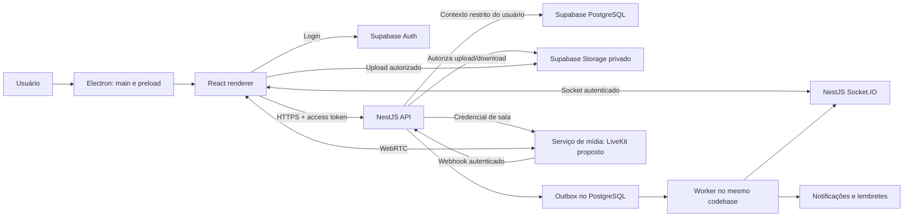

# 04 · Arquitetura e decisões técnicas

**Incremento v0.18 —25/10/2026:** identidade e trabalho online possuem schema
relacional/RLS no Forma e bucket privado. Entrada Nest com JWT do usuário;
JSON local/desktop preservados. Consultas periódicas, versões e idempotência;
não é adapter do State local. [Implementação e limites](../software-mvp/docs/central-work.md).
As notas datadas abaixo registram etapas anteriores; a direção proposta não
equivale à implementação integral de todos os domínios.

**Incremento beta v0.14 — 24/10/2026:** createApp aceita StateStore opcional,
com read/transact; Store JSON permanece padrão e uploads usam o diretório da API.
Testes cobrem injeção, erros sem fallback e permissões. Não há adapter PostgreSQL,
identidade central ou mídia gerenciada ativados. [Guia do incremento](../software-mvp/docs/beta-backend.md).

**Revisão estrutural v0.12 — 23/10/2026:** organização atual adequada ao MVP local; não é uma implementação compartilhada para equipe remota. Prioridade: API/identidade/banco/arquivos centrais antes do uso entre computadores, sem compartilhar JSON. Após isso, modularizar gradualmente Controller/dispatcher/formulários por domínio. Build web/desktop/API separado e distribuição Docker/documental ajustados. Evidências e limites no [relatório técnico](../software-mvp/docs/structure-review.md).

**Desktop v0.11 / app 0.1.1:** interface do app compilada separadamente em dist-desktop, sem landing ou downloads. Site permanece em dist. Um único Forma por cargo; preparação operacional do Studio por menu nativo na mesma janela, com API parada durante a gravação e reinício ao voltar. Estado atual e limites no [capítulo 14](14-aplicativo-desktop.md).

A expansão do [capítulo 13](13-gestao-integrada-e-expansao.md) mantém o monólito modular e o stack solicitado. JSON é a persistência do ambiente local; o domínio central de trabalho usa PostgreSQL/Supabase separado. Tempo concorrente e financeiro continuam propostos e exigem validar persistência e recuperação. Entidades e contratos futuros estão no capítulo13.

## 1. Direção proposta

Monólito modular NestJS, com interface React compartilhável e shell Electron. Supabase oferece serviços gerenciados de identidade, PostgreSQL e armazenamento; a API mantém regras de domínio e autorização. Reuniões usam um serviço de mídia dedicado. Docker reproduz o backend e suas dependências; o aplicativo desktop é compilado e instalado no sistema operacional.

| Alternativa | Benefício | Custo/limite | Decisão proposta |
|---|---|---|---|
| React conectado diretamente a todos os serviços Supabase | Menor backend próprio | Regras distribuídas entre clientes, policies e funções | Não adotar para mutações de domínio |
| NestJS modular + Supabase | Centraliza regras e preserva serviços gerenciados | Exige testes coerentes entre API, grants e RLS | Recomendada |
| Microsserviços e infraestrutura toda própria | Mais controle por componente | Maior operação e complexidade para equipe pequena | Adiar |

## 2. Diagrama lógico



Socket.IO transporta eventos de negócio e presença; não transporta áudio/vídeo. PostgreSQL é a fonte durável. Mensagens nunca dependem exclusivamente da conexão WebSocket.

## 3. Responsabilidade de cada tecnologia

| Componente | Responsabilidade | Não deve assumir |
|---|---|---|
| TypeScript | Tipagem comum, contratos e DTOs | Validação em runtime apenas por tipos |
| React | Páginas, interação, acessibilidade e estado visual | Autorização definitiva |
| Electron main | Janela, integração controlada com SO, sessão protegida e atualização | Renderizar conteúdo de usuários com privilégios nativos |
| Preload | Bridge IPC mínima e tipada | Expor filesystem/shell arbitrários |
| NestJS | Validação, autorização, transações, consultas e integrações | Duplicar identidade e senhas do provedor |
| Supabase Auth | Identidade, sessão e recuperação | Decidir associação a projetos pelo perfil editável |
| PostgreSQL | Dados, restrições, RLS, histórico e outbox | Armazenar binários de vídeo |
| Supabase Storage | Objetos privados e transferência autorizada | Substituir checagem de escopo da API |
| Socket.IO | Atualizações e presença da aplicação | Garantir entrega histórica sem reconciliação |
| LiveKit, candidato | Salas, áudio, vídeo e tela | Regras de associação da plataforma |
| Docker | Runtime reproduzível de serviços | Empacotar interface desktop como container para o usuário |

## 4. Fluxo de autenticação e banco

Supabase Auth é a única fonte de identidade. O NestJS verifica a assinatura do access token, emissor, expiração e audience esperada, com suporte à rotação de chaves. Depois consulta associação e papel atuais no banco. Não confiar em `user_metadata` para conceder acesso.

A matriz canônica é RN-03/04: cargos `admin`, `coordinator`, `user`. Autorizar combinando associação organizacional ativa, ação e recurso. Admin tem alcance organizacional completo sobre áreas/projetos/chats, nunca global entre organizações; Coordenador depende de escopo atribuído; Usuário atualiza apenas tarefas de que é responsável e colabora nos recursos acessíveis. A mesma decisão deve ser usada em API, consultas com RLS, Storage, sockets, métricas e credenciais de reunião. Inspeção administrativa de chat não equivale a participação, nem libera dados de suporte/credenciais. Rebaixar cargo exige invalidar consultas/assinaturas administrativas, mesmo mantendo a conta ativa.

Proposta de acesso SQL: API usa pool com papel restrito `app_api`, sem BYPASSRLS, sem propriedade das tabelas e sem privilégios de DDL. Para cada transação, define contexto local de identidade a partir do token já validado. Policies usam esse contexto e associações no banco; nenhum valor de organização enviado pelo cliente substitui essa checagem. `SET LOCAL` e transação obrigatória impedem reaproveitamento acidental de identidade no pool. A estratégia precisa de prova de integração com o pooler escolhido antes de consolidar a migração.

Tabelas de domínio ficam em schema não exposto pela Data API. RLS é defesa adicional nesse schema; acesso direto do cliente a tabelas de domínio fica desabilitado. Objetos de Storage recebem policies próprias. Credentials privilegiadas são isoladas para provisionamento/worker quando necessário e não aparecem em renderer, preload ou bundles públicos.

Isso evita duas implementações paralelas das mesmas mutações. Cliente usa Supabase diretamente apenas para autenticação e transferências de objetos já autorizadas; consultas/mutações do domínio passam pela API.

## 5. Módulos da API

`Identity`, `Organizations`, `Memberships`, `Workspaces`, `Projects`, `Tasks`, `Conversations`, `Files` (inclui pastas e mídia de mensagens), `Calendar`, `Meetings`, `Documents`, `Notifications`, `Reports`, `Support` e `Audit`. Configurações de servidor e cargos ficam em Organizations/Memberships; áudio/imagem reutilizam o fluxo privado de Files, sem serviço novo.

Controllers validam entrada e contexto; serviços aplicam regras; repositórios fazem persistência. Uma transação inclui mudança principal, evento de domínio e outbox. Worker processa outbox com retries limitados, `processed_at` e deduplicação. Redis e broker independente não são obrigatórios no piloto de uma instância; escala horizontal exigirá coordenação, adapter de sockets e controle de jobs.

Comandos de chat são dispatcher de ações com catálogo fechado no módulo Conversations, reutilizando os mesmos serviços/autorizações de Tasks, Meetings, Support e Memberships. Não criar executor genérico de código. Menções são referências estruturadas com destinatários resolvidos no servidor; somente evento de mensagem persistida produz notificação pela outbox. Notifications fornece Inbox pessoal e sincroniza leitura. Summary/foguinho são consultas derivadas de primeiros créditos, com autorização antes de agrupar; não há pontos ou contador independente editável pelo cliente. Essas extensões não exigem novo serviço, broker ou SDK nesta etapa documental.

## 6. Frontend e monorepo

Estrutura sugerida para implementação futura:

```text
apps/desktop/       Electron main, preload e bootstrap React
apps/api/           NestJS e worker do mesmo codebase
packages/ui/        Componentes e tokens
packages/contracts/ Schemas de validação e clientes gerados
packages/config/    Configuração comum de TypeScript/lint
packages/app/       Rotas e funcionalidades React reutilizáveis
supabase/           Configuração local e migrações
infra/              Dockerfiles e Compose
docs/               Especificações e decisões
```

Proposta complementar: gerenciador de pacotes com workspace e lockfile único; TanStack Query para estado remoto; estado local simples para modais e filtros; validação de runtime compartilhada; editor restrito baseado em Markdown. Confirmar ferramentas e versões suportadas na fase inicial, sem usar rótulos `latest` em builds reproduzíveis.

## 7. Tempo real e concorrência

Mutações REST retornam estado canônico e versão. Eventos de socket incluem ID, versão e recurso. Cliente deduplica e invalida consultas; na reconexão busca estado canônico e mensagens desde o último cursor. Não presumir ordenação global. Presença tem heartbeat e expiração; serve apenas à interface.

Mensagens usam chave idempotente. Tarefas e documentos usam controle otimista por versão; atualizações concorrentes retornam conflito. Colaboração simultânea com CRDT fica fora do piloto.

## 8. Reuniões

LiveKit é o candidato inicial, sujeito à prova técnica e orçamento. Antes da contratação, validar oito participantes, redes residenciais, TURN, compartilhamento de tela no Electron, permissão de dispositivos e remoção de participantes. Começar com serviço gerenciado reduz operação; self-hosting exigiria rede UDP, TLS, TURN, capacidade e monitoramento próprios.

Credencial é emitida pelo servidor para sala e usuário autorizados, com privilégios mínimos e duração curta. Expiração de token não deve ser tratada como expulsão de uma chamada já estabelecida; revogação exige ação no serviço de mídia. Webhooks autenticados atualizam histórico de participação. Falha nesse provedor não derruba tarefas ou chat.

## 9. Decisões arquiteturais iniciais

| ADR | Proposta | Consequência |
|---|---|---|
| 001 | Monólito modular | Menor operação, limites explícitos entre módulos |
| 002 | NestJS como entrada do domínio | Mais backend próprio, autorização central |
| 003 | Identidade no Supabase Auth | Recuperação e sessão dependem do provedor |
| 004 | PostgreSQL com organização e escopo em todas as relações | Mais integridade e testes de isolamento |
| 005 | Storage privado com fluxo de confirmação | Upload incompleto exige coleta de órfãos |
| 006 | Socket.IO com persistência REST | Reconexão reconcilia estado |
| 007 | Mídia em serviço dedicado | Custo acompanha uso e rede |
| 008 | Online no piloto | Sem fila offline de alterações de domínio |
| 009 | Três cargos cumulativos com escopo, conforme pedido de 22/10/2026 | Substitui a proposta Owner/Admin/Member/Manager; Admin inspeciona todos os chats do próprio servidor com transparência/auditoria; sem privilégio global de banco |

Referências técnicas consultadas: [JWT do Supabase](https://supabase.com/docs/guides/auth/jwts), [RLS](https://supabase.com/docs/guides/database/postgres/row-level-security), [segurança do Electron](https://www.electronjs.org/docs/latest/tutorial/security) e [tokens de mídia](https://docs.livekit.io/frontends/reference/tokens-grants/). As decisões acima são propostas específicas deste produto; não são prescrições desses fornecedores.

## Entrega desktop local — v0.9

A prévia Windows já inicia a API NestJS dentro do processo principal Electron, em porta efêmera de loopback, servindo o build React com raiz explícita. Perfil próprio, pacote portátil, IPC e limites estão no [capítulo 14](14-aplicativo-desktop.md). O diagrama de serviços remotos acima permanece arquitetura futura; esta entrega usa JSON e não sincroniza dispositivos.

## Implementação comercial —26/10/2026

Backend NestJS usa gateway Mercado Pago com destino HTTPS fixo, webhook assinado,
inbox durável e conciliação por referência. Schema privado forma_billing separa
catálogo, contratos e operação financeira dos dados de trabalho. RPC estreita
atestada pelo servidor substitui acesso amplo por service_role. Gates de código,
banco e ambiente mantêm venda fechada. Decisões e limites no
[guia de assinaturas](../software-mvp/docs/billing.md).
