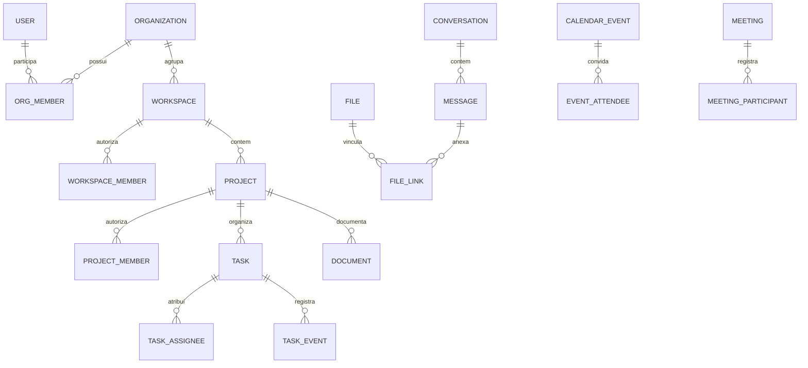

# 05 · Modelo de dados proposto

Implementação parcial em25/10/2026: identidade, associações e domínio de trabalho
online foram migrados no schema privado forma, com arquivos no Storage privado.
O [guia implementado](../software-mvp/docs/central-work.md) identifica tabelas e
migrações reais. O restante deste capítulo é referência lógica proposta; não
representa importação do JSON nem implementação de toda a expansão.

A extensão de CRM, comercial, horas, RH/ATS, financeiro, metas e operações está no [capítulo 13](13-gestao-integrada-e-expansao.md), seção de dados. Entidades novas reutilizam Studio, identidade, projetos e anexos; possuem integridade por organização, valores monetários exatos e acesso específico. São propostas, sem migração executada no JSON do MVP.

Este é o modelo lógico inicial. Não é uma migração SQL executada. Cada tabela de domínio tem UUID, datas UTC e organização explícita quando aplicável. Conteúdo textual precisa de limites e validação; referências cruzadas devem preservar o mesmo tenant e ancestral.

## 1. Relações principais

## 2. Identidade e estrutura

| Entidade | Campos centrais | Restrições |
|---|---|---|
| `profiles` | `user_id`, `display_name`, `timezone` | Identidade e preferências próprias; sem senha/token ou cargo editável pelo perfil; foto vai para apresentação por organização |
| `organizations` | `id`, `name`, `description`, `avatar_file_id`, `status`, `version` | Configuração do servidor editável por Admin; não excluir fisicamente no piloto |
| `organization_members` | `organization_id`, `user_id`, `role`, `status`, `joined_at`, `area_label?` | Único organização/usuário; role enum admin/coordinator/user; último Admin ativo protegido em transação; dados profissionais separados de credencial |
| `member_profiles` | `organization_id`, `user_id`, `handle`, `bio?`, `avatar_file_id?`, `background_file_id?`, `location_text?`, `professional_title?`, `version` | Um por associação; handle normalizado único no servidor; campos novos editáveis pelo próprio membro; substitui a localização inicial de avatar e cargo profissional, sem fontes duplicadas |
| `invitations` | `organization_id`, `email`, `token_hash`, `expires_at`, `accepted_at`, `revoked_at`, `invited_by` | Token hash único; aceite atômico; e-mail normalizado |
| `workspaces` | `organization_id`, `name`, `description`, `archived_at` | Nome não define autorização |
| `workspace_members` | `organization_id`, `workspace_id`, `user_id`, `status` | Exige membro da organização; único por workspace/usuário; delimita área atribuída, sem cargo paralelo |
| `projects` | `organization_id`, `workspace_id`, `name`, `description`, `timezone`, `archived_at`, `version` | Workspace da mesma organização |
| `project_members` | `organization_id`, `project_id`, `user_id`, `status` | Exige associação ao workspace ancestral; único por projeto/usuário; cargo vem da organização |

Associação pode ser suspensa sem apagar autoria. Remoção de membro não deve aplicar cascade a tarefas, mensagens e histórico. Política de anonimização posterior preservará referências técnicas sem expor identidade desnecessária.

Admin ativo não precisa de linhas sintéticas em todos os workspaces/projetos para o acesso organizacional de RN-03. Policies/serviços verificam organização e cargo atuais. Coordenador não pode escrever seu próprio role nem criar associação que amplie o seu escopo; convites emitidos por ele persistem cargo Usuário e apenas destinos autorizados. Criar novo servidor inclui primeiro Admin; suspensão/rebaixamento/exclusão concorrentes nunca deixam zero Admins ativos. Excluir associação local não apaga identidade global usada em outro servidor.

## 3. Execução e histórico

| Entidade | Campos centrais | Restrições |
|---|---|---|
| `tasks` | `organization_id`, `project_id`, `title`, `description`, `status`, `priority`, `due_date`, `position`, `blocked_reason`, `version`, `archived_at` | Status/priority enumerados; versão positiva; título obrigatório |
| `task_assignees` | `organization_id`, `task_id`, `user_id` | Único tarefa/usuário; membro ativo do projeto para novas atribuições |
| `task_checklist_items` | `organization_id`, `task_id`, `text`, `done`, `position` | Pertence a tarefa do mesmo tenant |
| `labels` / `task_labels` | `project_id`, `name`, `color` / `task_id`, `label_id` | Etiqueta pertence ao mesmo projeto da tarefa |
| `task_comments` | `task_id`, `author_id`, `body`, `edited_at`, `deleted_at` | Autor ou moderador autorizado; exclusão lógica |
| `task_events` | `task_id`, `actor_id`, `event_type`, `occurred_at`, `payload` | Append-only; fonte do histórico |
| `task_first_completions` | `task_id`, `event_id`, `completed_at` | Único por tarefa; criado na primeira conclusão em transação |
| `completion_credits` | `task_id`, `user_id`, `completion_event_id` | Único tarefa/usuário; snapshot dos responsáveis da primeira conclusão |

O agregado do projeto conta tarefas distintas em `task_first_completions`. O agregado pessoal usa `completion_credits`, filtrando acesso antes da agregação. Não contar eventos `done` diretamente para evitar duplicidade em reaberturas. Não atualizar o snapshot quando a tarefa é reatribuída.

Summary, total e foguinho de RN-23 derivam desses mesmos créditos e do timezone do perfil observado. Para perfil pessoal, aplicar interseção de acesso do titular e visitante antes de total/dias/sequências; histórico de ex-membro nos relatórios do projeto continua sujeito a RN-12. Não persistir um `streak` ou total livremente alterável pelo cliente. Cache eventual inclui organização, titular, observador, escopo, timezone e versão de acesso; invalidar após crédito, acesso ou timezone mudar.

Posição no quadro pode usar valor ordenável com desempate por ID. Reordenação deve receber vizinhos, validar coluna/projeto e recalcular no servidor. Estratégia final de rank será comprovada com concorrência; não confiar em posição absoluta calculada em cliente desatualizado.

## 4. Comunicação, arquivos e documentos

| Entidade | Campos centrais | Restrições |
|---|---|---|
| `conversations` | `organization_id`, `kind`, `name`, `description`, `created_by`, `workspace_id?`, `project_id?`, `version`, `archived_at` | kind workspace/project/direct; escopo coerente; múltiplos canais nomeados por área/projeto; criação por Admin/Coordenador |
| `conversation_members` | `conversation_id`, `user_id`, `last_read_message_id` | Participantes explícitos para direct; canais derivam acesso de associação |
| `messages` | `conversation_id`, `sender_id`, `kind`, `body?`, `client_message_id`, `edited_at`, `deleted_at`, `deleted_by?`, `moderation_reason?` | kind text/audio/image/file; texto ou anexo válido obrigatório; autoria imutável; moderador remove, não reescreve; ID idempotente único |
| `content_mentions` | `organization_id`, `message_id?`, `comment_id?`, `target_kind`, `target_user_id?`, `target_group?`, `handle_snapshot?` | Exatamente uma origem por CHECK e FKs da mesma organização: messages ou task_comments; alvo individual por ID, grupo de RN-22; sem resolver novamente handles antigos |
| `mention_recipients` | `organization_id`, `message_id?`, `comment_id?`, `recipient_id`, `active` | Mesma exclusividade/FKs de origem; único por mensagem/destinatário ou comentário/destinatário, com índices únicos parciais; expansão congelada, sem repetição por múltiplas menções; edição revalida e desativa removidos |
| `files` | `organization_id`, `uploaded_by`, `object_key`, `original_name`, `content_type`, `size_bytes`, `status`, `scope_type`, `scope_id` | Chave opaca única; escopo imutável após reserva; status validado |
| `file_links` | `file_id`, `task_id?`, `message_id?`, `document_id?`, `project_id?` | Exatamente um destino; destino no mesmo escopo permitido |
| `folders` | `organization_id`, `scope_type`, `scope_id`, `parent_id?`, `name`, `created_by`, `version`, `archived_at` | Escopo workspace/project no piloto; pai do mesmo escopo, sem ciclos; criação/movimentação por Admin/Coordenador |
| `folder_files` | `organization_id`, `folder_id`, `file_id` | Único pasta/arquivo; organização e escopo idênticos; organização lógica não muda o objeto nem concede acesso |
| `documents` | `project_id`, `title`, `current_revision_id`, `version`, `archived_at` | Projeto obrigatório no piloto |
| `document_revisions` | `document_id`, `author_id`, `content`, `revision_number` | Único documento/número; revisões imutáveis |

Escopo polimórfico de arquivo não dispensa integridade: resolver tipo, ancestral e tenant no serviço e em função/trigger restrita; destino precisa existir. Uma modelagem com FKs explícitas pode substituir o polimorfismo na migração. Não aprovar migração com referência genérica sem validação equivalente.

Arquivo de conversa direta só pode ser ligado à mesma conversa. Arquivo de projeto pode ser ligado a tarefas, docs e mensagens desse projeto; compartilhamento para outro projeto exige novo fluxo autorizado e não muda permissões do original.

Áudio, imagem e vídeo são objetos de Files vinculados à mensagem; duração/dimensões detectadas podem ser metadados opcionais, sem transcrição ou biometria. Áudio usa a mesma inspeção/reserva/limites do fluxo de arquivos. Arquivar pasta não apaga anexos já usados em mensagens/tarefas; remover vínculo é diferente de excluir objeto. Inspeção de chat pelo Admin não o adiciona a conversation_members, não altera last_read dos participantes e não envia recibo em nome deles.

Foto/capa usam destino interno de perfil identificado por organização/usuário; dono reserva/substitui o upload, membros ativos da mesma organização podem ler os campos publicados. Background nunca é URL de terceiros carregada automaticamente. Validar destino, tipo e referências antes de gravar member_profiles; remover vínculo antigo não apaga objeto ainda referenciado. `location_text` é texto opcional informado, sem latitude/longitude ou coleta de GPS. Nome e timezone de profiles são comuns à conta; foto e campos de apresentação de member_profiles não se propagam a outras equipes.

## 5. Agenda, reuniões e operação

| Entidade | Campos centrais | Restrições |
|---|---|---|
| `calendar_events` | `organization_id`, `owner_id`, `project_id?`, `title`, `starts_at`, `ends_at`, `timezone`, `version` | Fim posterior ao início; sem projeto significa evento pessoal |
| `event_attendees` | `event_id`, `user_id`, `response` | Membro organizacional ativo; em evento de projeto exige acesso |
| `meetings` | `organization_id`, `project_id`, `calendar_event_id?`, `host_id`, `provider_room_id`, `status` | Reunião sempre de projeto no piloto; ID da sala opaco e único |
| `meeting_participants` | `meeting_id`, `user_id`, `joined_at`, `left_at`, `provider_session_id` | Registrar reconexões sem duplicar sessão do provedor |
| `notifications` | `organization_id`, `recipient_id`, `event_id`, `type`, `dedupe_key`, `created_at`, `read_at`, `resource_ref` | Único destinatário/evento/tipo e destinatário/tipo/dedupe_key; Inbox só do destinatário; recurso revalidado a cada leitura/contagem |
| `notification_preferences` | `organization_id`, `user_id`, `type`, `enabled` | Único por usuário/tipo/organização |
| `support_requests` | `organization_id`, `requester_id`, `subject`, `body`, `status`, `assigned_to` | Solicitante/atendente designado; status aberto, em atendimento, resolvido |
| `support_agents` | `organization_id`, `user_id`, `active` | Designação administrativa auditada |
| `audit_logs` | `organization_id`, `actor_id`, `action`, `target_type`, `target_id`, `request_id`, `occurred_at` | Append-only; evitar payload com segredos e mensagens completas |
| `outbox_events` | `id`, `organization_id`, `type`, `resource_id`, `payload`, `attempts`, `processed_at` | Persistido junto à mutação; consumidor idempotente |
| `idempotency_records` | `organization_id`, `user_id`, `route`, `key`, `request_hash`, `response`, `expires_at` | Único no escopo; mesma chave/corpo diferente retorna conflito |
| `webhook_receipts` | `provider`, `provider_event_id`, `received_at`, `processed_at` | Único provedor/evento; autenticidade verificada antes de persistir |

Para menção, `dedupe_key` estável por tipo de origem (mensagem/comentário), ID da origem e destinatário impede novo alerta em retries ou reedição. Novos destinatários elegíveis recebem item uma vez; removidos tornam item indisponível sem conservar prévia. Excluir mensagem/comentário ou perder acesso ao respectivo chat/projeto invalida seus itens. Marcar todas usa cursor estável de criação e só afeta itens anteriores/iguais ao corte; item novo fica não lido. Estado de leitura não é recibo de chat. Não guardar cópia permanente da origem nas notificações. Retenção/anonimização de recipients, deduplicação e cache segue RN-19; o ledger técnico não justifica dados pessoais permanentes.

## 6. Integridade e acesso

Usar constraints compostas, por exemplo `(organization_id, project_id)` referenciando projeto da mesma organização. Usuário responsável deve existir em associação válida no momento da ação. Checagens que dependem de estado de outra linha precisam de transação, locks adequados e/ou trigger; não são resolvidas só por TypeScript.

Conta de migração é separada da conta de aplicação. Tabelas expostas a produtos Supabase exigem grants explícitos e RLS; private schema usa menor privilégio e RLS como defesa adicional. Policies não devem confiar em organização escolhida pelo cliente nem em metadata editável. Funções privilegiadas exigem revisão de `search_path`, grants e motivo; não usar como atalho geral.

Eventos e revisões são imutáveis nas operações comuns do produto. Essa restrição não impede o procedimento administrativo restrito de eliminação/anonimização cabível previsto nas RN-19 e RF-23. A implementação deve separar conteúdo/identificadores pessoais do evento técnico mínimo quando necessário e impedir sua reintrodução por replay, restauração ou recomputação de métricas.

## 7. Índices iniciais e paginação

- Associações: únicos por escopo/usuário; índice por usuário, organização e status.
- Tarefas: organização/projeto/status/posição e organização/projeto/prazo; responsáveis por usuário/tarefa.
- Mensagens: conversa/created_at/ID; paginação por cursor estável, sem offset para histórico extenso.
- Conclusões: completed_at/tarefa; créditos por usuário/tarefa.
- Agenda: organização/início, projeto/início e convidados por usuário/evento.
- Outbox: índice parcial de pendentes por próxima tentativa; notificações por destinatário/data.
- Busca inicial: full-text PostgreSQL com escopo autorizado; revisar plano real com dados representativos.

## 8. Migrações, retenção e exportação

Migrações versionadas, revisadas e aplicadas em staging antes de produção. Alterações incompatíveis seguem expandir → migrar → trocar consumidores → remover em release posterior. Seeds contêm usuários e conteúdo fictícios. Backups do banco não substituem cópia dos objetos de Storage.

Retenção exata será aprovada antes do piloto conforme o capítulo 12. Proposta: preservar histórico de projetos arquivados enquanto houver finalidade e fundamento que o justifiquem; limpar reservas de upload expiradas em até 24h; expurgar conteúdo excluído após 30 dias; tratar cópias em backup conforme janela do provedor e obrigações aplicáveis. Exportação administrativa deve respeitar escopo, ocultar segredos e registrar auditoria; exportação completa de organização é evolução posterior. Atendimento a acesso/cópia de dados pessoais cabível permanece previsto desde o piloto, por procedimento manual seguro.

## Implementação local: identidade separada da participação

No schema JSON v2 do MVP, `accounts` guarda identidade global e credenciais; `memberships` guarda vínculo, cargo, estado e escopo por Studio. `users` é uma projeção temporária para autorização e não é gravado como outra cópia das credenciais. A conta pode existir com zero participações. IDs usados pelos recursos legados são preservados. E-mail e @ são únicos por conta.

Convite registra destinatário, Studio, remetente, cargo, projetos, expiração e estado. Aceite é transacional e idempotente, limitado ao destinatário autenticado e à permissão atual do remetente. Sessão referencia a conta e o Studio selecionado; a seleção não substitui autorização. Migração v1 cria backup permanente antes da publicação atômica; ambiguidades interrompem a operação.

## Dados comerciais implementados —26/10/2026

forma_billing mantém plan_versions, offers, checkouts, payments, webhook_inbox,
requests, operators, settings, server_keys, audit e nonces. Oferta/quote aceita
é imutável; pagamentos têm identificador único e atualizações ordenadas. Uma
transação liga primeiro pagamento aprovado ao Studio e Admin. Responsável
financeiro e membership são relações distintas. Guard de bytes mantém tombstones
até confirmação de remoção física. Retenção/limpeza operacional ainda pendente.
[Detalhes](../software-mvp/docs/billing.md).
