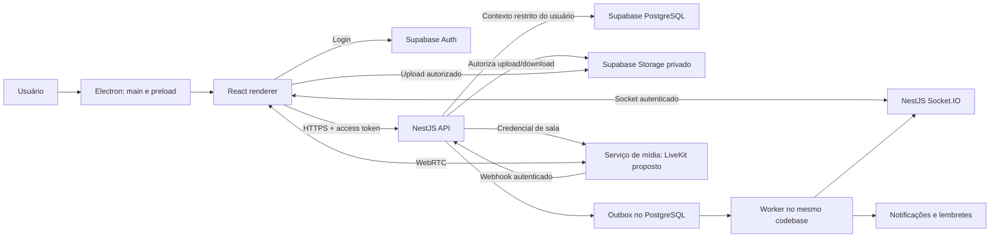
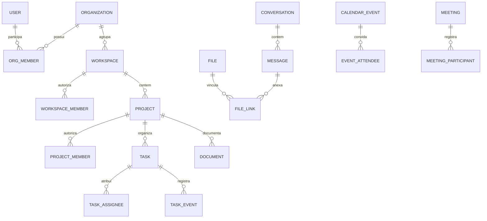

# Documentação completa · Plataforma de trabalho colaborativo

**Versão 0.30 · 2026-10-27 · Proposta para revisão**

Público inicial confirmado: equipe do criador e seus amigos. Este documento descreve o produto a desenvolver.

Os capítulos separados são a fonte editorial; esta versão os reúne para distribuição.

# 01 · Visão de produto e escopo

## 1. Problema

A equipe precisa de um ambiente para executar trabalho especializado. Reuniões, conversas, tarefas, arquivos e agenda pertencem ao mesmo processo, mas costumam ficar espalhados. A consequência é perder decisões, procurar materiais em vários lugares e ter dificuldade para entender responsabilidades e progresso.

O software deve responder rapidamente: o que preciso fazer, em que projeto, com quem, até quando, onde estão os materiais e qual foi a evolução das entregas?

## 2. Público e necessidades

O primeiro público é a equipe do criador, incluindo seus amigos. A quantidade de membros ainda será levantada. O MVP já permite cadastro pessoal público sem Studio; a entrada em uma equipe exige convite. Não há venda ou cobrança ativa; somente a administração da plataforma cria Studios nesta etapa.

| Perfil | Necessidade principal | Exemplo |
|---|---|---|
| Usuário | Executar o trabalho e colaborar | Entra em meet, recebe tarefa, atualiza status, envia mensagens/mídia e pede ajuda |
| Coordenador | Distribuir e acompanhar entregas | Adiciona usuários, cria/delega tarefas, acompanha progresso e organiza chats, pastas e reuniões de sua área |
| Admin | Administrar o servidor da equipe | Acessa todas as áreas e chats, gerencia cargos e usuários e configura o servidor |

São os três cargos solicitados pelo usuário. Admin acumula as capacidades de Coordenador e Usuário; Coordenador acumula as de Usuário. “Servidor” significa a organização da equipe dentro do produto, não acesso ao sistema operacional ou ao host de infraestrutura. Alcance e controles estão no documento 02.

## 3. Proposta de valor

Reunir a execução do trabalho em um contexto compartilhado. Uma reunião pode estar ligada a um projeto; sua ata pode gerar tarefas; tarefas podem ter arquivos e comentários; conclusões alimentam indicadores e o histórico de contribuições. O diferencial proposto está nessa continuidade, não no volume de funções isoladas.

## 4. Objetivos e indicadores

Após quatro semanas de piloto, avaliar:

| Objetivo | Indicador proposto | Como medir |
|---|---|---|
| Tornar o sistema parte da rotina | Ao menos 70% dos convidados ativos por semana | Usuários com tarefa, comentário, mensagem ou reunião; apenas login não conta |
| Melhorar clareza | Ao menos 90% das tarefas em andamento têm responsável | Consulta semanal, com denominador e período visíveis |
| Preservar contexto | Ao menos 80% das entregas amostradas têm informação suficiente no projeto | Revisão manual de tarefas, decisões e materiais |
| Reduzir atrito | Usuário encontra uma tarefa e inicia uma reunião sem ajuda | Sessão observada com membros reais |

São hipóteses de sucesso do piloto, não compromissos comprovados. Medidas de atividade não devem ser convertidas em ranking automático de desempenho individual.

## 5. Escopo do primeiro lançamento

1. Convites, autenticação, perfis, cargos Admin/Coordenador/Usuário e gestão de membros.
2. Organização, workspaces por área e projetos com acesso explícito.
3. Home, My Tasks, Calendar, Team, Docs, Reports, Inbox e perfil profissional ampliado.
4. Kanban com A fazer, Em andamento, Em revisão e Concluída; visualização em lista e calendário de tarefas.
5. Tarefas com responsáveis, prazo, prioridade, descrição, checklist, comentários e anexos.
6. Chat por workspace e projeto, mensagens diretas, comandos `/`, menções `@`, moderação por cargo e Inbox de notificações.
7. Pastas lógicas, upload privado de arquivos, vídeos, imagens e mensagens de áudio; reprodução dos formatos suportados pelo cliente.
8. Reuniões internas com áudio, vídeo e compartilhamento de tela.
9. Agenda própria, documentos simples, relatórios básicos e perfil com summary inspirado no GitHub: mapa, total de tarefas concluídas e foguinho de sequência de entregas. Bio, nome/@, foto/capa, localização informada e cargo profissional completam o perfil.
10. Ajuda, solicitação de suporte, configurações pessoais e administração do próprio servidor pelo Admin.

Todos esses módulos fazem parte do produto solicitado. A entrega será incremental, mas o piloto completo só será considerado pronto quando o conjunto obrigatório estiver integrado.

## 6. Fora do primeiro lançamento

Cobrança, assinatura, marketplace, portal público, convidados externos, aplicativo móvel nativo, macOS/Linux certificados, sincronização Google/Outlook, integração GitHub, edição colaborativa simultânea de documentos, gravação/transcrição de reuniões, IA, automações de workflow, ponto eletrônico, folha de pagamento e trabalho offline com sincronização.

RH é inicialmente um workspace restrito aos membros atribuídos e aos Admins do servidor, conforme a matriz. Não pressupõe um sistema de folha, prontuário de funcionários ou recrutamento. Design e desenvolvimento também não pressupõem editor gráfico ou IDE internos.

## 7. Hipóteses de produto

A expansão de 23/10/2026 está no [capítulo 13](13-gestao-integrada-e-expansao.md): primeiro incremento CRM/comercial já entregue no MVP; horas e custos a seguir; HRM/ATS, metas e operações em etapas posteriores. Isso atualiza a direção futura de RH descrita acima, sem incluir recrutamento no primeiro piloto. Estoque e produção dependem de necessidade validada. Dados de RH/financeiro terão permissões específicas. O capítulo 13 distingue o recorte entregue das demais capacidades planejadas.

- O MVP utiliza a marca Forma; “Mova” pertence à imagem de referência e não foi escolhido como nome.
- Windows é o primeiro alvo de distribuição; Electron foi solicitado, mas sistemas operacionais não foram especificados.
- A equipe aceita operar conectada; falhas de rede devem ser visíveis e recuperáveis.
- “Meet” significa videoconferência dentro do produto. Não foi solicitada integração com Google Meet.
- “Summary igual ao GitHub” significa resumo e mapa diário de conclusões; não implica acessar contas ou repositórios GitHub.
- A expressão “feitas” e “concluídas” foi normalizada: concluída é uma única categoria terminal; revisão é uma etapa opcional proposta.

## 8. Exemplo de uso completo

O administrador convida uma designer para Marketing. Ela entra no projeto Campanha, lê o briefing em Docs, aceita uma tarefa e conversa no canal. A equipe agenda uma revisão, compartilha a tela e registra a decisão em uma ata. A designer envia o material, move a tarefa para revisão e o responsável aprova a conclusão. A entrega aparece no relatório e no mapa diário de contribuições, respeitando os acessos do observador.

## 9. Limites desta documentação

Esta versão define uma base transversal para o produto e sua engenharia. Layouts finais, migrações executáveis, OpenAPI validada, política jurídica, orçamento contratado e procedimentos de produção comprovados serão produzidos ou confirmados durante as respectivas fases. Decisões abertas não devem ser apresentadas como já aprovadas.


---

# 02 · Requisitos e regras de negócio

Os requisitos de expansão RF-30 a RF-41 e regras RN-26 a RN-32 estão definidos no [capítulo 13](13-gestao-integrada-e-expansao.md). RF-30/31 têm um primeiro recorte local entregue, conforme a seção 9; demais módulos são planejamento posterior. As permissões específicas de RH e financeiro não decorrem automaticamente da inspeção administrativa de chats descrita abaixo.

## 1. Organização e autorização

**RN-01:** usuário pode pertencer a várias organizações no modelo, mas o primeiro piloto usa uma. Cada recurso pertence exatamente a uma organização. Trocar a organização ativa limpa resultados, caches e assinaturas anteriores.

**RN-02:** a hierarquia é organização → workspace → projeto → tarefa. Workspace agrupa uma área ou frente; projeto representa uma iniciativa. Um projeto pode envolver pessoas de várias áreas, desde que tenham acesso ao workspace e associação ao projeto.

**RN-03:** para Usuário e Coordenador, acesso ao workspace não concede automaticamente acesso a todos os projetos. Acesso ao projeto exige associação ativa a organização, workspace e projeto. Coordenador atua apenas em escopos que lhe foram atribuídos. Remover acesso do workspace suspende os acessos descendentes. Exceção explícita: Admin ativo pode acessar e administrar todas as áreas, projetos e chats da sua própria organização, sem associação artificial a cada recurso; a exceção nunca atravessa organizações.

**RN-04:** os cargos são **Admin**, **Coordenador** e **Usuário**, com códigos propostos `admin`, `coordinator` e `user`. Não há quarto cargo Owner/Manager. Permissões são cumulativas: Admin inclui Coordenador e Usuário; Coordenador inclui Usuário. O cargo pertence à associação na organização; acesso às áreas/projetos delimita o alcance do Coordenador e do Usuário. Negar por padrão toda ação não concedida.

| Ação | Admin | Coordenador | Usuário |
|---|---|---|---|
| Adicionar usuário por convite | Sim, no servidor | Sim, como Usuário e só para seus escopos | Não |
| Delegar/alterar cargos | Sim | Não, inclusive em convites | Não |
| Editar dados administrativos, suspender e excluir usuário do servidor | Sim | Não | Não |
| Configurar servidor, criar áreas e atribuir coordenadores | Sim | Não | Não |
| Visualizar todas as áreas, projetos e chats do servidor | Sim, inclusive chats diretos; acesso administrativo auditado | Apenas escopos atribuídos e chats dos quais participa | Apenas escopos atribuídos e chats dos quais participa |
| Criar projeto/gerenciar associações dentro de área existente | Sim | Sim, na área atribuída; sem ampliar o próprio acesso | Não |
| Criar/editar/delegar tarefas | Sim, no servidor | Sim, no projeto atribuído | Não |
| Marcar tarefa Em andamento ou Concluída | Sim | Sim, no projeto atribuído | Sim, se responsável ativo pela tarefa |
| Visualizar progresso e relatórios | Todo o servidor | Seus escopos | Próprias tarefas e resumos dos projetos acessíveis |
| Criar chats e pastas | Sim | Sim, nos escopos atribuídos | Não |
| Editar configuração de chat: nome, descrição e participantes | Todos os chats do servidor, respeitando coerência do escopo | Chats que coordena; participantes já autorizados | Não |
| Apagar mensagens de terceiros | Sim, em qualquer chat do servidor | Nos canais do escopo que coordena; sem moderar diretos alheios | Não |
| Enviar mensagens/comentários e editar/remover os próprios | Sim, onde participa | Sim, onde participa | Sim, onde participa |
| Agendar/iniciar/gerenciar reuniões de trabalho | Sim | Sim, no projeto atribuído | Não; pode responder convite e entrar |
| Entrar em meet | Sim, com ingresso autorizado na sala | Sim, com ingresso autorizado na sala | Sim, em projeto atribuído e sala autorizada |
| Enviar arquivos, vídeos, áudio e imagens | Sim, em destino autorizado | Sim, em destino autorizado | Sim, em destino autorizado |
| Visualizar perfil profissional de colega do servidor | Sim | Sim | Sim |
| Configurar próprio perfil, login e preferências | Sim, apenas a própria credencial | Sim, apenas a própria credencial | Sim, apenas a própria credencial |
| Enviar help e consultar solicitações próprias | Sim | Sim | Sim |
| Usar comandos `/` | Catálogo completo, dentro do servidor | Comandos pessoais e de coordenação no escopo | Comandos pessoais e ações permitidas sobre suas tarefas |
| Mencionar pessoa por `@handle` | Participantes autorizados no contexto | Participantes autorizados no contexto | Participantes autorizados no contexto |
| Menção coletiva por cargo/escopo | Todos os grupos autorizados | Usuários/Coordenadores do escopo, sem convocar Admins como grupo | Não; pode mencionar pessoa individual visível |
| Ler e organizar Inbox | Só a própria | Só a própria | Só a própria |

**Detalhes de engenharia propostos para tornar o pedido executável:**

- Coordenador adiciona novas pessoas sem conceder cargos superiores; associa apenas a áreas/projetos que coordena. Admin é o único que promove/rebaixa cargos. O último Admin ativo não pode ser excluído, suspenso nem rebaixado; criar o servidor designa seu primeiro Admin.
- Admin não lê senhas, tokens ou credenciais de outros usuários. Edição administrativa cobre cadastro profissional e associações do servidor; redefinição de senha usa recuperação pelo próprio titular. Excluir usuário remove acesso à organização, sem apagar conta global de outras organizações nem autoria em cascata; eliminação/anonimização segue RF-23/RN-19.
- “Editar chat” significa configurar o chat, sem reescrever uma mensagem de outra pessoa como se fosse o autor. Alterar participantes de um direto cria nova conversa, preservando a audiência histórica; chats de projeto/área não concedem acesso fora do escopo.
- Admin pode inspecionar diretos sem tornar-se participante nem enviar mensagens se passando por alguém. O aviso de uso explica esse acesso antes da entrada; a interface não promete sigilo exclusivo entre participantes. A leitura administrativa tem trilha mínima, sem copiar conteúdo para logs. Essa escolha de produto não certifica adequação jurídica ao uso real.
- “Configurações gerais do próprio login” abrange senha pelo provedor, sessão, timezone, notificações e preferências pessoais. Não inclui cargo, configuração global do servidor ou acesso a dados de colegas.

## 2. Catálogo funcional e aceite

| ID | Requisito | Critério de aceite mínimo |
|---|---|---|
| RF-01 | Convite e entrada | Admin e Coordenador convidam por e-mail com uso único e validade proposta de 7 dias; Coordenador só concede Usuário nos seus escopos; apenas destinatário autenticado aceita |
| RF-02 | Sessão e recuperação | Login, logout, renovação e recuperação funcionam; erro não revela cadastro; suspensão bloqueia novas operações |
| RF-03 | Perfil e conta pessoal | Nome e @, foto e capa/background, bio, localização informada e cargo profissional; editar os próprios dados, timezone, sessões e preferências; ver colegas no mesmo servidor, sem credenciais; perfil não altera privilégios |
| RF-04 | Workspaces | Criar, editar, associar membros e arquivar; pessoa sem acesso não vê nomes privados na sidebar ou busca |
| RF-05 | Projetos | Admin/Coordenador cria no workspace autorizado e define membros; coordenação deriva do cargo/escopo, sem cargo Manager separado; projeto arquivado permite leitura e bloqueia mutações de trabalho |
| RF-06 | Tarefas e delegação | Admin/Coordenador cria e edita título, descrição, responsáveis, prioridade, prazo, etiquetas e checklist no escopo; Usuário responsável atualiza status/checklist, sem reatribuir ou criar tarefa |
| RF-07 | Kanban | Arrastar ou mover por teclado; alteração aparece nos demais clientes; conflito não sobrescreve silenciosamente |
| RF-08 | My Tasks | Lista tarefas atribuídas ao usuário em projetos acessíveis; filtra prazo, status e projeto; remoção de acesso elimina o item |
| RF-09 | Comentários | Autor cria, edita e remove seu comentário; marcação exige destinatário com acesso; exclusão mantém marcador no histórico |
| RF-10 | Chat e moderação | Admin/Coordenador cria chats no escopo; participantes ativos enviam mensagens; Admin acessa/configura todos do próprio servidor e Coordenador só os seus; exclusão moderada mostra marcador e auditoria |
| RF-11 | Arquivos | Upload autorizado, progresso, erro, cancelamento e download privado; arquivo de outro projeto não pode ser reutilizado sem autorização |
| RF-12 | Vídeos | Upload respeita tamanho permitido; player para formatos compatíveis; formato não suportado oferece download com aviso |
| RF-13 | Reuniões | Participantes autorizados entram com microfone/câmera, escolhem dispositivos, compartilham tela e saem; bloqueio do SO tem orientação de recuperação |
| RF-14 | Calendar | Admin/Coordenador agenda eventos de trabalho/reuniões no escopo; Usuário responde e participa; todos podem manter lembretes pessoais sem criar reuniões para terceiros; tarefas com prazo não viram eventos duplicados |
| RF-15 | Docs | Criar documento por projeto, salvar revisão e controlar versão; duas edições concorrentes não perdem conteúdo silenciosamente |
| RF-16 | Reports | Progresso, tarefas por status, atrasos e conclusões por período; mostrar filtros, denominadores e horário de atualização |
| RF-17 | Contribuições | Summary no perfil com mapa diário, quantidade de tarefas concluídas e foguinho; mesma fonte de créditos e filtro de acesso; reabertura/conclusão repetida não inflam contagem |
| RF-18 | Inbox de notificações | Central pessoal para atribuições, menções, convites e lembretes; abas Todas/Não lidas, filtro por tipo, paginação, marcar lida/não lida e todas como lidas; badge consistente entre clientes e sem vazar conteúdo inacessível |
| RF-19 | Team | Exibir membros, áreas e papéis visíveis; presença é indicativa, não prova de produtividade |
| RF-20 | Ajuda e suporte | Consultar guia e abrir solicitação com protocolo; apenas solicitante e atendentes designados acessam detalhes |
| RF-21 | Busca | Buscar tarefas, documentos e arquivos acessíveis por texto; resultados paginados e escopo claro |
| RF-22 | Auditoria | Registrar alterações de acesso, arquivamento e eventos críticos; usuário comum não altera registros |
| RF-23 | Direitos e privacidade | Canal comunicado recebe pedidos de titulares, inclusive sem conta ativa; responsável verifica identidade, responde e executa medidas cabíveis com registro restrito; pode operar manualmente no piloto |
| RF-24 | Pastas | Admin/Coordenador cria, renomeia, move e arquiva pastas de materiais do escopo; Usuário navega e envia arquivos; pasta não amplia permissões nem permite mover anexos entre escopos |
| RF-25 | Áudio e imagens | Participante envia imagem ou grava/anexa áudio com prévia, cancelamento, progresso e retry; gravação de áudio exige ação e microfone explícitos; reprodução não inicia sozinha; sem transcrição automática |
| RF-26 | Administração do servidor | Somente Admin edita nome, imagem e descrição da organização, delega cargos e edita/suspende/exclui associações de usuários; impedir escalada e operação contra último Admin; auditar mudanças |
| RF-27 | Comandos de chat | Digitar / abre catálogo permitido por cargo/escopo; parâmetros tipados, ação de domínio autorizada e erros preservam entrada; invocação direta de comando proibido também é negada |
| RF-28 | Menções por hierarquia | @ sugere pessoas autorizadas e grupos permitidos; destinatários sem acesso não são incluídos; enviar mensagem revalida cargo/escopo; menção notifica sem conceder acesso |
| RF-29 | Foguinho de incentivo | Sequência atual e melhor sequência de dias com conclusão elegível, conforme RN-23; texto explica cálculo, timezone e escopo; sem pontos extras por reabrir, ranking ou monitoramento oculto |

## 3. Tarefas e estados

**RN-05:** fluxo inicial: `todo` → `in_progress` → `in_review` → `done`. Admin/Coordenador pode mover/reabrir tarefas no escopo; Usuário responsável pode iniciar e marcar a própria tarefa concluída, além de submetê-la à revisão opcional. Não altera tarefa de outro responsável nem reabre conclusão sem coordenação. Revisão pode ser pulada; não há aprovador diferente obrigatório. Toda transição registra autor e estado anterior; checklists pendentes exigem confirmação explícita antes da conclusão.

**RN-06:** tarefa tem um ou mais responsáveis ou permanece sem responsável em A fazer. Para iniciar trabalho deve haver ao menos um responsável. Prioridades: baixa, média, alta, urgente. Bloqueio é atributo separado, com motivo; não é uma coluna adicional.

**RN-07:** datas de prazo são datas civis (`due_date`), consideradas vencidas após o fim daquele dia no timezone do projeto. Eventos usam instante e timezone IANA. Alterar timezone não reescreve instantes históricos.

**RN-08:** arquivamento tira itens das consultas padrão e métricas operacionais; não apaga o histórico. Exclusão definitiva geral de projetos e materiais fica posterior ao piloto; exclusão de associação de usuário pelo Admin faz parte do piloto conforme RF-26. Isso não adia eliminações ou anonimizações cabíveis em pedidos de privacidade, atendidos pelo procedimento restrito do RF-23. Arquivo e documento não ficam públicos por terem sido anexados.

**RN-09:** progresso do projeto = tarefas não arquivadas em `done` / todas as tarefas não arquivadas, multiplicado por 100. Zero tarefas exibe “Sem tarefas”, sem divisão por zero. Percentual do checklist aparece como checklist, não como avanço subjetivo da tarefa. Não somar percentuais de tarefas para obter progresso do projeto.

## 4. Contribuições inspiradas no GitHub

**RN-10:** transição real para `done` cria evento imutável com autor da ação, instante e cópia dos responsáveis daquele momento. A primeira conclusão válida de cada tarefa concede uma contribuição a cada responsável registrado; o autor do movimento não recebe crédito extra. Sem responsável, entra apenas no total do projeto.

Uma tarefa concluída, reaberta e concluída novamente continua contando uma vez, na data da primeira conclusão. Reatribuir depois não transfere crédito histórico. O indicador mede entregas históricas, enquanto progresso mede estado atual; reabertura diminui progresso e não apaga a entrega histórica. A interface explica essa diferença.

**RN-11:** agrupar contribuições pelo timezone de perfil selecionado; padrão inicial `America/Sao_Paulo`. Um dia vai de 00h00 até antes de 00h00 do dia seguinte nesse timezone. Alterar o timezone pode redistribuir os dias, mas não a quantidade total. Datas do observador seguem o timezone explicitado no relatório, nunca uma mistura por pessoa.

**RN-12:** filtros de autorização são aplicados antes da agregação. Quem perdeu acesso não consulta o projeto nem seus números; histórico de ex-membro fica disponível aos membros autorizados do projeto. No perfil, mapa/total/foguinho só agregam projetos atualmente acessíveis tanto ao titular quanto ao observador, conforme RN-23. Não há ranking público ou acesso a RH por inferência de métricas.

**AC de exemplo:** tarefa com Ana e Bruno concluída na segunda soma 1 para cada um e 1 no projeto. Reaberta terça e concluída quarta continua com 1 no projeto na segunda. Maria executar a segunda conclusão não altera crédito. Avanço do projeto volta a cair enquanto estiver reaberta.

## 5. Comunicação e agenda

**RN-13:** mensagem direta pertence a uma organização; não cruza organizações. Participantes ativos e Admins ativos da própria organização podem ler conteúdo, com identificação do acesso administrativo conforme RN-04. Coordenador sem participação não lê diretos. Remoção organizacional bloqueia leitura, envio, sockets e reuniões; perder cargo Admin revoga também a inspeção de conversas das quais não participa.

**RN-14:** canais de área/projeto são acessíveis aos membros ativos do escopo e ao Admin da organização. Autor pode editar/remover sua mensagem; Admin pode apagar qualquer mensagem do servidor e Coordenador pode moderar canais que coordena. Ninguém reescreve texto alheio. Edição tem indicação; remoção mantém marcador com indicação de moderação, auditoria mínima e expurgo conforme retenção aprovada. Feed e busca não recuperam o conteúdo removido.

**RN-15:** eventos pessoais são privados; eventos de projeto seguem o acesso do projeto. Mover ou reagendar não confirma presença automaticamente. Respostas: pendente, aceito e recusado. Recorrência e integrações externas ficam para depois.

**RN-16:** Admin/Coordenador agenda ou inicia encontros internos no escopo; Usuário entra com acesso válido ao projeto e autorização de sala. Link encaminhado não concede entrada. A inspeção de chat pelo Admin não o conecta automaticamente a meet nem captura dispositivos. Encerrar/remover participante exige Admin ou Coordenador anfitrião/autorizado. Gravação de reuniões fica desabilitada no piloto; mensagem de áudio RF-25 é fluxo independente.

## 6. Notificações, suporte e limites

**RN-17:** notificações são geradas por evento persistido, deduplicadas por destinatário/evento/tipo. Mencionar a si próprio não gera notificação. Lembretes vencidos não são reenviados indefinidamente após indisponibilidade.

**RN-18:** atendentes são membros designados por Admin para suporte; designação é capacidade adicional, não quarto cargo e não abre projetos/chats por si só. Solicitações incluem apenas informações fornecidas pelo solicitante, sem captura automática de tela/conversas. Todos os cargos podem enviar help e acompanhar protocolo próprio; detalhes ficam com solicitante/atendentes, mesmo quando há administração de chats.

**RN-19:** retenção e preservação do histórico dependem da finalidade e de eventual obrigação aplicável. Prazos propostos de limpeza não são prazos legais gerais. Pedidos de titulares podem exigir eliminação/anonimização também de eventos, revisões e créditos; preservar somente o que tiver justificativa documentada, com acesso restrito e proteção de terceiros.

**RN-20:** decisões jurídicas usam a fonte oficial pertinente e seu enquadramento, não apenas a cópia do GitHub. Seguir os controles JUR-01 a JUR-10 do capítulo 12 nas funcionalidades afetadas. Licença de um acervo ou dependência não define a licença do produto nem transfere direitos de arquivos enviados.

Limites iniciais propostos: título de tarefa até 200 caracteres, mensagem até 10.000 caracteres, arquivo até 250 MB, vídeo até 1 GB, 10 anexos por envio e até 8 participantes por reunião. A política efetiva depende de suporte do provedor, teste de rede e orçamento. Rejeitar acima do limite tanto no cliente quanto no servidor, antes de reservar upload quando possível.

## 7. Comandos `/` e menções `@`

**RN-21:** comando é atalho de interface para uma ação existente, nunca execução de shell, SQL, scripts ou código livre. O servidor fornece catálogo conforme cargo atual, organização, escopo e parâmetros; negar comando não autorizado mesmo que digitado manualmente. Alterar cargo durante a digitação exige nova checagem ao executar. Texto de arquivos, mensagens recebidas e previews nunca executa comando automaticamente. Comando desconhecido preserva rascunho e mostra ajuda.

Catálogo inicial **proposto**, com nomes finais ajustáveis:

| Comando | Cargos e condição | Resultado |
|---|---|---|
| `/ajuda`, `/perfil`, `/minhas-tarefas` | Todos, próprio contexto | Ajuda, próprio perfil ou tarefas em resposta privada ao solicitante |
| `/andamento tarefa`, `/concluir tarefa` | Usuário responsável; Coordenador do escopo; Admin | Mesmas transições e créditos de RN-05/10, sem regra paralela |
| `/help assunto` | Todos | Abre solicitação própria; relato e protocolo não são publicados no chat |
| `/tarefa criar`, `/atribuir tarefa @pessoa` | Admin/Coordenador autorizado | Prévia/formulário com validação de projeto, responsável e prazo |
| `/chat criar`, `/pasta criar`, `/reuniao agendar` | Admin/Coordenador autorizado | Abre o mesmo fluxo permitido pela interface |
| `/apagar-mensagem id` | Autor ou moderador autorizado de RN-14 | Confirmação da exclusão, marcador e auditoria conforme o caso |
| `/cargo @pessoa cargo`, `/usuario editar`, `/usuario remover`, `/servidor editar` | Apenas Admin, na própria organização | Fluxo administrativo com confirmação/reautenticação quando exigidas |

Resultados pessoais e erros são privados por padrão. Ações publicadas usam eventos normais do domínio, sem enviar recibos/dados administrativos como mensagem. Ações destrutivas exigem confirmação; cancelamento não produz efeito. Retry usa a mesma chave idempotente, sem duplicar tarefa, convite, help ou reunião. Inspeção de chat sem participação continua sem compositor: usar a administração apropriada, sem contornar esse limite por comando.

**RN-22:** distinguir **menção individual** e **menção coletiva**. A hierarquia limita a convocação coletiva, sem impedir um Usuário de pedir ajuda a um Coordenador/Admin individual que já participa do contexto.

| Alvo proposto | Admin | Coordenador | Usuário |
|---|---|---|---|
| `@handle` de pessoa | Sim | Sim | Sim |
| `@usuarios` / `@coordenadores` | Sim | Sim, no escopo coordenado | Não |
| `@admins` | Sim | Não | Não |
| `@todos` no canal | Sim, todos os participantes elegíveis | Sim, apenas Usuários/Coordenadores do escopo; exclui Admins | Não |

Todos os casos exigem permissão de envio e destinatários ativos que já possam ler aquele canal/conversa. Para Coordenador, a expansão de qualquer grupo, inclusive `@todos`, exclui Admins; a prévia mostra o alcance e a contagem, sem usar esse grupo para contornar `@admins`. Mencionar Admin individual participante continua permitido. No direto, destinatários se restringem aos participantes; inspeção administrativa não é participação para receber menções. Menção nunca convida, concede cargo ou abre um projeto. Sugestões não revelam nomes/handles inacessíveis. Grupos expandem para IDs no envio, deduplicam a pessoa mencionada várias vezes e respeitam preferências/rate limit; não há menção global entre servidores. Comentários de tarefa usam as mesmas regras, com acesso ao projeto e origem própria para destinatários/notificações.

## 8. Perfil, summary e incentivo

**RN-23:** summary pessoal usa `completion_credits` e primeiras conclusões de RN-10/11/12. “Tarefas concluídas” conta tarefas distintas com crédito daquela pessoa no intervalo/escopo exibido; não mede quantas vezes ela clicou em concluir nem corresponde à quantidade de tarefas hoje em done. Reabrir não dá novo crédito. Tarefa com dois responsáveis pode contar uma vez para cada perfil, nunca duas vezes no mesmo perfil.

Regra inicial **proposta** para o foguinho: um dia civil com ao menos um crédito elegível mantém a sequência; várias tarefas no dia não somam dias extras. Dias consecutivos incluem fins de semana. Sequência atual é a cadeia que termina hoje ou ontem; sem atividade em nenhum desses dias, vale zero. Melhor sequência é a maior cadeia do histórico elegível. Exemplo: segunda e terça com entregas → 2; quarta sem entrega mantém 2 até o fim do dia; quinta sem nova entrega → 0. Na quinta com entrega, começa 1, pois quarta interrompeu a cadeia.

Calendário e foguinho usam o timezone declarado do perfil da pessoa observada, padrão RN-11; mostrar timezone e data de atualização, sem misturar com timezone do visitante. Trocar timezone ou perder acesso pode recalcular dias/sequência; não gera crédito novo e a interface explica mudanças. A contagem respeita interseção entre projetos acessíveis ao titular e ao observador; nem o número isolado denuncia RH/projeto restrito. O total e mapa seguem o filtro de período; o foguinho indica explicitamente que usa histórico elegível completo, não só o período filtrado. Sem dados elegíveis, mostrar 0 e estado vazio, sem dados fictícios.

Foguinho é incentivo visual e textual, não avaliação formal, ranking, recompensa financeira ou requisito de jornada. Não coletar horas de trabalho nem criar lembretes de cobrança por inatividade por causa dessa função. Animação respeita movimento reduzido; texto “sequência de N dias” acompanha o ícone.

**RN-24:** campos do perfil: nome e @ de identificação, foto, capa/background, bio, cidade/região de residência ou trabalho informada pela própria pessoa e cargo profissional, por exemplo “Senior Software Engineer”. Bio, localização, cargo profissional e capa são opcionais; não exigir endereço exato ou GPS. Cargo profissional é texto de apresentação, distinto e visualmente separado de Admin/Coordenador/Usuário. Editá-lo nunca promove permissões.

Proposta de @: handle único sem distinção de maiúsculas dentro da organização, com 3–30 caracteres ASCII entre letras, números e underscore; reservar nomes de grupos/comandos para evitar ambiguidade. Normalizar e validar no servidor; sugestão de handle vem no onboarding e exige confirmação. Menção persiste userId, não só texto; mudar @ não redireciona menções antigas para outra pessoa. A autoria existente continua referenciada pelo ID e menções já enviadas não são reprocessadas.

Perfil detalhado e summary ficam dentro do servidor, sem página pública externa. Nome/timezone e preferências pertencem à própria conta; foto, bio, handle, localização, capa e cargo profissional são por organização, evitando propagação involuntária entre equipes. Foto/capa são uploads internos validados, não URLs remotas arbitrárias. Mostrar claramente quais campos são visíveis aos colegas. A lista de campos e as imagens orientam esta versão; o trecho incompleto do pedido não foi convertido em regra adicional.

## 9. Inbox pessoal

**RN-25:** Inbox é a central de notificações persistidas do próprio destinatário, separada de chats e help. Mesmo Admin não lê a Inbox de outra pessoa por possuir cargo. Abrir Inbox não marca tudo como lido; abrir um item marca aquele item, e ação explícita permite marcar todos os itens existentes até o cursor retornado. Notificações que chegam depois permanecem não lidas. Estado de leitura sincroniza entre clientes, e badge contabiliza apenas itens não lidos ainda autorizados.

Revalidar acesso ao renderizar, abrir e contar. Se o recurso ficar inacessível, ocultar prévia e retirar do badge/lista; link antigo abre estado genérico. Menção editada pode notificar apenas destinatários realmente novos ainda elegíveis; removidos perdem a prévia e o item associado. Reenvio idempotente e nova inclusão do mesmo destinatário na mesma mensagem não geram alertas repetidos. Não revelar conteúdo de mensagem excluída em Inbox, push ou logs. Preferências controlam alertas opcionais sem desativar avisos de segurança essenciais; política de retenção inclui notificações e deduplicação, conforme RN-19.

## Evolução confirmada do MVP local — 22/10/2026

Estas decisões atualizam o fluxo inicial de entrada: cadastro pessoal é livre e começa sem Studio; somente a administração da plataforma cria Studios. Admin de Studio não equivale a administrador da plataforma. Futuramente um plano poderá liberar criação, sem cobrança nesta etapa. Admin e Coordenador convidam dentro das permissões; o convite aparece exclusivamente na Inbox do destinatário, que aceita ou recusa. Convites duram sete dias e são revalidados no aceite. Suspensão de participação não elimina a conta pessoal nem concede acesso a outro Studio.

Código pode ser anexado ao chat e lido como texto escapado dentro do aplicativo, com destaque, linhas, cópia e download autorizado. Limites locais: 15 MB por upload; prévia de 500 KB e 5.000 linhas. Não executar anexos. Tarefas abrem em painel lateral e mantêm Quadro/Lista/Calendário; animações respeitam redução de movimento. Temas Claro/Escuro/Híbrido são locais ao dispositivo; Híbrido tem navegação escura e conteúdo claro.

Comandos `/meet` e `/meet criar` abrem, respectivamente, reuniões e agendamento com validação de cargo/escopo. M/C controlam os dispositivos da prévia sem interceptar campos de edição. A prévia não implementa chamada remota. Configurações de Studio incluem identidade, membros, cargos, convites e auditoria; alteração de identidade exige versão atual e privilégio Admin.

## Preparação comercial aprovada —26/10/2026

Mensalidade por Studio: Essencial R$79 e Pro R$149. Ofertas empresariais privadas
são versionadas por operador da plataforma; não constituem terceiro plano público.
Cadastro continua sem Studio. Contrato pago e conferido provisiona um Studio e
seu Admin atomicamente, sem conceder acesso pelo retorno do navegador. Convites
independem da contratação. Valores, cotas, carência, cancelamento e evidências
estão no [guia comercial](../software-mvp/docs/billing.md). Vendas desativadas.


---

# 03 · Experiência, páginas e jornadas

A navegação de gestão integrada está no [capítulo 13](13-gestao-integrada-e-expansao.md). Clientes e Comercial já aparecem no MVP para Admin/Coordenador, com registros filtrados pelas áreas autorizadas. Formulários cobrem cadastro, oportunidades, propostas versionadas e aceite confirmado; Horas, Pessoas administrativas e Financeiro permanecem planejados. Não há menus simulados dessas etapas futuras.

## 1. Leitura da referência visual

A referência inicial e sua composição em recortes mostram uma aplicação de trabalho com sidebar fixa, breadcrumb superior, título de projeto, cartões de indicadores, alternância Calendar/Board/List e kanban. Os cartões de tarefa apresentam prioridade, nome, data, anexos, etiquetas, responsáveis, comentários e percentual de progresso. A linguagem visual usa superfícies claras, bordas suaves, cantos arredondados, bastante espaço em branco e laranja como destaque. As cinco imagens posteriores complementam essa direção para equipe, perfis, atividade e etiquetas.

Esses elementos são referência de composição e densidade. Textos, marca “Mova”, percentuais e números da imagem não são requisitos funcionais. O plano de fundo paisagístico pode ser explorado como ambientação opcional; legibilidade e área útil vêm primeiro. Assets e identidade finais devem ser próprios ou licenciados.

Na imagem, “Ready to Build” não significa conclusão. O produto proposto usa estados semanticamente explícitos, incluindo Concluída. O dashboard não copiará números estáticos da referência. Os quatro recortes não representam quatro rotas independentes: são enquadramentos para comunicar a interface e orientar a implementação.

### Evidência visual observada

| Região | Elementos observados | Decisão para o produto |
|---|---|---|
| Sidebar | Marca, controle de recolher, grupo Main, itens Home/My Tasks/Calender/Team/Docs/Reports, workspaces aninhados, Add Project, Add Workspace e Support | Usar grupos com estado expandido/recolhido; corrigir o rótulo para `Calendar` na interface final |
| Cabeçalho | Breadcrumb `Workspace > Product & Technology > Green Campaign` e título/subtítulo do projeto | Breadcrumb deve ser navegável e refletir o escopo autorizado |
| Métrica | Cartão branco, ícone de pasta, menu, número grande, “completed”, barra segmentada laranja, total concluído, variação semanal verde e nota | Componente de métrica reutilizável; números vêm da API e mostram período/filtro |
| Quadro | Seletor Calendar/Board/List, colunas Backlog e In Progress, contador, adicionar, menu e cartões | Kanban deve manter rolagem horizontal e alternativa em lista em janelas menores |
| Cartão | Badge de prioridade, título, prazo, anexos, chips de área, avatares, comentários e progresso circular | Conteúdo acessível por texto; cor nunca é o único indicador |
| Ambiente | Paisagem ao redor, moldura branca translúcida e painel claro | Tratar cenário como direção visual opcional; não depender de imagem externa para legibilidade |

### Cinco referências adicionais · cargos e equipe

Imagens fornecidas pelo usuário em 22/10/2026, preservadas como referência documental. Sua inclusão não comprova licença para reutilizar fotos, marcas ou assets no software. O pedido textual define permissões; botões e textos presentes nas imagens não concedem capacidades extras.

| Referência | Elementos observados | Aplicação proposta |
|---|---|---|
| [1 · Equipe](referencias-visuais/01-equipe.png) | Cards de pessoas, cargo profissional, departamento, busca/filtros, alternância grade/lista e agenda | Team com filtros por área e cargo de acesso; Novo membro/Nova tarefa só para Admin/Coordenador no escopo. Cargo profissional é diferente de Admin/Coordenador/Usuário; telefone e vínculo empregatício não são campos obrigatórios |
| [2 · Atividade detalhada](referencias-visuais/02-atividade-detalhada.png) | Linha do tempo, menções, upload, reunião, responsável e horário | Direção para atividade recente da Home, com links autorizados; não importar exemplos de clientes, comentários ou backups como regras |
| [3 · Atividade por tipo](referencias-visuais/03-atividade-por-tipo.png) | Tabs Chats/Status/Uploads, eventos e solicitações | Proposta de filtros para atividade. Botões de aprovar ingresso são ilustrativos, sem novo fluxo obrigatório de aprovação. Não confundir feed com auditoria de segurança |
| [4 · Etiquetas de estado](referencias-visuais/04-etiquetas-de-estado.png) | Chips com texto, ícone, cores suaves e estados diversos | Todo=A fazer/Pendente, in_progress=Em andamento, in_review=Em revisão, done=Concluída. Submitted pode ser rótulo de envio para revisão; Failed/Expired são estados de operações/convites, não novas colunas do kanban. Sem depender só de cor |
| [5 · Perfis](referencias-visuais/05-perfis.png) | Diretório em tabela, pesquisa e avatar | Perfil profissional visível no mesmo servidor; sem expor IDs técnicos de analytics como dado principal. Session replay/analytics da imagem não são requisitos nem autorização para monitoramento |

### Perfil e chat · referências adicionais da v0.6

| Referência fornecida | Leitura visual | Aplicação ao produto |
|---|---|---|
| [6 · Perfil com capa](referencias-visuais/06-perfil-com-capa.png) | Capa larga, foto sobreposta, nome, cargo, localização e Edit Profile; indicadores e painéis | Perfil com nome/@, bio, foto/capa e cargo profissional; trocar horas/rating/projetos ilustrativos pelo summary de tarefas pedido. Não importar avaliação por estrelas, selo de verificação, coleta de horas ou clientes da imagem |
| [7 · Chat, Inbox e busca](referencias-visuais/07-chat-com-inbox-e-busca.png) | Sidebar com Inbox e badges, canais, busca central e painel de contexto/membros | Inbox com notificações pessoais; busca autorizada e sugestões de / e @ no compositor. A imagem não define comandos, regras de IA, bot, editor de scripts ou permissões; o catálogo é proposta textual RN-21/22 |

As duas imagens complementam as referências anteriores e estão no ZIP. Marcas, nomes, fotos e números são ilustrativos, sem autorização implícita para reutilizar seus assets no software.

### Tokens visuais iniciais

Os valores abaixo são aproximações de leitura da imagem, úteis para a primeira implementação e sujeitos a validação por screenshot. Não são extraídos de um design system oficial.

| Token | Valor inicial | Uso |
|---|---|---|
| `surface-app` | `#F7F7F5` | Fundo do painel principal |
| `surface-card` | `#FFFFFF` | Cartões, colunas e menus |
| `text-primary` | `#25272B` | Títulos e dados principais |
| `text-secondary` | `#777A80` | Metadados e descrições |
| `accent-orange` | `#F59A22` | Progresso e ação principal |
| `accent-green` | `#20B86A` | Variação positiva e estado de sucesso |
| `border-soft` | `#E3E3E1` | Divisores e contornos |
| `radius-card` | `16px` | Cartões grandes e colunas |
| `radius-control` | `10px` | Botões, tabs e campos |
| `shadow-card` | `0 1px 3px rgba(20,20,20,.08)` | Elevação discreta |

O componente de progresso segmentado deve expor valor textual e aria-label. O progresso circular do cartão é um resumo da tarefa e não altera a regra de progresso do projeto descrita no documento de requisitos.

## 2. Navegação lateral proposta

```text
Seletor de organização
Principal
  Home
  My Tasks
  Calendar
  Team
  Docs
  Reports
  Inbox [badge de não lidas]
Comunicação
  Chat
  Reuniões
Workspaces
  Design
    Projeto Site
  Marketing
    Campanha
  Desenvolvimento
    Plataforma
  RH [membros atribuídos e Admin do servidor]
Suporte
  Ajuda e suporte
  Configurações
Perfil e presença
```

Nomes podem ser traduzidos para Início, Minhas tarefas, Calendário, Equipe, Documentos e Relatórios. A decisão de rótulos finais não muda as rotas. Só aparecem espaços/projetos autorizados; Admin tem visão de todas as áreas do próprio servidor. “Meus projetos” é filtro de associação, sem criar cópias por usuário. Configurações separa Minha conta (todos) e Servidor/Cargos/Usuários (Admin); ocultar controles não substitui autorização na API.

## 3. Mapa de páginas

| Rota de interface proposta | Conteúdo e ação principal |
|---|---|
| `/sign-in` | Entrar e recuperar acesso |
| `/invite/:token` | Aceitar convite após autenticação |
| `/o/:orgId/home` | Prioridades pessoais, próximos eventos, atividade recente e acesso rápido à reunião |
| `/o/:orgId/my-tasks` | Lista consolidada por responsável e filtros |
| `/o/:orgId/calendar` | Agenda pessoal e eventos de projetos; visão mês/semana |
| `/o/:orgId/team` | Membros, áreas e papéis; administração conforme permissão |
| `/o/:orgId/team/:userId` | Perfil profissional de colega do mesmo servidor, com campos compartilháveis |
| `/o/:orgId/inbox` | Todas/Não lidas, filtro por tipo e links autorizados; estado de leitura pessoal |
| `/o/:orgId/docs` | Documentos acessíveis agrupados por projeto |
| `/o/:orgId/reports` | Indicadores e mapa de contribuições com período e escopo |
| `/o/:orgId/chat/:conversationId` | Histórico, texto/áudio/imagens/anexos e não lidas; aviso de acesso administrativo |
| `/o/:orgId/meetings` | Reuniões agendadas e recentes acessíveis |
| `/o/:orgId/workspaces/:workspaceId` | Visão da área, projetos, canal e membros |
| `/o/:orgId/projects/:projectId` | Resumo e abas Quadro, Lista, Calendário, Chat, Arquivos, Docs e Reuniões |
| `/o/:orgId/tasks/:taskId` | Link estável para tarefa; painel sobre contexto ou página direta |
| `/o/:orgId/meetings/:meetingId` | Prévia de dispositivos e sala |
| `/o/:orgId/support` | Ajuda e solicitações próprias |
| `/o/:orgId/settings` | Perfil, notificações e administração autorizada |
| `/o/:orgId/settings/server` | Nome, imagem e descrição do servidor; apenas Admin |
| `/o/:orgId/settings/members` | Cargos, edição e exclusão de associações; apenas Admin |

Rotas diretas revalidam associação. Recurso inexistente ou inacessível mostra estado genérico sem confirmar existência. A URL deve preservar filtros úteis sem incluir tokens ou dados sensíveis.

## 4. Tela de projeto

O topo mantém breadcrumb, título, descrição, membros e ação de convite autorizada. Indicadores propostos: progresso, tarefas em andamento e itens que precisam de atenção. Cada indicador abre sua lista filtrada. Abaixo: seletor de visão, busca e filtro; Nova tarefa e criação rápida só aparecem para Admin/Coordenador do escopo. Usuário responsável movimenta suas tarefas por mouse/teclado conforme RN-05; os outros cartões são de leitura. Arquivos permite navegar em pastas e enviar material; criação/organização das pastas exige coordenação.

Cartão exibe título, prioridade por texto e cor, prazo, número de anexos, responsáveis e checklist quando existir. Comentários e bloqueios têm rótulo acessível. Detalhe abre descrição, histórico, checklist, comentários e arquivos sem esconder o contexto do projeto. Busca, filtros e ordenação operam sobre o mesmo conjunto nas três visões.

## 5. Jornadas essenciais

### Entrada na equipe

Admin ou Coordenador convida → pessoa abre convite → entra ou cria credencial no provedor → confirma identidade → aceita → vê os espaços atribuídos. Coordenador convida sempre como Usuário e apenas para seu escopo. Antes de aceitar, a pessoa é informada de que Admin pode acessar chats de trabalho, inclusive diretos. Conta com e-mail diferente não consome convite; conta sem convite válido não recebe acesso.

### Uma entrega

Admin/Coordenador cria projeto → adiciona membros → registra briefing → cria e delega tarefa → Usuário responsável inicia → comenta e anexa material → submete à revisão opcional ou marca concluída → evento atualiza métricas/mapa. Usuário sem atribuição não altera status; reabrir tarefa exige coordenação. Erro preserva texto digitado.

### Reunião com contexto

Admin/Coordenador inicia reunião no projeto → participantes autorizados abrem a prévia, escolhem dispositivos e entram → compartilham tela → registram decisões em Doc → coordenação cria/delega tarefas → anfitrião autorizado encerra. Usuário pode entrar e participar, mas não agendar/iniciar sala por esse cargo. Criar ata/tarefas não exige gravação.

### Agendamento

Admin/Coordenador cria evento de projeto → define início, fim, timezone e convidados → solicita reunião integrada → convidados respondem → lembrete interno → entrada na sala. Usuário mantém lembretes pessoais e responde convites. Reagendar evento de trabalho exige coordenação, avisa convidados e invalida lembretes anteriores.

### Saída ou suspensão

Admin suspende membro → servidor recusa operações → conexões são desconectadas e participação em sala removida → cliente limpa dados de sessão/escopo → projetos preservam autoria histórica → tarefas sem responsável ativo entram em lista de atenção da coordenação.

## 6. Estados de interface obrigatórios

### Perfil ampliado

Cabeçalho: capa de fundo, foto, nome, @handle, cargo profissional, badge separado de cargo de acesso, localização opcional e bio. Editar perfil só no próprio perfil; edição administrativa de cargo fica em Servidor/Usuários, visualmente distinta. Nome/handle vazios ou duplicados recebem erro acionável, sem perder os demais campos. Sem capa/foto, usar fallback próprio; campos opcionais em branco não ganham dados inventados.

Abaixo: total de tarefas concluídas no período, summary anual por padrão com mapa diário inspirado no GitHub, filtro de período/escopo e legenda textual; cada dia abre lista autorizada. Foguinho mostra sequência atual e melhor sequência, com explicação de créditos, timezone e histórico considerado. Tooltip não é a única forma de ler números: fornecer tabela/lista equivalente por teclado/leitor de tela. Não exibir totais globais de projetos privados por trás de um filtro. Perfil próprio e visão de colega podem ter números diferentes conforme acesso; explicar o escopo antes de comparar.

### Compositor de chat

Ao digitar `/` no início do compositor, abrir lista de comandos permitidos com descrição, parâmetros e atalho de teclado; ao digitar `@`, sugerir pessoas/grupos elegíveis no contexto. Setas navegam, Enter seleciona, Esc fecha sem apagar rascunho. Menu usa nomes acessíveis e foco previsível. Comando de mutação abre prévia/formulário conforme RN-21, sem publicar o texto cru como mensagem e depois executar de novo. Texto comum pode incluir barra fora desse início sem ser interpretado como comando.

Menção selecionada vira token com nome/@ e referência interna à pessoa/grupo. Digitação livre não concede autoridade: só tokens reconhecidos/revalidados notificam; desconhecidos ficam como texto. Sugestões coletivas variam por hierarquia. Usuário pode mencionar um Coordenador/Admin participante individual, mas não convocar `@admins` ou `@todos`. Para Coordenador, a prévia de `@todos` explica que inclui apenas Usuários/Coordenadores elegíveis, excluindo Admins. Mudança de cargo/acesso antes de enviar produz erro, preservando rascunho. Não mostrar resultados de busca de outro servidor.

### Inbox

Entrada própria na sidebar e atalho no sino; badge é de notificações não lidas autorizadas, separado de mensagens não lidas por chat. Listar ator quando visível, tipo, data e recurso, com filtros Todas/Não lidas e por tipo. Ações: abrir, marcar lida/não lida e marcar todas como lidas até o cursor da consulta. O visitante não abre Inbox de colega pelo perfil, nem como Admin. Estados: vazio, nenhuma não lida, carregando, falha/retry e recurso que deixou de estar disponível. Abrir o painel não limpa badge automaticamente. Notificações novas após marcar todas permanecem não lidas.

**Chat e conta:** compor áudio requer iniciar/parar, ouvir prévia, descartar ou enviar; sem gravação contínua. Imagem tem prévia e alternativa textual informada pelo autor. Ao inspecionar chat sem participação, Admin vê modo “Acesso administrativo”, sem compositor ou simulação de participação. Remoção moderada mostra marcador, sem revelar texto removido. Team abre perfil profissional; Minha conta permite alterar apenas os próprios dados/preferências; Help gera protocolo acessível ao solicitante.

**Atividade recente, proposta a partir das imagens:** cartões com ator, ação, horário e recurso; filtros por tipo/data. Consultar autorização atual antes de mostrar título, trecho ou anexo, inclusive em totais. Admin pode ver atividade dos recursos sob sua administração; Coordenador/Usuário não veem eventos de escopos sem acesso. A ausência de permissão remove item e prévia, sem contornar isso por menções. Não implementar aprovações, automações ou monitoramento só porque aparecem nas imagens.

| Estado | Comportamento |
|---|---|
| Carregando | Skeleton sem números fictícios; área principal mantém estrutura |
| Vazio inicial | Explica o próximo passo com ação permitida |
| Sem resultado | Mostra filtros ativos e opção de limpar |
| Sem permissão | Mensagem genérica e saída para área acessível |
| Offline | Banner persistente; leitura em memória pode continuar; mutações bloqueadas |
| Reenviando mensagem | Estado pendente com tentativa/repetição e prevenção de duplicidade |
| Conflito | Preserva alteração local e oferece recarregar/comparar |
| Upload falhou | Mantém nome e motivo; permite repetir sem anexo duplicado |
| Sessão expirada | Recupera navegação após login, sem registrar rascunho sensível em disco |
| Serviço de chamada indisponível | Mantém tarefas/chat utilizáveis e permite tentar novamente |

## 7. Acessibilidade e adaptação

Alvo proposto: acessibilidade equivalente aos critérios WCAG 2.2 AA aplicáveis, validada durante implementação. Requisitos: navegação por teclado, foco visível, nomes acessíveis, contraste medido, status sem depender só de cor, `prefers-reduced-motion`, modais com foco controlado e confirmação de ações destrutivas.

Validar desktop em 1440×900, 1920×1080 e janela reduzida 1024×768, com zoom de 200%. Em largura pequena, sidebar vira gaveta e kanban permite rolagem horizontal com alternativa em lista. Não certificar uma versão móvel nesta fase. Captura de tela, áudio e vídeo precisam de validação no Electron instalado, além da interface executada no navegador.

## 8. Critério visual de aceite

Antes do fechamento da interface, comparar screenshots reais com a referência: hierarquia, espaçamento, densidade dos cartões, bordas, tipografia e destaque de ações. A imagem orienta o projeto; ainda não existe compromisso de reprodução pixel a pixel. Aprovação visual e aprovação funcional são verificações separadas.

## 9. Landing pública implementada no MVP

A entrada `/` ou `#landing` apresenta o Forma: finalidade, prévia ilustrativa
com abas Quadro/Conversa/Calendário, recursos, conta sem Studio, convite na
Inbox, orientação para desktop e FAQ. Links para `#login`, `#register` e
`#home` mantêm o fluxo existente. O Electron abre diretamente o aplicativo.

A página tem animações GSAP de entrada e scroll sempre ativas por pedido
explícito do usuário em 23/10/2026, substituindo a preferência automática e
o seletor anterior. ScrollSmoother suaviza o conteúdo no desktop em 1,1 s;
toque mantém acompanhamento direto. Há navegação suave entre seções,
barra de progresso, cartões em sequência e transformações com parallax em
desktop. O motor é encerrado ao sair da landing. Usa dados fictícios
identificados, tema claro temporário e menu
responsivo. Oferece download de um guia real em Markdown; não promete
instalador, planos pagos ativos ou chamadas remotas implementadas.

A especificação técnica, conteúdo, arquivos, manutenção e critérios de aceite
estão em `outputs/software-mvp/docs/landing-page.md`. Essa documentação da
implementação acompanha o MVP; o pacote editorial conserva este resumo.

## 10. Caminho de navegação e equipe no MVP

Workspace, área e projeto no topo são links funcionais. Workspace retorna
à Home; a área abre sua visão de projetos ativos visíveis, com links para
conversas e documentos; o projeto abre seu quadro. O último link identifica
a página atual. Área indisponível apresenta estado vazio, sem ampliar acesso.

A equipe exibe até 20 membros ativos por página, tanto em grade quanto em
lista. O 21º membro inicia a página 2. Busca e filtro de cargo são aplicados
antes da paginação e retornam à primeira página ao mudar. Redução da lista
ajusta páginas inexistentes; troca de Studio reinicia o estado. Rodapé informa
intervalo/total e oferece navegação anterior, próxima e por número quando
há mais de uma página. A paginação local usa o snapshot autorizado existente.

Detalhes e evidências: `outputs/software-mvp/docs/navigation-team.md`.


## Refinamento visual com referências — 26/10/2026

O pedido de aproveitar ideias dos nove mockups enviados foi aplicado à base web
local e ao código do aplicativo desktop. Foram aproveitados organização em cartões,
resumo profissional, detalhes laterais e agrupamento dos controles, mantendo marca,
cores, rotas e dados reais do Forma. Não são cópias de fotografias ou assets HYVE.

### Perfil

A identidade, foto/capa e métricas existentes permanecem. Os novos cartões mostram
função profissional, Studio, localização e fuso, com edição pelos controles existentes.
Campos ausentes têm estado vazio, sem inventar skills, aniversário ou presença online.
As áreas compartilhadas levam ao workspace correspondente. Entregas recentes mostram
até quatro tarefas com primeira conclusão creditada ao perfil e projeto ativo em
comum; abrem o detalhe da tarefa. Próximos eventos mostram até três eventos futuros
compartilhados, abrem a prévia e usam o fuso da conta que está consultando. O summary
de contribuições e o foguinho continuam disponíveis; não há ranking de produtividade.

### Workspace

A visão geral apresenta cor/identidade da área, membros ativos visíveis, quantidade
de projetos ativos, tarefas concluídas/total e documentos visíveis. A busca filtra
nome e descrição dos projetos dessa área, com estado vazio e restauração ao limpar.
Abas levam a visão geral, conversas e documentos da mesma área. Não há descoberta
pública de áreas ou entrada sem convite; os dados vêm do snapshot autorizado.

### Configurações do Studio

O formulário existente de nome, descrição, ícone e cor fica acompanhado por uma
prévia e resumo de áreas, projetos, documentos e conversas visíveis. Em telas menores,
o resumo e o formulário se empilham. O acesso continua restrito ao Admin. Convites
e auditoria preservam seus controles. Aparência e atualizador ficam na aba Minha
conta, evitando misturar essas preferências pessoais com a identidade do Studio.
Não foram adicionadas exclusão, exportação local ou integrações fictícias.

### Reuniões

A sala local apresenta conexão real, botão com número de participantes e lista
expansível com nomes do LiveKit, incluindo identificação da própria pessoa. A área
de vídeo permanece escura, com controles agrupados em faixa clara no tema claro:
microfone, câmera, tela e sair. Os controles ficam acessíveis em telas menores e
seguem o tema existente. Câmera e microfone continuam desligados ao entrar.
IA, transcrição, resumo automático e gravação dos mockups não foram implementados
neste recorte. Os limites de mídia/Internet permanecem no guia de reuniões.

### Implementação e verificação

Arquivos: People.tsx, WorkspacePage.tsx, StudioSettings.tsx, MeetingRoom.tsx,
meeting-room.css e reference-ui.css. Reutiliza snapshot, mutações, ícones e LiveKit;
sem novas dependências, banco ou permissões. Controles pertinentes: JUR-05 (escopo),
JUR-08 (origem dos materiais) e JUR-09 (teclado, foco e telas menores).

Validação desta rodada usa fixture isolado com contas fictícias; não altera o Studio
do usuário. Build web/desktop/API e testes existentes verificam regressões. A revisão
estática identificou o fuso dos eventos e a correção foi aplicada. A distribuição
0.2.1 existente não é reempacotada automaticamente por esta mudança de código.


## Criação e edição de Spaces — implementação local 0.26

Space representa a área de trabalho dentro do Studio. A listagem em #spaces
permite buscar nome/descrição, filtrar áreas vinculadas e abrir ou configurar uma
área autorizada. A criação pelo Admin tem nome, descrição, ícone, cor, capa
predefinida, seleção de pessoas do Studio e prévia em tempo real. Desktop usa duas
colunas; celular usa Informações, Membros e Configurações em três etapas.

A edição em #workspace-settings/ID possui Geral, Membros, Canais e Permissões,
resumo lateral e salvamento no backend. Geral salva identidade e fuso de referência;
Membros edita vínculos; Canais abre os controles existentes de canais do projeto;
Permissões explica os cargos herdados do Studio. Não há descoberta pública,
integração ou exclusão decorativa. Links exigem conta e autorização.

Adicionar à área não concede seus projetos existentes. Retirar alguém revoga os
projetos daquela área. Versão otimista e comparação da lista original impedem que
um formulário obsoleto sobrescreva acesso novo. Confirmação de senha recente é
exigida nas operações administrativas. Dados antigos permanecem compatíveis.
Controles: JUR-05, JUR-08 e JUR-09. O guia [Spaces](../software-mvp/docs/spaces.md)
detalha operação e limites; o fluxo online e o instalador anterior não foram atualizados.


## Sala em página própria — implementação local0.27

A apresentação modal da chamada foi substituída pela rota #meeting/ID dentro do
layout do Forma, com menu lateral e barra superior. Entradas por reunião imediata,
lista e prévia convergem nessa página. Sair retorna a Reuniões; navegar para outra
página desconecta a mídia. A reentrada começa com dispositivos desligados e exige
novamente sessão e acesso válidos. Erro tem opção de voltar. Chat e contexto do
projeto permanecem na página. No celular, controles ficam na base e navegação no
topo. Veja o [guia da sala](../software-mvp/docs/meeting-room.md).


## Painel contextual do Space — implementação local0.28

Inspirado na composição visual enviada pelo usuário, #workspace/ID apresenta
cabeçalho, abas de conteúdos, saudação, indicadores de entregas e conversas recentes.
Lateral reúne descrição, membros visíveis, documentos recentes e atalhos. Projetos
com busca/progresso permanecem na visão geral. Cada aba opera nos projetos/canais
autorizados da área; o feed exclui mensagens apagadas e conversas diretas. Em telas
menores, lateral empilha e abas/canais rolam horizontalmente. Configuração requer
Admin e criar tarefas/canais/reuniões exige projeto gerenciável. Nenhuma IA ou
presença simulada foi adicionada. Detalhes e limites no [guia de Spaces](../software-mvp/docs/spaces.md).


## Redesign visual — implementação local0.29

A interface aproxima a identidade da landing e referências do usuário: fundos
neutros, contraste tipográfico, botões monocromáticos e acentos discretos em
lavanda/pêssego. Navegação, cartões, formulários e tabelas recebem tratamento
compartilhado. A Home tem chamada compacta e atalhos de trabalho em vez da
ilustração grande. Tarefas, agenda, chat, equipe, Spaces e configurações mantêm
seus fluxos e escopos. Superfícies antigas usam tokens para evitar falhas de
contraste no tema escuro. Claro, Escuro e Híbrido continuam preferências locais.
A sala permanece em página própria. Landing mantém seus estilos e animações.
Veja [sistema visual, manutenção e limites](../software-mvp/docs/design-system.md).


## UX de navegação — implementação local0.30

A navegação principal prioriza o trabalho diário; módulos secundários ficam em
Ferramentas. O nome do Space passa a abrir a área; a seta só expande projetos.
Abas têm endereços próprios em #workspace/ID/TAB, preservados em reload e histórico.
Criar oferece ações compatíveis com cargo e contexto, mostrando o projeto inicial.
No celular, navegação inferior reúne Início, Tarefas, Spaces, Inbox e Perfil, sem
ocupar compositores ou controles de chamada. O breadcrumb identifica área e aba.
As validações do servidor e os formulários existentes permanecem. Guia detalhado:
[UX de navegação](../software-mvp/docs/navigation-team.md).


---

# 04 · Arquitetura e decisões técnicas

**Incremento v0.18 —25/10/2026:** identidade e trabalho online possuem schema
relacional/RLS no Forma e bucket privado. Entrada Nest com JWT do usuário;
JSON local/desktop preservados. Consultas periódicas, versões e idempotência;
não é adapter do State local. [Implementação e limites](../software-mvp/docs/central-work.md).
As notas datadas abaixo registram etapas anteriores; a direção proposta não
equivale à implementação integral de todos os domínios.

**Incremento beta v0.14 — 24/10/2026:** createApp aceita StateStore opcional,
com read/transact; Store JSON permanece padrão e uploads usam o diretório da API.
Testes cobrem injeção, erros sem fallback e permissões. Não há adapter PostgreSQL,
identidade central ou mídia gerenciada ativados. [Guia do incremento](../software-mvp/docs/beta-backend.md).

**Revisão estrutural v0.12 — 23/10/2026:** organização atual adequada ao MVP local; não é uma implementação compartilhada para equipe remota. Prioridade: API/identidade/banco/arquivos centrais antes do uso entre computadores, sem compartilhar JSON. Após isso, modularizar gradualmente Controller/dispatcher/formulários por domínio. Build web/desktop/API separado e distribuição Docker/documental ajustados. Evidências e limites no [relatório técnico](../software-mvp/docs/structure-review.md).

**Desktop v0.11 / app 0.1.1:** interface do app compilada separadamente em dist-desktop, sem landing ou downloads. Site permanece em dist. Um único Forma por cargo; preparação operacional do Studio por menu nativo na mesma janela, com API parada durante a gravação e reinício ao voltar. Estado atual e limites no [capítulo 14](14-aplicativo-desktop.md).

A expansão do [capítulo 13](13-gestao-integrada-e-expansao.md) mantém o monólito modular e o stack solicitado. JSON é a persistência do ambiente local; o domínio central de trabalho usa PostgreSQL/Supabase separado. Tempo concorrente e financeiro continuam propostos e exigem validar persistência e recuperação. Entidades e contratos futuros estão no capítulo13.

## 1. Direção proposta

Monólito modular NestJS, com interface React compartilhável e shell Electron. Supabase oferece serviços gerenciados de identidade, PostgreSQL e armazenamento; a API mantém regras de domínio e autorização. Reuniões usam um serviço de mídia dedicado. Docker reproduz o backend e suas dependências; o aplicativo desktop é compilado e instalado no sistema operacional.

| Alternativa | Benefício | Custo/limite | Decisão proposta |
|---|---|---|---|
| React conectado diretamente a todos os serviços Supabase | Menor backend próprio | Regras distribuídas entre clientes, policies e funções | Não adotar para mutações de domínio |
| NestJS modular + Supabase | Centraliza regras e preserva serviços gerenciados | Exige testes coerentes entre API, grants e RLS | Recomendada |
| Microsserviços e infraestrutura toda própria | Mais controle por componente | Maior operação e complexidade para equipe pequena | Adiar |

## 2. Diagrama lógico



Socket.IO transporta eventos de negócio e presença; não transporta áudio/vídeo. PostgreSQL é a fonte durável. Mensagens nunca dependem exclusivamente da conexão WebSocket.

## 3. Responsabilidade de cada tecnologia

| Componente | Responsabilidade | Não deve assumir |
|---|---|---|
| TypeScript | Tipagem comum, contratos e DTOs | Validação em runtime apenas por tipos |
| React | Páginas, interação, acessibilidade e estado visual | Autorização definitiva |
| Electron main | Janela, integração controlada com SO, sessão protegida e atualização | Renderizar conteúdo de usuários com privilégios nativos |
| Preload | Bridge IPC mínima e tipada | Expor filesystem/shell arbitrários |
| NestJS | Validação, autorização, transações, consultas e integrações | Duplicar identidade e senhas do provedor |
| Supabase Auth | Identidade, sessão e recuperação | Decidir associação a projetos pelo perfil editável |
| PostgreSQL | Dados, restrições, RLS, histórico e outbox | Armazenar binários de vídeo |
| Supabase Storage | Objetos privados e transferência autorizada | Substituir checagem de escopo da API |
| Socket.IO | Atualizações e presença da aplicação | Garantir entrega histórica sem reconciliação |
| LiveKit, candidato | Salas, áudio, vídeo e tela | Regras de associação da plataforma |
| Docker | Runtime reproduzível de serviços | Empacotar interface desktop como container para o usuário |

## 4. Fluxo de autenticação e banco

Supabase Auth é a única fonte de identidade. O NestJS verifica a assinatura do access token, emissor, expiração e audience esperada, com suporte à rotação de chaves. Depois consulta associação e papel atuais no banco. Não confiar em `user_metadata` para conceder acesso.

A matriz canônica é RN-03/04: cargos `admin`, `coordinator`, `user`. Autorizar combinando associação organizacional ativa, ação e recurso. Admin tem alcance organizacional completo sobre áreas/projetos/chats, nunca global entre organizações; Coordenador depende de escopo atribuído; Usuário atualiza apenas tarefas de que é responsável e colabora nos recursos acessíveis. A mesma decisão deve ser usada em API, consultas com RLS, Storage, sockets, métricas e credenciais de reunião. Inspeção administrativa de chat não equivale a participação, nem libera dados de suporte/credenciais. Rebaixar cargo exige invalidar consultas/assinaturas administrativas, mesmo mantendo a conta ativa.

Proposta de acesso SQL: API usa pool com papel restrito `app_api`, sem BYPASSRLS, sem propriedade das tabelas e sem privilégios de DDL. Para cada transação, define contexto local de identidade a partir do token já validado. Policies usam esse contexto e associações no banco; nenhum valor de organização enviado pelo cliente substitui essa checagem. `SET LOCAL` e transação obrigatória impedem reaproveitamento acidental de identidade no pool. A estratégia precisa de prova de integração com o pooler escolhido antes de consolidar a migração.

Tabelas de domínio ficam em schema não exposto pela Data API. RLS é defesa adicional nesse schema; acesso direto do cliente a tabelas de domínio fica desabilitado. Objetos de Storage recebem policies próprias. Credentials privilegiadas são isoladas para provisionamento/worker quando necessário e não aparecem em renderer, preload ou bundles públicos.

Isso evita duas implementações paralelas das mesmas mutações. Cliente usa Supabase diretamente apenas para autenticação e transferências de objetos já autorizadas; consultas/mutações do domínio passam pela API.

## 5. Módulos da API

`Identity`, `Organizations`, `Memberships`, `Workspaces`, `Projects`, `Tasks`, `Conversations`, `Files` (inclui pastas e mídia de mensagens), `Calendar`, `Meetings`, `Documents`, `Notifications`, `Reports`, `Support` e `Audit`. Configurações de servidor e cargos ficam em Organizations/Memberships; áudio/imagem reutilizam o fluxo privado de Files, sem serviço novo.

Controllers validam entrada e contexto; serviços aplicam regras; repositórios fazem persistência. Uma transação inclui mudança principal, evento de domínio e outbox. Worker processa outbox com retries limitados, `processed_at` e deduplicação. Redis e broker independente não são obrigatórios no piloto de uma instância; escala horizontal exigirá coordenação, adapter de sockets e controle de jobs.

Comandos de chat são dispatcher de ações com catálogo fechado no módulo Conversations, reutilizando os mesmos serviços/autorizações de Tasks, Meetings, Support e Memberships. Não criar executor genérico de código. Menções são referências estruturadas com destinatários resolvidos no servidor; somente evento de mensagem persistida produz notificação pela outbox. Notifications fornece Inbox pessoal e sincroniza leitura. Summary/foguinho são consultas derivadas de primeiros créditos, com autorização antes de agrupar; não há pontos ou contador independente editável pelo cliente. Essas extensões não exigem novo serviço, broker ou SDK nesta etapa documental.

## 6. Frontend e monorepo

Estrutura sugerida para implementação futura:

```text
apps/desktop/       Electron main, preload e bootstrap React
apps/api/           NestJS e worker do mesmo codebase
packages/ui/        Componentes e tokens
packages/contracts/ Schemas de validação e clientes gerados
packages/config/    Configuração comum de TypeScript/lint
packages/app/       Rotas e funcionalidades React reutilizáveis
supabase/           Configuração local e migrações
infra/              Dockerfiles e Compose
docs/               Especificações e decisões
```

Proposta complementar: gerenciador de pacotes com workspace e lockfile único; TanStack Query para estado remoto; estado local simples para modais e filtros; validação de runtime compartilhada; editor restrito baseado em Markdown. Confirmar ferramentas e versões suportadas na fase inicial, sem usar rótulos `latest` em builds reproduzíveis.

## 7. Tempo real e concorrência

Mutações REST retornam estado canônico e versão. Eventos de socket incluem ID, versão e recurso. Cliente deduplica e invalida consultas; na reconexão busca estado canônico e mensagens desde o último cursor. Não presumir ordenação global. Presença tem heartbeat e expiração; serve apenas à interface.

Mensagens usam chave idempotente. Tarefas e documentos usam controle otimista por versão; atualizações concorrentes retornam conflito. Colaboração simultânea com CRDT fica fora do piloto.

## 8. Reuniões

LiveKit é o candidato inicial, sujeito à prova técnica e orçamento. Antes da contratação, validar oito participantes, redes residenciais, TURN, compartilhamento de tela no Electron, permissão de dispositivos e remoção de participantes. Começar com serviço gerenciado reduz operação; self-hosting exigiria rede UDP, TLS, TURN, capacidade e monitoramento próprios.

Credencial é emitida pelo servidor para sala e usuário autorizados, com privilégios mínimos e duração curta. Expiração de token não deve ser tratada como expulsão de uma chamada já estabelecida; revogação exige ação no serviço de mídia. Webhooks autenticados atualizam histórico de participação. Falha nesse provedor não derruba tarefas ou chat.

## 9. Decisões arquiteturais iniciais

| ADR | Proposta | Consequência |
|---|---|---|
| 001 | Monólito modular | Menor operação, limites explícitos entre módulos |
| 002 | NestJS como entrada do domínio | Mais backend próprio, autorização central |
| 003 | Identidade no Supabase Auth | Recuperação e sessão dependem do provedor |
| 004 | PostgreSQL com organização e escopo em todas as relações | Mais integridade e testes de isolamento |
| 005 | Storage privado com fluxo de confirmação | Upload incompleto exige coleta de órfãos |
| 006 | Socket.IO com persistência REST | Reconexão reconcilia estado |
| 007 | Mídia em serviço dedicado | Custo acompanha uso e rede |
| 008 | Online no piloto | Sem fila offline de alterações de domínio |
| 009 | Três cargos cumulativos com escopo, conforme pedido de 22/10/2026 | Substitui a proposta Owner/Admin/Member/Manager; Admin inspeciona todos os chats do próprio servidor com transparência/auditoria; sem privilégio global de banco |

Referências técnicas consultadas: [JWT do Supabase](https://supabase.com/docs/guides/auth/jwts), [RLS](https://supabase.com/docs/guides/database/postgres/row-level-security), [segurança do Electron](https://www.electronjs.org/docs/latest/tutorial/security) e [tokens de mídia](https://docs.livekit.io/frontends/reference/tokens-grants/). As decisões acima são propostas específicas deste produto; não são prescrições desses fornecedores.

## Entrega desktop local — v0.9

A prévia Windows já inicia a API NestJS dentro do processo principal Electron, em porta efêmera de loopback, servindo o build React com raiz explícita. Perfil próprio, pacote portátil, IPC e limites estão no [capítulo 14](14-aplicativo-desktop.md). O diagrama de serviços remotos acima permanece arquitetura futura; esta entrega usa JSON e não sincroniza dispositivos.

## Implementação comercial —26/10/2026

Backend NestJS usa gateway Mercado Pago com destino HTTPS fixo, webhook assinado,
inbox durável e conciliação por referência. Schema privado forma_billing separa
catálogo, contratos e operação financeira dos dados de trabalho. RPC estreita
atestada pelo servidor substitui acesso amplo por service_role. Gates de código,
banco e ambiente mantêm venda fechada. Decisões e limites no
[guia de assinaturas](../software-mvp/docs/billing.md).


---

# 05 · Modelo de dados proposto

Implementação parcial em25/10/2026: identidade, associações e domínio de trabalho
online foram migrados no schema privado forma, com arquivos no Storage privado.
O [guia implementado](../software-mvp/docs/central-work.md) identifica tabelas e
migrações reais. O restante deste capítulo é referência lógica proposta; não
representa importação do JSON nem implementação de toda a expansão.

A extensão de CRM, comercial, horas, RH/ATS, financeiro, metas e operações está no [capítulo 13](13-gestao-integrada-e-expansao.md), seção de dados. Entidades novas reutilizam Studio, identidade, projetos e anexos; possuem integridade por organização, valores monetários exatos e acesso específico. São propostas, sem migração executada no JSON do MVP.

Este é o modelo lógico inicial. Não é uma migração SQL executada. Cada tabela de domínio tem UUID, datas UTC e organização explícita quando aplicável. Conteúdo textual precisa de limites e validação; referências cruzadas devem preservar o mesmo tenant e ancestral.

## 1. Relações principais



## 2. Identidade e estrutura

| Entidade | Campos centrais | Restrições |
|---|---|---|
| `profiles` | `user_id`, `display_name`, `timezone` | Identidade e preferências próprias; sem senha/token ou cargo editável pelo perfil; foto vai para apresentação por organização |
| `organizations` | `id`, `name`, `description`, `avatar_file_id`, `status`, `version` | Configuração do servidor editável por Admin; não excluir fisicamente no piloto |
| `organization_members` | `organization_id`, `user_id`, `role`, `status`, `joined_at`, `area_label?` | Único organização/usuário; role enum admin/coordinator/user; último Admin ativo protegido em transação; dados profissionais separados de credencial |
| `member_profiles` | `organization_id`, `user_id`, `handle`, `bio?`, `avatar_file_id?`, `background_file_id?`, `location_text?`, `professional_title?`, `version` | Um por associação; handle normalizado único no servidor; campos novos editáveis pelo próprio membro; substitui a localização inicial de avatar e cargo profissional, sem fontes duplicadas |
| `invitations` | `organization_id`, `email`, `token_hash`, `expires_at`, `accepted_at`, `revoked_at`, `invited_by` | Token hash único; aceite atômico; e-mail normalizado |
| `workspaces` | `organization_id`, `name`, `description`, `archived_at` | Nome não define autorização |
| `workspace_members` | `organization_id`, `workspace_id`, `user_id`, `status` | Exige membro da organização; único por workspace/usuário; delimita área atribuída, sem cargo paralelo |
| `projects` | `organization_id`, `workspace_id`, `name`, `description`, `timezone`, `archived_at`, `version` | Workspace da mesma organização |
| `project_members` | `organization_id`, `project_id`, `user_id`, `status` | Exige associação ao workspace ancestral; único por projeto/usuário; cargo vem da organização |

Associação pode ser suspensa sem apagar autoria. Remoção de membro não deve aplicar cascade a tarefas, mensagens e histórico. Política de anonimização posterior preservará referências técnicas sem expor identidade desnecessária.

Admin ativo não precisa de linhas sintéticas em todos os workspaces/projetos para o acesso organizacional de RN-03. Policies/serviços verificam organização e cargo atuais. Coordenador não pode escrever seu próprio role nem criar associação que amplie o seu escopo; convites emitidos por ele persistem cargo Usuário e apenas destinos autorizados. Criar novo servidor inclui primeiro Admin; suspensão/rebaixamento/exclusão concorrentes nunca deixam zero Admins ativos. Excluir associação local não apaga identidade global usada em outro servidor.

## 3. Execução e histórico

| Entidade | Campos centrais | Restrições |
|---|---|---|
| `tasks` | `organization_id`, `project_id`, `title`, `description`, `status`, `priority`, `due_date`, `position`, `blocked_reason`, `version`, `archived_at` | Status/priority enumerados; versão positiva; título obrigatório |
| `task_assignees` | `organization_id`, `task_id`, `user_id` | Único tarefa/usuário; membro ativo do projeto para novas atribuições |
| `task_checklist_items` | `organization_id`, `task_id`, `text`, `done`, `position` | Pertence a tarefa do mesmo tenant |
| `labels` / `task_labels` | `project_id`, `name`, `color` / `task_id`, `label_id` | Etiqueta pertence ao mesmo projeto da tarefa |
| `task_comments` | `task_id`, `author_id`, `body`, `edited_at`, `deleted_at` | Autor ou moderador autorizado; exclusão lógica |
| `task_events` | `task_id`, `actor_id`, `event_type`, `occurred_at`, `payload` | Append-only; fonte do histórico |
| `task_first_completions` | `task_id`, `event_id`, `completed_at` | Único por tarefa; criado na primeira conclusão em transação |
| `completion_credits` | `task_id`, `user_id`, `completion_event_id` | Único tarefa/usuário; snapshot dos responsáveis da primeira conclusão |

O agregado do projeto conta tarefas distintas em `task_first_completions`. O agregado pessoal usa `completion_credits`, filtrando acesso antes da agregação. Não contar eventos `done` diretamente para evitar duplicidade em reaberturas. Não atualizar o snapshot quando a tarefa é reatribuída.

Summary, total e foguinho de RN-23 derivam desses mesmos créditos e do timezone do perfil observado. Para perfil pessoal, aplicar interseção de acesso do titular e visitante antes de total/dias/sequências; histórico de ex-membro nos relatórios do projeto continua sujeito a RN-12. Não persistir um `streak` ou total livremente alterável pelo cliente. Cache eventual inclui organização, titular, observador, escopo, timezone e versão de acesso; invalidar após crédito, acesso ou timezone mudar.

Posição no quadro pode usar valor ordenável com desempate por ID. Reordenação deve receber vizinhos, validar coluna/projeto e recalcular no servidor. Estratégia final de rank será comprovada com concorrência; não confiar em posição absoluta calculada em cliente desatualizado.

## 4. Comunicação, arquivos e documentos

| Entidade | Campos centrais | Restrições |
|---|---|---|
| `conversations` | `organization_id`, `kind`, `name`, `description`, `created_by`, `workspace_id?`, `project_id?`, `version`, `archived_at` | kind workspace/project/direct; escopo coerente; múltiplos canais nomeados por área/projeto; criação por Admin/Coordenador |
| `conversation_members` | `conversation_id`, `user_id`, `last_read_message_id` | Participantes explícitos para direct; canais derivam acesso de associação |
| `messages` | `conversation_id`, `sender_id`, `kind`, `body?`, `client_message_id`, `edited_at`, `deleted_at`, `deleted_by?`, `moderation_reason?` | kind text/audio/image/file; texto ou anexo válido obrigatório; autoria imutável; moderador remove, não reescreve; ID idempotente único |
| `content_mentions` | `organization_id`, `message_id?`, `comment_id?`, `target_kind`, `target_user_id?`, `target_group?`, `handle_snapshot?` | Exatamente uma origem por CHECK e FKs da mesma organização: messages ou task_comments; alvo individual por ID, grupo de RN-22; sem resolver novamente handles antigos |
| `mention_recipients` | `organization_id`, `message_id?`, `comment_id?`, `recipient_id`, `active` | Mesma exclusividade/FKs de origem; único por mensagem/destinatário ou comentário/destinatário, com índices únicos parciais; expansão congelada, sem repetição por múltiplas menções; edição revalida e desativa removidos |
| `files` | `organization_id`, `uploaded_by`, `object_key`, `original_name`, `content_type`, `size_bytes`, `status`, `scope_type`, `scope_id` | Chave opaca única; escopo imutável após reserva; status validado |
| `file_links` | `file_id`, `task_id?`, `message_id?`, `document_id?`, `project_id?` | Exatamente um destino; destino no mesmo escopo permitido |
| `folders` | `organization_id`, `scope_type`, `scope_id`, `parent_id?`, `name`, `created_by`, `version`, `archived_at` | Escopo workspace/project no piloto; pai do mesmo escopo, sem ciclos; criação/movimentação por Admin/Coordenador |
| `folder_files` | `organization_id`, `folder_id`, `file_id` | Único pasta/arquivo; organização e escopo idênticos; organização lógica não muda o objeto nem concede acesso |
| `documents` | `project_id`, `title`, `current_revision_id`, `version`, `archived_at` | Projeto obrigatório no piloto |
| `document_revisions` | `document_id`, `author_id`, `content`, `revision_number` | Único documento/número; revisões imutáveis |

Escopo polimórfico de arquivo não dispensa integridade: resolver tipo, ancestral e tenant no serviço e em função/trigger restrita; destino precisa existir. Uma modelagem com FKs explícitas pode substituir o polimorfismo na migração. Não aprovar migração com referência genérica sem validação equivalente.

Arquivo de conversa direta só pode ser ligado à mesma conversa. Arquivo de projeto pode ser ligado a tarefas, docs e mensagens desse projeto; compartilhamento para outro projeto exige novo fluxo autorizado e não muda permissões do original.

Áudio, imagem e vídeo são objetos de Files vinculados à mensagem; duração/dimensões detectadas podem ser metadados opcionais, sem transcrição ou biometria. Áudio usa a mesma inspeção/reserva/limites do fluxo de arquivos. Arquivar pasta não apaga anexos já usados em mensagens/tarefas; remover vínculo é diferente de excluir objeto. Inspeção de chat pelo Admin não o adiciona a conversation_members, não altera last_read dos participantes e não envia recibo em nome deles.

Foto/capa usam destino interno de perfil identificado por organização/usuário; dono reserva/substitui o upload, membros ativos da mesma organização podem ler os campos publicados. Background nunca é URL de terceiros carregada automaticamente. Validar destino, tipo e referências antes de gravar member_profiles; remover vínculo antigo não apaga objeto ainda referenciado. `location_text` é texto opcional informado, sem latitude/longitude ou coleta de GPS. Nome e timezone de profiles são comuns à conta; foto e campos de apresentação de member_profiles não se propagam a outras equipes.

## 5. Agenda, reuniões e operação

| Entidade | Campos centrais | Restrições |
|---|---|---|
| `calendar_events` | `organization_id`, `owner_id`, `project_id?`, `title`, `starts_at`, `ends_at`, `timezone`, `version` | Fim posterior ao início; sem projeto significa evento pessoal |
| `event_attendees` | `event_id`, `user_id`, `response` | Membro organizacional ativo; em evento de projeto exige acesso |
| `meetings` | `organization_id`, `project_id`, `calendar_event_id?`, `host_id`, `provider_room_id`, `status` | Reunião sempre de projeto no piloto; ID da sala opaco e único |
| `meeting_participants` | `meeting_id`, `user_id`, `joined_at`, `left_at`, `provider_session_id` | Registrar reconexões sem duplicar sessão do provedor |
| `notifications` | `organization_id`, `recipient_id`, `event_id`, `type`, `dedupe_key`, `created_at`, `read_at`, `resource_ref` | Único destinatário/evento/tipo e destinatário/tipo/dedupe_key; Inbox só do destinatário; recurso revalidado a cada leitura/contagem |
| `notification_preferences` | `organization_id`, `user_id`, `type`, `enabled` | Único por usuário/tipo/organização |
| `support_requests` | `organization_id`, `requester_id`, `subject`, `body`, `status`, `assigned_to` | Solicitante/atendente designado; status aberto, em atendimento, resolvido |
| `support_agents` | `organization_id`, `user_id`, `active` | Designação administrativa auditada |
| `audit_logs` | `organization_id`, `actor_id`, `action`, `target_type`, `target_id`, `request_id`, `occurred_at` | Append-only; evitar payload com segredos e mensagens completas |
| `outbox_events` | `id`, `organization_id`, `type`, `resource_id`, `payload`, `attempts`, `processed_at` | Persistido junto à mutação; consumidor idempotente |
| `idempotency_records` | `organization_id`, `user_id`, `route`, `key`, `request_hash`, `response`, `expires_at` | Único no escopo; mesma chave/corpo diferente retorna conflito |
| `webhook_receipts` | `provider`, `provider_event_id`, `received_at`, `processed_at` | Único provedor/evento; autenticidade verificada antes de persistir |

Para menção, `dedupe_key` estável por tipo de origem (mensagem/comentário), ID da origem e destinatário impede novo alerta em retries ou reedição. Novos destinatários elegíveis recebem item uma vez; removidos tornam item indisponível sem conservar prévia. Excluir mensagem/comentário ou perder acesso ao respectivo chat/projeto invalida seus itens. Marcar todas usa cursor estável de criação e só afeta itens anteriores/iguais ao corte; item novo fica não lido. Estado de leitura não é recibo de chat. Não guardar cópia permanente da origem nas notificações. Retenção/anonimização de recipients, deduplicação e cache segue RN-19; o ledger técnico não justifica dados pessoais permanentes.

## 6. Integridade e acesso

Usar constraints compostas, por exemplo `(organization_id, project_id)` referenciando projeto da mesma organização. Usuário responsável deve existir em associação válida no momento da ação. Checagens que dependem de estado de outra linha precisam de transação, locks adequados e/ou trigger; não são resolvidas só por TypeScript.

Conta de migração é separada da conta de aplicação. Tabelas expostas a produtos Supabase exigem grants explícitos e RLS; private schema usa menor privilégio e RLS como defesa adicional. Policies não devem confiar em organização escolhida pelo cliente nem em metadata editável. Funções privilegiadas exigem revisão de `search_path`, grants e motivo; não usar como atalho geral.

Eventos e revisões são imutáveis nas operações comuns do produto. Essa restrição não impede o procedimento administrativo restrito de eliminação/anonimização cabível previsto nas RN-19 e RF-23. A implementação deve separar conteúdo/identificadores pessoais do evento técnico mínimo quando necessário e impedir sua reintrodução por replay, restauração ou recomputação de métricas.

## 7. Índices iniciais e paginação

- Associações: únicos por escopo/usuário; índice por usuário, organização e status.
- Tarefas: organização/projeto/status/posição e organização/projeto/prazo; responsáveis por usuário/tarefa.
- Mensagens: conversa/created_at/ID; paginação por cursor estável, sem offset para histórico extenso.
- Conclusões: completed_at/tarefa; créditos por usuário/tarefa.
- Agenda: organização/início, projeto/início e convidados por usuário/evento.
- Outbox: índice parcial de pendentes por próxima tentativa; notificações por destinatário/data.
- Busca inicial: full-text PostgreSQL com escopo autorizado; revisar plano real com dados representativos.

## 8. Migrações, retenção e exportação

Migrações versionadas, revisadas e aplicadas em staging antes de produção. Alterações incompatíveis seguem expandir → migrar → trocar consumidores → remover em release posterior. Seeds contêm usuários e conteúdo fictícios. Backups do banco não substituem cópia dos objetos de Storage.

Retenção exata será aprovada antes do piloto conforme o capítulo 12. Proposta: preservar histórico de projetos arquivados enquanto houver finalidade e fundamento que o justifiquem; limpar reservas de upload expiradas em até 24h; expurgar conteúdo excluído após 30 dias; tratar cópias em backup conforme janela do provedor e obrigações aplicáveis. Exportação administrativa deve respeitar escopo, ocultar segredos e registrar auditoria; exportação completa de organização é evolução posterior. Atendimento a acesso/cópia de dados pessoais cabível permanece previsto desde o piloto, por procedimento manual seguro.

## Implementação local: identidade separada da participação

No schema JSON v2 do MVP, `accounts` guarda identidade global e credenciais; `memberships` guarda vínculo, cargo, estado e escopo por Studio. `users` é uma projeção temporária para autorização e não é gravado como outra cópia das credenciais. A conta pode existir com zero participações. IDs usados pelos recursos legados são preservados. E-mail e @ são únicos por conta.

Convite registra destinatário, Studio, remetente, cargo, projetos, expiração e estado. Aceite é transacional e idempotente, limitado ao destinatário autenticado e à permissão atual do remetente. Sessão referencia a conta e o Studio selecionado; a seleção não substitui autorização. Migração v1 cria backup permanente antes da publicação atômica; ambiguidades interrompem a operação.

## Dados comerciais implementados —26/10/2026

forma_billing mantém plan_versions, offers, checkouts, payments, webhook_inbox,
requests, operators, settings, server_keys, audit e nonces. Oferta/quote aceita
é imutável; pagamentos têm identificador único e atualizações ordenadas. Uma
transação liga primeiro pagamento aprovado ao Studio e Admin. Responsável
financeiro e membership são relações distintas. Guard de bytes mantém tombstones
até confirmação de remoção física. Retenção/limpeza operacional ainda pendente.
[Detalhes](../software-mvp/docs/billing.md).


---

# 06 · API e eventos propostos

Implementação parcial em25/10/2026: rotas reais sob `/api/central` documentadas
no [guia de trabalho online](../software-mvp/docs/central-work.md). Usam sessão
central HttpOnly, mutações tipadas e JWT do usuário no provedor. Os prefixos e
eventos abaixo continuam como intenção arquitetural para evolução futura.

Contratos de intenção para a expansão de gestão integrada constam no [capítulo 13](13-gestao-integrada-e-expansao.md). O prefixo futuro `/api/v1/studios/:studioId` não documenta endpoints disponíveis hoje. Autorização, idempotência, controle de versão, paginação e eventos pós-persistência deverão ser definidos e testados por incremento.

## 1. Convenções

Base `/v1`. Rotas abaixo são propostas para implementação, não endpoints em funcionamento. OpenAPI executável será gerada e validada a partir dos DTOs/controllers na implementação. JSON em UTF-8; instantes RFC 3339 UTC; datas civis `YYYY-MM-DD`; UUIDs para identificadores. Autenticação via `Authorization: Bearer <access_token>` emitido pelo Supabase Auth. Nunca enviar refresh token para endpoints de domínio.

Todas as rotas organizacionais começam em `/v1/organizations/:orgId`. Referências a projeto, arquivo ou usuário são verificadas nessa organização e no escopo real. Retornar 404 para recurso inexistente/inacessível, 401 para autenticação inválida e 403 para operação proibida em recurso que o usuário já pode conhecer.

Listas usam `cursor` opaco e `limit` proposto de 30, máximo 100. Resposta: `{ data: [...], page: { nextCursor, hasMore } }`. Ordem inclui desempate por ID. Filtros aceitos são documentados por endpoint e desconhecidos são rejeitados. Limites e rate limiting retornam 429 com orientação de retry.

## 2. Catálogo de operações

Prefixo organizacional omitido na tabela, exceto onde indicado.

| Área | Operações propostas |
|---|---|
| Identidade | `GET /v1/me`; `PATCH /v1/me`; `GET /v1/me/organizations`; recuperação/credenciais pelo provedor |
| Servidor | `GET /settings`; `PATCH /settings` apenas Admin, com nome/descrição/imagem; nenhum acesso ao host |
| Convites | `POST /invitations`; `GET /invitations` para admins; `DELETE /invitations/:id`; `POST /v1/invitations/accept` com token no body |
| Membros e perfis | `GET /members`; `GET /members/:userId/profile`; `PATCH /members/:userId`; `PATCH /members/:userId/role`; `POST /members/:userId/suspend`; `DELETE /members/:userId` remove associação local, apenas Admin |
| Workspaces | `GET/POST /workspaces`; `GET/PATCH /workspaces/:id`; `POST /workspaces/:id/archive`; `POST /workspaces/:id/restore`; `GET/POST /workspaces/:id/members`; `DELETE /workspaces/:id/members/:userId` |
| Projetos | `GET/POST /workspaces/:id/projects`; `GET/PATCH /projects/:id`; `POST /projects/:id/archive`; `POST /projects/:id/restore`; `GET/POST /projects/:id/members`; `PATCH/DELETE /projects/:id/members/:userId` |
| Tarefas | `GET/POST /projects/:id/tasks`; `GET/PATCH /tasks/:id`; `POST /tasks/:id/move`; `POST /tasks/:id/archive`; `GET /my-tasks`; `GET /tasks/:id/events` |
| Checklist | `POST /tasks/:id/checklist`; `PATCH/DELETE /tasks/:id/checklist/:itemId` |
| Etiquetas | `GET/POST /projects/:id/labels`; `PATCH/DELETE /projects/:id/labels/:labelId` |
| Comentários | `GET/POST /tasks/:id/comments`; `PATCH/DELETE /tasks/:id/comments/:commentId` |
| Chat | `GET/POST /conversations`; `POST /conversations/direct`; `GET/PATCH /conversations/:id`; `POST /conversations/:id/archive`; `GET /projects/:id/conversations`; `GET /workspaces/:id/conversations`; `GET/POST /conversations/:id/messages`; `PATCH/DELETE /messages/:id`; `POST /conversations/:id/read` |
| Arquivos | `POST /files/upload-intents`; `POST /files/:id/complete`; `GET /files/:id/download`; `DELETE /files/:id`; `GET /projects/:id/files` |
| Pastas | `GET/POST /folders?scopeType=&scopeId=`; `PATCH /folders/:id`; `POST /folders/:id/archive`; `GET/POST /folders/:id/files`; `DELETE /folders/:id/files/:fileId` remove só vínculo |
| Agenda | `GET/POST /calendar/events`; `GET/PATCH/DELETE /calendar/events/:id`; `POST /calendar/events/:id/respond` |
| Reuniões | `GET /meetings`; `POST /projects/:id/meetings`; `POST /meetings/:id/join-token`; `POST /meetings/:id/end`; `POST /meetings/:id/participants/:userId/remove` |
| Docs | `GET/POST /projects/:id/documents`; `GET/PATCH /documents/:id`; `POST /documents/:id/archive`; `GET /documents/:id/revisions` |
| Notificações | `GET /notifications`; `POST /notifications/:id/read`; `POST /notifications/read-all`; `GET/PATCH /notification-preferences` |
| Métricas | `GET /projects/:id/report`; `GET /reports/overview`; `GET /reports/contributions?userId=&from=&to=&timezone=` |
| Busca | `GET /search?q=&type=&projectId=` |
| Suporte | `GET/POST /support/requests`; `GET/PATCH /support/requests/:id`; `GET/POST /support/agents`; `DELETE /support/agents/:userId` |
| Auditoria | `GET /audit-logs` para papéis administrativos autorizados, sem conteúdo privado |

Webhook de mídia é endpoint separado, por exemplo `POST /v1/webhooks/media`, sem autenticação de usuário e com assinatura/autenticidade verificadas conforme o SDK do provedor. Endpoints de liveness/readiness não expõem segredos ou conteúdo.

### Autorização das operações

RN-04 é a fonte de permissão por ação. Papel atual vem do domínio, não do corpo/JWT editável. `POST /invitations` aceita Coordenador, mas rejeita cargo superior a Usuário e destino fora do seu escopo. Somente Admin muda cargo, cadastro administrativo, suspensão/exclusão de associação e configurações do servidor. Proibir excluir/suspender/rebaixar último Admin, inclusive sob concorrência.

Criar/editar/delegar tarefas, criar/configurar canais/pastas e agendar/iniciar reuniões exige Admin ou Coordenador no escopo. Para Usuário, `/tasks/:id/move` aceita apenas tarefa atribuída e transição RN-05; PATCH de checklist só permite marcar/desmarcar `done` de item existente da própria tarefa, sem editar estrutura/título/prazo/responsáveis. PATCH de mensagem é do autor; DELETE admite autor ou moderador de RN-14 com motivo de moderação. `PATCH /v1/me` nunca aceita role/organização; perfil de colega retorna somente campos profissionais compartilháveis.

Admin pode ler todos os chats do próprio servidor pela mesma política de acesso; resposta identifica `accessMode: administrative` quando não participa e gera trilha de inspeção sem conteúdo. Esse modo não marca lidas em nome alheio, não envia mensagem nem insere associação. Coordenador/Usuário recebem só seus chats. Não permitir filtro `all=true` ou troca de orgId como atalho de autorização. Alterar destinatários de direto exige nova conversa.

Mensagem de áudio/imagem usa `kind` e anexos de Files disponíveis, sem URL externa arbitrária. Upload/download e organização de pastas usam a mesma checagem atual de escopo; Admin inspeciona anexos ligados a chats do próprio servidor, sem tornar buckets públicos. GET de atividade recente, se adotado, filtra autorização antes de paginação/agregação e respeita mensagem removida.

## 3. Exemplo de tarefa

`POST /v1/organizations/:orgId/projects/:projectId/tasks`

```json
{
  "title": "Criar proposta visual da campanha",
  "description": "Usar o briefing aprovado no documento do projeto.",
  "status": "todo",
  "priority": "high",
  "assigneeIds": ["<uuid-do-membro>"],
  "dueDate": "2026-11-05",
  "labelIds": []
}
```

Resposta 201 com representação canônica, `id`, `version: 1` e timestamps. Os valores entre `<...>` são ilustrativos, não UUIDs válidos para envio. DTO rejeita campos privilegiados como `organizationId`, `createdBy` e `completedAt` no corpo: são derivados do contexto e operação.

`POST /tasks/:id/move` recebe `status`, `beforeTaskId`/`afterTaskId` opcionais e `expectedVersion`. O servidor valida vizinhos, coluna e permissão e realiza atualização, registro de evento, primeira conclusão e outbox em uma transação. Falha de qualquer etapa não deve deixar conclusão parcial.

## 4. Concorrência e idempotência

PATCH de tarefa, projeto, evento e documento exige `expectedVersion`. Versão atual diferente retorna 409 `VERSION_CONFLICT` com versão atual e orientação para recarregar; cliente preserva rascunho. Não resolver documento concorrente por sobrescrita automática.

Criação de tarefas, mensagens, reuniões, eventos e suporte aceita `Idempotency-Key` obrigatória no cliente oficial. Janela proposta: 24h para mutações gerais; mensagem mantém `clientMessageId` único durável. Mesma chave/corpo retorna resultado anterior; chave reutilizada com corpo diferente retorna 409. Retry após timeout consulta/repete com a mesma chave. Checar autorização de novo antes de devolver resposta armazenada.

## 5. Fluxo de upload

1. Cliente solicita intenção com nome, tamanho, MIME, finalidade e destino existente autorizado. Arquivos de mensagens usam conversa como escopo antes da criação da mensagem.
2. API valida permissão/cota, cria reserva com escopo imutável e retorna mecanismo assinado de upload com validade proposta de 15 minutos.
3. Cliente transfere diretamente ao bucket privado, com progresso e cancelamento. Arquivos grandes usam fluxo retomável compatível com o provedor.
4. Cliente confirma; API verifica objeto, tamanho real, tipo detectado e vínculo. Publicação depende de aprovação do processamento/checagem de segurança, com estado `pending`, `checking`, `available`, `rejected` ou `deleted`.
5. Apenas arquivos `available` podem ser anexados/baixados. Rotina remove reservas vencidas e órfãos. Worker de inspeção e tipos permitidos precisam estar definidos antes do piloto.

Download exige checagem atual de acesso e retorna URL assinada de curta duração, proposta de 60 segundos. A revogação não elimina uma URL já emitida até sua expiração; não prometer bloqueio instantâneo de uma cópia já baixada. Vídeo exige testar range requests e expiração durante reprodução.

## 6. Formato de erro

```json
{
  "error": {
    "code": "VERSION_CONFLICT",
    "message": "Esta tarefa foi atualizada. Recarregue antes de salvar.",
    "requestId": "<id-de-correlacao>",
    "details": { "currentVersion": 8 }
  }
}
```

| HTTP | Exemplos de códigos |
|---|---|
| 400 | `INVALID_INPUT`, `INVALID_CURSOR` |
| 401 | `UNAUTHENTICATED`, `SESSION_EXPIRED` |
| 403 | `ACTION_FORBIDDEN`, `MEMBERSHIP_SUSPENDED` |
| 404 | `RESOURCE_NOT_FOUND` |
| 409 | `VERSION_CONFLICT`, `IDEMPOTENCY_CONFLICT`, `LAST_ADMIN` |
| 413 | `FILE_TOO_LARGE` |
| 415 | `FILE_TYPE_NOT_ALLOWED` |
| 422 | `INVALID_TRANSITION`, `INACTIVE_ASSIGNEE` |
| 429 | `RATE_LIMITED`, `QUOTA_EXCEEDED` |
| 503 | `MEDIA_UNAVAILABLE`, `DEPENDENCY_UNAVAILABLE` |

Nunca retornar stack trace, SQL, tokens ou existência de recurso privado em mensagem de erro.

## 7. Socket e eventos

Handshake autenticado; token em campo de autenticação, não em query de URL que possa ir a logs. Salas são calculadas no servidor: usuário, workspace, projeto e conversa. Pedir assinatura de um ID não prova permissão. Revalidar em assinatura, renovação e alteração de acesso; desconectar/remove rooms após suspensão. Presença expira sem heartbeat.

Envelope proposto:

```json
{
  "eventId": "<uuid>",
  "type": "task.updated",
  "organizationId": "<uuid>",
  "resourceId": "<uuid>",
  "resourceVersion": 8,
  "occurredAt": "2026-10-21T18:00:00Z",
  "data": { "changedFields": ["status"] }
}
```

Eventos: `task.created`, `task.updated`, `task.completed`, `task.reopened`, `message.created`, `message.updated`, `message.deleted`, `file.available`, `document.updated`, `calendar.updated`, `notification.created`, `membership.changed` e `meeting.ended`.

Entrega pode repetir; consumidor deduplica por `eventId`. Evento anterior à versão local é ignorado. Se houver lacuna, reconectar ou suspeita de perda, refazer consulta canônica; a API não promete replay universal de todo evento. Payload só contém o mínimo necessário e passa por autorização na entrega, inclusive no worker da outbox.

## 8. Extensões: perfil, `/`, `@` e Inbox

Prefixo organizacional continua obrigatório; as operações abaixo são propostas de contrato, sem endpoints implementados.

| Operação | Contrato e autorização |
|---|---|
| `GET /chat-commands?conversationId=` | Catálogo permitido por cargo e contexto; sem revelar comandos/recursos internos não autorizados |
| `POST /chat-commands/execute` | commandId de allowlist, argumentos tipados e conversationId; checar participação/ação; retorna resultado privado ou recurso autorizado. Mutação reutiliza serviço, confirmação e Idempotency-Key; não aceita shell/código livre |
| `GET /mention-candidates?conversationId=&q=` | Somente pessoas/grupos elegíveis; limite/paginação/rate limit. Em comentário, usar contexto autorizado de taskId em vez de conversa, rejeitando contextos ambíguos |
| `POST /conversations/:id/messages`; `PATCH /messages/:id` | Campos estruturados de menção com userIds ou groupKey reservado; validar cargo do remetente e acesso dos destinatários no envio; texto com @ sozinho não concede acesso nem dispara alertas |
| `POST /tasks/:id/comments`; `PATCH /tasks/:id/comments/:commentId` | Mesmo formato de menções autorizado no projeto, com origem de comentário distinta; editar só como autor, mantendo destinatários e deduplicação por origem/pessoa |
| `GET /members/:userId/profile` | Perfil interno de membro visível no mesmo servidor; cargo profissional separado do role; nunca credenciais |
| `GET/PATCH /members/me/profile` | Editar próprios handle/bio/foto/capa/localização/cargo profissional com expectedVersion; não admite role/status ou identidade alheia |
| `GET /members/:userId/summary?from=&to=&timezone=` | Mapa/total filtrados e streak atual/melhor, com escopo, período, timezone do perfil observado e updatedAt; não agrega projetos fora da interseção de acesso de titular/observador |
| `GET /notifications?read=&type=&cursor=` | Inbox exclusivamente do próprio destinatário; totais/badge só de itens ainda autorizados |
| `GET /notifications/unread-count` | Mesmo filtro de acesso da lista; nunca contador bruto de itens inacessíveis |
| `POST /notifications/:id/unread` | Reabre como não lida somente notificação própria ainda acessível |
| `POST /notifications/read-all` | Recebe corte retornado pela consulta; não marca notificações posteriores nem permite escolher recipientId |

`POST /notifications/:id/read` continua pessoal. Ler/alterar Inbox alheia é negado inclusive para Admin. `GET/PATCH /notification-preferences` só altera o próprio destinatário; avisos essenciais de segurança não são silenciados como alertas opcionais. Acesso a chat por inspeção administrativa não libera Inbox do participante.

PATCH /v1/me mantém nome/timezone e preferências de conta; apresentação específica do servidor usa members/me/profile. Handle normalizado duplicado retorna 409 `HANDLE_TAKEN`; nome reservado/formato inválido retorna 400 `INVALID_HANDLE`. Arquivos de perfil são uploads internos com destino organização/usuário, inspecionados antes de vincular. Nenhum texto de bio/localização é interpretado como HTML, comando ou menção notificável.

Em summary, timezone opcional deve coincidir com o timezone informado do perfil observado para comparação com foguinho; rejeitar divergência ou orientar alteração pela preferência própria. O servidor informa que o foguinho usa histórico completo elegível enquanto mapa/total seguem o intervalo. A consulta de reports/contributions para perfil usa a mesma fonte/regra, sem contagem paralela. Sem usuário/escopo autorizado, resposta genérica, sem revelar totais de projetos privados.

Edição de mensagem ou comentário calcula destinatários novos/removidos na mesma transação, com outbox e deduplicação por tipo/ID de origem/pessoa; não renotifica todos a cada edição. Expansão coletiva por Coordenador exclui Admins inclusive em @todos, e o servidor revalida isso sem confiar na prévia do cliente. Não ampliar destinatários antigos quando alguém muda de cargo posteriormente. Eventos adicionais propostos: `profile.updated`, `notification.read-state-changed` e `notification.visibility-changed`, enviados apenas a destinatários permitidos. Rebaixamento/perda de acesso invalida menus, sugestões, summary e Inbox em clientes conectados.

## Rotas efetivas da evolução local

`POST /api/register` cria somente conta. `GET /api/account` retorna identidade própria, Studios e convites pessoais; `POST /api/account/profile` atualiza os campos pessoais. `POST /api/studios/select` seleciona participação ativa. `GET /api/state` exige contexto de Studio.

`POST /api/invitations` cria convite autorizado; `POST /api/invitations/:id/respond` recebe `accept` ou `decline`; `POST /api/invitations/:id/revoke` revoga convite pendente; `GET /api/studio/invitations` lista somente convites no escopo gestor. `/api/setup` não cria Studios por HTTP público. O operador local usa comando com API parada. Socket invalida consultas sem transmitir conteúdo privado; mudança de Studio exige novo snapshot antes de exibir o contexto.

## API comercial implementada —26/10/2026

/api/central/billing oferece catálogo público, conta/recibos/solicitações
privados, checkout, conciliação, cancelamento e propostas privadas. Webhook
assinado persiste evento antes de processamento; o estado do provedor é conferido
antes de conceder cobertura. Criação ambígua não repete POST automaticamente.
Rotas, identidade, versão de preço e controles no
[contrato comercial](../software-mvp/docs/billing.md). Checkout indisponível.


---

# 07 · Segurança e privacidade

A expansão do [capítulo 13](13-gestao-integrada-e-expansao.md) aplica RN-26 a RN-32: dados administrativos de RH, currículos, taxas individuais e financeiro exigem permissão específica, sem herdar acesso de uma coordenação de projeto ou da inspeção de chats. Dashboard, busca, API, anexos, exportação e Inbox seguem o mesmo limite. Horas são apontamentos explícitos; captura de tela/teclas e vigilância contínua não integram a proposta. CRM local já filtra Studio/área/cargo, revalida retry e preserva condições comerciais fora da descrição pública interna do projeto. Controles de RH/financeiro ainda precisam ser implementados nos respectivos módulos.

Esta seção deve ser aplicada em conjunto com [Legislação e aplicabilidade](12-legislacao-e-aplicabilidade.md), incorporada por solicitação do usuário. Os controles legais pertinentes passam a integrar a continuidade do projeto.

## 1. Objetivo e fronteiras

Proteger credenciais, conversas, arquivos e projetos privados da equipe. Ameaças prioritárias: acesso horizontal por troca de IDs, conteúdo malicioso em mensagens/arquivos, vazamento de sessão no desktop, socket sem autorização, associação revogada ainda ativa e erro de contexto no pool do banco.

Serviços externos recebem apenas dados necessários. Não há promessa de criptografia ponta a ponta. HTTPS/WSS e os mecanismos de armazenamento do provedor precisam ser configurados e verificados; isso não equivale a E2EE.

## 2. Identidade e autorização

- Autenticação pelo Supabase Auth; nenhuma senha armazenada no domínio ou em logs.
- Verificar token criptograficamente no backend; validar emissor, audience esperada e validade. Metadata editável não concede papel.
- Confirmar associação ativa a cada operação e em emissão de download/token de reunião.
- Reautenticação para alteração de cargos, exclusão/suspensão de usuários e outras operações administrativas críticas; proteger o último Admin ativo.
- Revogação deve produzir invalidação de cache, fechamento de sockets e remoção da chamada; alvo proposto de propagação em até 10 segundos, sujeito a teste.
- Sessão vencida impede mutações; refresh não deve gerar várias renovações concorrentes.
- Aplicar rate limit em login, convites, busca, criação e envio; configurar recuperação de conta com respostas não enumeráveis.

Autenticação válida não significa permissão para uma organização. Testes de acesso incluem API, banco, storage, socket e serviço de mídia.

Papéis de acesso são Admin/Coordenador/Usuário, conforme RN-04. Coordenador não concede cargos nem amplia seu escopo ao adicionar pessoas. Usuário não cria/delega tarefas; somente responsável ativo altera estado/checklist da própria tarefa. Admin tem alcance total nas áreas/chats do próprio servidor, sem privilégios sobre outras organizações ou credenciais alheias. Alterar cargo exige validação no servidor e propagação a caches, subscriptions e downloads futuros; um token antigo não conserva o cargo anterior.

## 3. Desktop Electron

Renderer sem Node integration, com `contextIsolation` e sandbox habilitados. Preload expõe operações estreitas e tipadas; main valida origem/remetente, schema e permissão de cada chamada IPC. Nenhum IPC permite executar shell, ler caminho arbitrário ou abrir URL sem validação.

Conteúdo do aplicativo é local; links externos aprovados abrem no navegador do sistema. Bloquear navegação e novas janelas inesperadas. CSP restrita; não desativar `webSecurity`. Não renderizar HTML arbitrário de mensagens ou documentos. Downloads não executam automaticamente.

Refresh token deve ficar em armazenamento protegido pelo SO, acessado pelo main, com bridge mínima de sessão. Access token de curta duração pode ficar em memória do renderer quando necessário à API. Evitar `localStorage` para credenciais persistentes. A implementação do fluxo Supabase/Electron e proteção em Windows deve ser comprovada em spike antes de consolidar a distribuição.

Captura de tela é ação explícita. O usuário escolhe tela/janela e vê indicação enquanto compartilha. Solicitar apenas permissões necessárias. Pacote distribuído deve ser assinado; atualização automática exige assinatura e verificação. Sem orçamento de certificado definido, não prometer instalador assinado já disponível.

Referência: [recomendações oficiais do Electron](https://www.electronjs.org/docs/latest/tutorial/security).

## 4. Dados e Storage

Separar credenciais de runtime e migração. Nenhum segredo privilegiado em código cliente. Policy de banco considera tenant, associações e tipo da operação; testar ausência de contexto e reutilização de conexão. `app_api` não pode ser dono das tabelas nem BYPASSRLS. Schema privado reduz exposição pela Data API, sem substituir menor privilégio.

Buckets privados; chave opaca, nunca nome fornecido pelo usuário como caminho executável. Nome exibido passa por escape. Validar MIME, extensão, bytes reais, tamanho, destino e cota. Impedir path traversal e anexos cruzados. SVG/HTML e formatos ativos não recebem preview executável. Binários só são disponibilizados após a estratégia de inspeção definida para o piloto.

Não carregar URLs arbitrárias no servidor para “prévia” sem política contra SSRF. No primeiro lançamento, previews se limitam a objetos internos validados; link externo é apenas link. Proteção contra malware reduz risco, sem garantir que todo arquivo seja seguro.

Referência: [grants e RLS no Supabase](https://supabase.com/docs/guides/database/postgres/row-level-security).

## 5. Conteúdo privado e RH

RH usa workspace e projetos com associação explícita para Coordenador/Usuário. Admin pode visualizar todas as áreas da sua organização, inclusive RH, conforme pedido do usuário; não há um quarto cargo ou bypass entre organizações. A UI explica esse alcance e a inspeção administrativa gera trilha mínima. Não incluir documentos de RH em busca, notificações ou relatórios de pessoas sem acesso. Coleção de dados sensíveis exige análise específica de finalidade e necessidade; cargo técnico não substitui essa análise.

Nesta versão, Admin pode ler e administrar todos os chats de trabalho da própria organização, inclusive diretos. Isso substitui a proposta anterior de acesso exclusivo dos participantes. Coordenador lê diretos apenas quando participa e modera terceiros apenas nos canais que coordena. Admin em modo de inspeção não envia mensagem, não muda recibos nem simula participação; conteúdo alheio não é editado como se fosse do autor. Toda exclusão moderada registra ator/alvo/motivo, preserva marcador e respeita retenção, sem manter cópia integral nos logs.

Antes do primeiro uso e ao abrir um direto, informar claramente a possibilidade de inspeção administrativa; “direto” descreve destinatários, sem promessa de sigilo exclusivo. Documentar finalidade, responsáveis, campos e controles desse acesso antes do piloto, como JUR-01/02/05/10; o requisito funcional não equivale a validação jurídica concluída. Solicitações de suporte continuam restritas a solicitante/atendente: ter Admin ou inspecionar chats não libera todos os tickets. Diagnóstico permite revisão e remove tokens/URLs assinadas antes do envio.

## 6. Privacidade por padrão

Minimizar cadastro a nome, e-mail de identidade e avatar opcional. Presença, contribuições e relatórios têm finalidade de coordenação, sem coleta de teclas, capturas silenciosas ou monitoramento oculto. Telemetria de conteúdo fica desligada; logs usam IDs e códigos de erro.

Perfil de colega mostra apenas dados profissionais compartilháveis no mesmo servidor, com cargo de acesso separado de função profissional. E-mail de identidade, telefone e dados de RH não se tornam públicos por constarem das imagens. Admin edita cadastro/associações administrativas, sem visualizar senha, redefinir credencial em nome do titular ou alterar configurações pessoais globais de outra conta. Excluir usuário do servidor primeiro revoga o acesso local; não destrói automaticamente identidade de outros servidores nem autoria.

Áudio em mensagem exige captura iniciada pelo usuário, indicador ativo, prévia e cancelamento; nunca gravação de fundo ou de reunião. Imagem/áudio/vídeo passam pelos mesmos controles de tipo, inspeção, limite e destino. Pastas não mudam a classificação do material; feed de atividade não serve de canal alternativo para conteúdo removido ou sem autorização.

Antes do piloto, definir responsável pelo tratamento, contato de privacidade, finalidade, fundamento a avaliar por tratamento, retenção, subprocessadores, localização dos dados e procedimento de acesso/correção/exclusão. O atendimento a direitos cabíveis deve funcionar desde o piloto, ainda que por operação manual restrita; não depende da futura exportação administrativa completa. A revisão jurídica aplicável depende do uso real e não está concluída por esta documentação. Não afirmar conformidade legal automática por usar Supabase.

### Comandos, menções e perfil ampliado

Comandos `/` usam allowlist e ações do domínio, sem eval, shell, SQL ou interpretação de conteúdo recebido. Resolver cargo/escopo no servidor para catálogo e execução, sem confiar no item oculto no menu. Passagem manual de commandId/actorId/role não concede acesso. Confirmação/reautenticação e idempotência são as mesmas do fluxo normal. `/help` responde privadamente; não publica protocolo ou relato no canal. Menções `@` resolvem IDs ativos e grupos autorizados; limitar busca e fanout para não enumerar pessoas nem gerar spam. Menção não concede acesso.

Inbox pertence apenas ao destinatário, inclusive em servidor administrado pelo observador. Recursos revogados e mensagens removidas deixam de fornecer prévias e totais; revalidar lista, abertura, badge e entrega em tempo real. Um log ou notificação não vira cópia permanente do conteúdo. Sugestões de menção e métricas do perfil obedecem à mesma contenção entre organizações/escopos.

Bio, localização, cargo profissional, foto e capa são dados de apresentação deliberadamente publicados aos colegas do mesmo servidor. Campos opcionais não são enriquecidos automaticamente; não coletar coordenadas/endereço ou inferir localização do IP. Exibir formulário com público de cada campo e permitir limpar opcionais. Foto/capa só de uploads internos inspecionados; não importar imagem de URL arbitrária nem renderizar HTML em bio. Handle e cargo profissional são independentes de role, e alteração não muda destinatários históricos de menções.

Mapa/total/foguinho são derivados dos créditos autorizados, sem permitir descobrir projeto privado por soma global, cache de outro visitante ou dia selecionado. Foguinho não coleta horas, presença contínua, pausas ou teclas; não cria ranking/avaliação individual. Direitos/eliminação pertinentes alcançam perfil, menções, Inbox, caches e derivados, conforme o procedimento já descrito. Não apresentar o incentivo como medida de valor profissional.

## 7. Retenção e exclusão

Proposta inicial: edição/exclusão de mensagem mantém marcador; conteúdo removido é expurgado após 30 dias; arquivo sem vínculo/reserva vencida é coletado em até 24h; projetos arquivados preservam histórico justificado. Logs de segurança: proposta de 90 dias com acesso administrativo limitado. Esses números não são prazos legais gerais: datas e limites devem ser confrontados com finalidade e obrigações de guarda aplicáveis, aprovados antes de produção e refletidos no aviso de privacidade.

Exclusão de conta não pode apagar silenciosamente autoria e comprometer projetos. Fluxo administrativo separa revogação de acesso, anonimização quando aplicável e retenções justificadas. Backups possuem janela própria; documentar quando conteúdo deixa também as cópias de recuperação.

## 8. Resposta a incidente

1. Registrar incidente, horário e responsável sem reproduzir segredo em ticket.
2. Conter: revogar sessão/chave, interromper rota ou desabilitar integração afetada.
3. Preservar logs mínimos e identificar organizações/recursos atingidos.
4. Corrigir causa e provar isolamento/regressão em ambiente separado.
5. Avaliar e realizar comunicações cabíveis à ANPD e aos titulares pelo responsável autorizado, conforme prazo e enquadramento regulamentares registrados no capítulo 12; manter linha do tempo e decisão documentadas.
6. Registrar causa, impacto, recuperação e ação preventiva.

Nenhum atendente deve solicitar senha, refresh token, chave de serviço ou acesso remoto irrestrito para resolver um ticket.

## Evidência desktop — v0.9

A prévia portátil implementa isolamento do renderer, navegação restrita e IPC por frame/origem, conforme [capítulo 14](14-aplicativo-desktop.md). Usa sessões do backend local; não implementa o fluxo Supabase de refresh token descrito como proposta acima. Não tem assinatura, updater ou criptografia própria em repouso. Administração local depende do acesso do operador ao usuário Windows/base; não é um papel remoto autenticado. Não promover esta prévia a distribuição pública de produção sem resolver essas condições.

## Segurança comercial —26/10/2026

Identidade financeira não concede acesso ao trabalho de outra empresa. Operador
da plataforma é allowlist própria, diferente de Admin do Studio. Segredos MP e
atestação ficam exclusivamente no servidor, fora de VITE_*, bundles e ZIP.
SQL real verificou isolamento, assinatura/replay, limites e coluna purged_at
não forjável. Falta operar retenção/limpeza de nonces e auditoria; não adotar
conservação indefinida por omissão. Evidências e limitações no
[guia comercial](../software-mvp/docs/billing.md).


---

# 08 · Qualidade, ambientes e operação

Os aceites específicos da expansão estão no [capítulo 13](13-gestao-integrada-e-expansao.md): isolamento entre Studios, aprovação sem autoaprovação, tempo concorrente, quantias/moedas, estorno, importação recuperável e dados restritos de RH/ATS. O primeiro incremento CRM/comercial tem testes de domínio/HTTP/persistência e QA visual ali registrados. Horas, financeiro, importação e RH/ATS ainda não possuem módulos implementados ou testes funcionais executados. A validação documental não equivale a QA funcional dessas capacidades.

## 1. Metas não funcionais propostas

| ID | Meta | Como validar |
|---|---|---|
| RNF-01 | 30 membros, 15 simultâneos e 10.000 tarefas no piloto | Cenário de carga com dataset fictício; ajustar após inventário real |
| RNF-02 | p95 da API abaixo de 500 ms para leituras comuns e 800 ms para mutações | Medir no servidor sob carga do piloto; exclui mídia, transferência e provedor indisponível |
| RNF-03 | Atualização de tarefa/mensagem visível em outro cliente em até 2 s no p95 | Medição ponta a ponta em rede controlada, incluindo persistência |
| RNF-04 | Sala com até 8 pessoas, tela e áudio estáveis em cenário aprovado | Testar Electron real e redes distintas; medir perda, reconexão e qualidade |
| RNF-05 | Disponibilidade mensal alvo de 99,5% da API | Monitorar por sondas; é objetivo interno, sem SLA comercial |
| RNF-06 | Recuperação alvo RPO de 24h e RTO de 8h | Simular restauração de banco, objetos e configuração; confirmar recursos do plano contratado |
| RNF-07 | Acesso por teclado e zoom 200% nos fluxos principais | Teste manual e verificações automatizadas aplicáveis |
| RNF-08 | Revogação online em até 10 s | Suspender usuário durante API, socket e chamada; observar limites de URLs já emitidas |

Não existe garantia de capacidade ou desempenho enquanto os testes não forem executados. Volume de vídeos e minutos de reunião precisam de orçamento próprio.

## 2. Ambientes

| Ambiente | Uso | Dados e serviços |
|---|---|---|
| Desenvolvimento | Trabalho individual | Supabase local via CLI/Docker ou projeto dev; dados fictícios |
| Staging | Integração, QA e instalação de teste | Projeto Supabase e mídia separados; mesma arquitetura de produção |
| Produção piloto | Uso da equipe | Credenciais, buckets e banco próprios; acesso restrito |

Não copiar banco de produção para desenvolvimento. Variáveis têm schema validado no boot. Exemplo documental de categorias: `API_BASE_URL`, `SUPABASE_URL`, chave pública permitida ao cliente, issuer/JWKS esperado, credencial SQL restrita da API, segredo de webhook e credenciais de mídia apenas no servidor. Nomes finais serão definidos no template real; este documento não é um `.env` funcional.

Docker Compose proposto para API, worker e dependências auxiliares necessárias. Supabase local tem stack própria coordenada pela CLI. Usar healthchecks, rede privada e volumes nomeados. Electron é executado/empacotado fora de containers. Configuração gerenciada de produção pode usar Supabase remoto e API em host de containers; host e região ainda serão decididos.

## 3. Estratégia de testes

| Camada | Risco que deve provar |
|---|---|
| Unidade de domínio | Último Admin ativo, três cargos, escopo, status, prazos, contagem de conclusões e snapshot de responsáveis |
| Integração PostgreSQL | Transação, FK entre tenants, RLS, contexto do pool, duplicação de evento e concorrência |
| Integração Storage | Reserva, confirmação, conteúdo real, URL expirada e anexo de outro escopo |
| Contrato API | DTO, paginação, erro, versão e idempotência; spec OpenAPI coerente |
| Socket | Assinatura indevida, suspensão, reconexão e evento duplicado/fora de ordem |
| E2E | Convite → acesso → projeto → tarefa → conversa → reunião → conclusão → relatório |
| Electron instalado | Login persistente protegido, IPC, links, dispositivos, tela e atualização |
| Visual/acessibilidade | Referência, viewports, teclado, foco, contraste e zoom |

## 4. Casos de regressão indispensáveis

### Aceite dos cargos e das novas mídias

Executar futura suíte com Admin A, Coordenador Design, Coordenador RH, Usuário atribuído, Usuário não atribuído e Admin de outra organização. São critérios para implementação, não testes já executados neste pacote documental.

| Cenário | Resultado esperado |
|---|---|
| Coordenador convida pessoa para projeto atribuído | Convite como Usuário, sem liberar outra área |
| Coordenador força role admin/coordinator no convite ou PATCH do próprio perfil | Negado; nenhum cargo elevado, mesmo por API direta |
| Usuário tenta criar/delegar tarefa, chat, pasta ou reunião de trabalho | Negado; botões ausentes e backend recusa |
| Usuário responsável atualiza status e checklist | Permitido em sua tarefa conforme RN-05; tarefa alheia, reatribuição e reabertura negadas |
| Coordenador cria/delega tarefa, chat, pasta e reunião | Permitido só no escopo; troca de IDs não libera RH/outro projeto |
| Admin edita servidor/cargo/cadastro ou exclui associação | Permitido com reautenticação para ações críticas e auditoria; sem senha/token ou exclusão da identidade de outros servidores |
| Duas operações removem/rebaixam/suspendem Admins simultaneamente | Ao menos um Admin ativo permanece; operação perdedora falha |
| Admin é rebaixado durante inspeção de direto/RH | Consultas e subscriptions administrativas revogadas no alvo RNF-08; sem alegar recolher cópias baixadas |
| Admin inspeciona direto sem participar | Modo administrativo, aviso e trilha sem conteúdo; sem recibo, participação ou envio em nome alheio |
| Coordenador apaga mensagem de terceiro | Só canal coordenado; direto alheio negado; marcador/motivo, sem edição de autoria |
| Perfil, login e help | Todos veem perfil profissional permitido e editam própria conta; cargo alheio e tickets de terceiros negados |
| Imagem/áudio/vídeo: cancelamento, tipo inválido, retry e revogação | Sem publicação parcial/duplicada; captura explícita, prévia, reprodução acessível e inspeção de arquivo |
| Pasta movida para outro projeto ou ciclo entre pastas | Negado; nenhum novo acesso; arquivar pasta preserva anexo histórico |
| Feed, busca, relatórios e notificações | Mesma matriz RN-04; sem texto removido ou evento inacessível |

### Regressões transversais

1. Usuário A troca todos os IDs de projeto/tarefa/arquivo por IDs de workspace privado B; nenhum conteúdo ou agregado é retornado.
2. Admin ativo acessa áreas, projetos e todos os chats apenas do próprio servidor, inclusive RH/diretos sem associação; leitura administrativa gera trilha e não o torna participante. Admin de outra organização não acessa nada.
3. Suspensão durante uso encerra socket e chamada, impede nova credencial e bloqueia API.
4. Duas conclusões concorrentes produzem um primeiro evento válido e um único crédito por responsável.
5. Reabrir e concluir novamente não muda o dia nem soma contribuição; progresso acompanha estado atual.
6. Conclusão perto da meia-noite e mudança de timezone respeitam a regra de agrupamento.
7. Retry de mensagem após timeout não duplica; mesma chave com texto diferente retorna conflito.
8. Duas edições de documento preservam o rascunho do segundo usuário e retornam conflito.
9. Falha após gravar tarefa mas antes de publicar evento é recuperada pela outbox.
10. Upload cancelado não aparece como arquivo disponível; destino não autorizado não recebe intenção assinada.
11. Conexão SQL reutilizada não herda identidade; contexto ausente falha fechado.
12. Provedor de vídeo indisponível mantém tarefas, arquivos e chat operacionais.
13. Pedido de dados do usuário suspenso pode ser recebido e autenticado; resposta não revela conversas/dados privados de terceiros.
14. Eliminação/anonimização cabível alcança revisões, objetos e derivados; restauração de backup não reintroduz dados sem aplicar o registro de expurgo.

## 5. Pipeline de entrega proposto

Pull request → instalação por lockfile → lint/typecheck → testes relevantes → build API/desktop → migração em ambiente descartável → integração/E2E → revisão de alterações → staging → smoke test com pacote instalado → publicação aprovada pelo responsável.

Não exigir percentual arbitrário de cobertura como substituto dos casos críticos. Release registra versão, migrações, compatibilidade de clientes e instrução de rollback. Recursos incompletos permanecem ocultos, sem botões que simulam funcionamento.

## 6. Observabilidade

Logs estruturados com `requestId`, organização quando apropriado, rota, duração e código de erro. Excluir corpos de mensagens, documentos, tokens, URLs assinadas e senhas. Eventos administrativos têm trilha própria. Métricas: latência/erros API, conexões de socket, atraso da outbox, tentativas falhas de job, bytes de Storage e falhas de mídia.

Alertas iniciais: erro 5xx sustentado, falha de readiness, outbox atrasada, upload rejeitado em excesso, falha de backup e limite de orçamento próximo. Responsável e canal de alerta precisam ser designados antes do piloto; criar esta documentação não configura alertas.

## 7. Backups e recuperação

Confirmar cobertura e retenção do plano Supabase antes de contratar. Backup de PostgreSQL não deve ser tomado como backup de objetos. Documentar cópia de Storage, restauração de credenciais/configurações sem vazar segredos e ordem de retorno dos serviços.

Runbook de recuperação: declarar incidente → interromper escritas se necessário → escolher ponto de restauração → restaurar em ambiente isolado → verificar associações, contagem e objetos de amostra → reconciliar outbox/webhooks sem reenvio em massa → promover ambiente recuperado → validar clientes → comunicar impacto e perda estimada. Registrar tempo real e comparar com RTO/RPO propostos.

## 8. Rollback

Manter imagem anterior da API e instalador anterior. Migrações destrutivas não têm rollback automático por downgrade de binário; usar mudança compatível e plano de restauração/correção. Durante transição, suportar ao menos a versão anterior do cliente para evitar obrigar atualização simultânea. Não publicar atualização se rollback de sessão, contratos ou migração estiver indefinido.

## 9. Custos e limites

Sem orçamento aprovado, não estimar preço fechado. Planilha futura deve considerar: assentos, banco/compute, Storage acumulado, egress de arquivos/vídeo, minutos-participante de reunião, SMTP, API host, backups, observabilidade e certificado de assinatura. Exemplo de volume de mídia: 8 participantes × 60 minutos = 480 minutos-participante, sujeito à unidade comercial real do provedor. Aplicar cota e alerta antes de liberar uploads grandes.

## 10. Condição de pronto

### Aceite adicional da v0.6 · a executar na implementação

| Cenário | Resultado esperado |
|---|---|
| Menu / para cada cargo e mudança de cargo antes de executar | Catálogo correto; requisição manual proibida negada; rascunho preservado |
| Comando destrutivo cancelado e retry de criação após timeout | Cancelar não muda dados; retry não cria segunda tarefa/help/reunião |
| / em arquivo recebido, bio, trecho colado ou meio de texto | Nenhuma execução automática; só invocação explícita do compositor/catálogo |
| Usuário menciona Coordenador/Admin individual participante | Permitido no mesmo contexto, sem menção coletiva de cargo |
| Usuário força @todos/@admins; Coordenador força @admins/área alheia | Negado no servidor, sem fanout parcial ou revelação de nomes |
| Menções individual+grupo para a mesma pessoa; edição/remoção/reinclusão | Um alerta por mensagem/pessoa; novos recebem uma vez, removidos perdem item/prévia; sem renotificar todos |
| Coordenador usa @todos em canal com Admins | Só Usuários/Coordenadores elegíveis são expandidos; Admin não recebe alerta coletivo; menção individual permanece permitida |
| Menções em comentário: envio, edição, remoção e tentativa de origem de outro tenant | Mesma matriz do projeto; origem por comentário, dedupe própria e revogação; FK/CHECK rejeitam origem cruzada/dupla |
| Troca de handle e reutilização por outra pessoa | Menção antiga continua no ID original; não notifica o novo dono do texto |
| Perfil por servidor, cargos e campos opcionais | Bio/@/localização/capa/foto/cargo profissional não vazam entre equipes; editar Senior Software Engineer não altera role |
| Total de conclusões e mapa | Dataset com dois responsáveis, reabertura e reatribuição produz mesmo crédito de RN-10, sem duplicação |
| Foguinho e timezone | RN-23 validada em meia-noite, horário de verão, dias sem entrega, fins de semana e troca de timezone; vários créditos no dia contam um dia |
| Exemplo do foguinho | Segunda+terça=2; quarta sem entrega preserva 2; quinta sem quarta elegível=0 antes de nova conclusão, que inicia 1 |
| Perfil visto pelo titular e colega sem acesso ao RH | Nenhum total, dia, tooltip ou lista revela projeto fora da interseção autorizada; cache não reaproveita visão de outro observador |
| Inbox própria e tentativa de ler Inbox alheia por Admin | Própria disponível; alheia negada; acesso administrativo ao chat não muda essa regra |
| Marcar todas e chegada concorrente de novo item | Só itens até o cursor válido ficam lidos; o novo item mantém badge e estado entre clientes |
| Mensagem apagada ou acesso revogado com Inbox já aberta | Item/prévia e contador reconciliados; link antigo genérico; sem cópia no push/log |
| Teclado/leitor de tela e movimento reduzido | / e @ navegáveis, foco previsível, mapa com alternativa textual e foguinho com sequência por extenso |

Esses critérios não são executados pela suíte Python da documentação: ela verifica integridade de fontes/pacote, sem aplicativo, backend ou dados reais.

Requisito tem implementação real, critério de aceite comprovado, acesso negativo testado, estado de erro e documentação atualizada. Piloto completo exige instalação utilizável, serviços persistentes, backup restaurado em teste, responsável por suporte e orçamento/limites definidos. Também exige evidências pertinentes aos controles JUR-01 a JUR-10 do capítulo 12, incluindo atendimento a direitos, inventário de dados, retenção justificada e licenças de distribuição. Build ou interface estática, isoladamente, não comprovam esses requisitos.

## Evidência desktop — v0.9

Primeiro pacote Windows portátil e scripts de smoke entregues, com API e perfis temporários reais, 59 testes da aplicação e build aprovados. O [capítulo 14](14-aplicativo-desktop.md) discrimina aceites e limites; resultados específicos estão no guia desktop do MVP. Smoke técnico não comprova teste visual nativo, acessibilidade completa, dispositivos físicos ou funcionamento em máquina limpa. O pipeline de produção descrito acima continua proposto.


---

# 09 · Backlog, fases e evolução

As fases representam sequência de entrega e dependências, sem promessa de prazo. Estimativas exigem tamanho da equipe, disponibilidade, prova de mídia e ambiente escolhido. Já existe um MVP local em `outputs/software-mvp`; estas fases descrevem o alvo completo e não comprovam entrega de cada item. Os limites atuais estão no README do MVP.

A extensão de 23/10/2026 está no [capítulo 13](13-gestao-integrada-e-expansao.md): EP-15 a EP-22 e RF-30 a RF-41 cobrem gestão integrada. Primeiro recorte EP-15 já entregue no MVP, com limites e evidências na seção 9 do capítulo 13. Ordem subsequente proposta: horas → custos/orçamento → pessoas/ATS conforme demanda → integrações/operações. Demais incrementos permanecem planejados, fora do aceite P0 original, sem prazo prometido.

## 1. Épicos e histórias

| Épico | História representativa | Requisitos | Prioridade/dependência |
|---|---|---|---|
| EP-01 Identidade e acesso | Como Admin/Coordenador, adiciono colegas respeitando cargo e escopo | RF-01 a 03, RF-22, RF-26 | P0; base de todos |
| EP-02 Estrutura de trabalho | Como Admin/Coordenador, organizo áreas/projetos atribuídos e participantes | RF-04, RF-05, RF-19, RF-24 | P0; após identidade |
| EP-03 Execução | Como colaborador, vejo minhas tarefas e movo uma entrega até conclusão | RF-06 a 09 | P0; após projetos |
| EP-04 Comunicação | Como Usuário, participo de chats/envio mídia; como coordenação, crio canais e modero | RF-10, RF-18, RF-25 | P0; após associações; anexos após arquivos |
| EP-05 Materiais | Como designer, envio versões/vídeos/imagens/áudio e navego em pastas | RF-11, RF-12, RF-24, RF-25 | P0; após autorização |
| EP-06 Agenda e reunião | Como Admin/Coordenador, agendo revisão; como Usuário, respondo e entro em meet | RF-13, RF-14 | P0; spike de mídia antecipado |
| EP-07 Conhecimento | Como equipe, mantemos briefing e decisões no projeto | RF-15 | P0; após projetos |
| EP-08 Acompanhamento | Como membro, vejo entregas e resumo diário com números confiáveis | RF-16, RF-17 | P0; após histórico de tarefas |
| EP-09 Experiência integrada | Como usuário, encontro contexto nas páginas e na busca | RF-08, RF-19, RF-21 | P0; incrementa com módulos |
| EP-10 Operação e suporte | Como usuário, recupero acesso e consigo ajuda com protocolo | RF-02, RF-20, RF-22 | P0; requisito de lançamento |
| EP-11 Privacidade e direitos | Como titular, solicito acesso/correção e demais providências cabíveis por um canal seguro | RF-23, RN-19/20, JUR-01 a JUR-10 | P0; procedimento manual pode atender o piloto |
| EP-12 Perfil e incentivo | Como usuário, apresento nome/@, bio, foto/capa, localização/cargo profissional e acompanho minhas conclusões/foguinho | RF-03, RF-17, RF-29; RN-23/24 | P0; perfil após identidade, summary após créditos |
| EP-13 Comandos e menções | Como membro, uso atalhos e @ sem ultrapassar meu cargo/escopo | RF-27, RF-28; RN-21/22 | P0; após autorização, chat e ações de domínio |
| EP-14 Inbox | Como usuário, concentro alertas próprios, marco leitura e encontro o contexto autorizado | RF-18; RN-17/25 | P0; após outbox/notificações |

P0 significa necessário ao piloto completo. Não significa desenvolver todos os módulos ao mesmo tempo.

## 2. Sequência recomendada

### Fase 0 — Decisões e provas

Consolidar nomes e vocabulário, inventariar membros/arquivos, definir responsáveis operacionais e orçamento. Provar autenticação segura no Electron, contexto SQL com RLS e pool, vídeo/tela com oito participantes e uploads grandes. Registrar resultados, limites e arquitetura final. Saída: riscos críticos resolvidos e contratos fundamentais revisados.

### Fase 1 — Fundação de acesso

Criar monorepo e pipeline, configurar ambientes, identidade, convites, três cargos cumulativos, servidor, associações, auditoria e shell. Entrega verificável: cada cargo exercitado em escopos distintos, isolamento entre organizações, último Admin protegido, edição/exclusão de associações sem perder autoria. Não basta sidebar com páginas vazias.

### Fase 2 — Núcleo de execução

Implementar projetos, tarefas, kanban/lista, responsáveis, prazos, checklist, comentários, My Tasks e outbox. Entrega: mudança persistida e refletida entre dois clientes, incluindo conflito e reabertura. Começar eventos de conclusão nesta fase para preservar histórico desde o início.

### Fase 3 — Comunicação e materiais

Chat por escopo, diretos, criação/moderação por cargo, inspeção administrativa transparente, notificações, pastas, arquivos/vídeos/imagens/áudio e busca inicial. Entrega: envio persistido, retry idempotente, prévia/cancelamento de áudio, download privado e revogação em cliente conectado.

Nesta fase, acrescentar catálogo `/`, menções individuais/coletivas autorizadas e Inbox pessoal. Os atalhos só são liberados quando a ação real correspondente estiver pronta, sem botões ou comandos que simulem backend. Provar edição de menção, deduplicação e mudança de acesso com dois clientes.

### Fase 4 — Agenda, reuniões e documentos

Agenda interna, respostas, lembretes, sala com dispositivos e compartilhamento, documentos com revisões e conflito. Entrega: reunião a partir de projeto/evento, ata e tarefas vinculadas manualmente ao contexto.

### Fase 5 — Visibilidade e experiência

Home integrada, Team, Reports e mapa de contribuições; estados vazios/erro, atalhos e ajustes visuais. Entrega: indicadores comparados com consultas conhecidas e screenshots avaliadas nos tamanhos definidos.

Perfil ampliado inclui bio, nome/@, foto/capa, localização e cargo profissional. Summary/total/foguinho usam primeiras conclusões e o mesmo filtro autorizado, com sequência atual/melhor e timezone visíveis. Contadores fixos, horas e ratings vistos nas referências não substituem dados reais.

### Fase 6 — Piloto instalado

Suporte interno, segurança, acessibilidade, teste de carga, instalação e recuperação. Entrega: percurso completo por membros reais, backup restaurado e responsável por operação. Corrigir bloqueios do piloto antes de ampliar o público.

## 3. Rastreamento de aceite

Cada história deve guardar: RF/RN relacionados, descrição do comportamento, caminhos de erro, teste/evidência, migração associada, observação visual quando aplicável e estado. Estados do backlog: proposta, pronta para desenvolvimento, em andamento, em revisão, validada e entregue.

Exemplo: `EP-03 / Concluir tarefa` → RF-06/07/17 + RN-05/09/10 → teste de conclusão concorrente e reabertura → captura do quadro atualizado → validação de agregado. Uma história não está entregue quando só existe frontend com dados fictícios.

## 4. Critérios para liberar o piloto

- Convidar usuário real, aceitar e recuperar acesso.
- Restringir RH e outro projeto para Coordenador/Usuário sem atribuição, inclusive em busca/métricas/download; validar visão completa do Admin só no seu servidor e aviso de inspeção.
- Criar, atribuir, mover, reabrir e concluir tarefa com histórico correto.
- Conversar e compartilhar arquivo/vídeo/imagem/áudio entre dois clientes reais, com criação de chats/pastas e moderação por cargo.
- Agendar reunião, entrar, compartilhar tela e revogar participante.
- Salvar documento e resolver edição concorrente sem perda silenciosa.
- Conferir relatório e mapa contra dataset conhecido.
- Instalar em máquinas da equipe, com variáveis e endpoints de produção corretos.
- Ter backup testado, custo limitado, retenção aprovada e canal de suporte.
- Ter canal de privacidade e procedimento exercitado para direitos cabíveis, com responsáveis e fontes legais registrados.

## 5. Evolução após uso real

Priorizar com base no piloto: templates por área, workflow configurável, dependências entre tarefas, recorrência, busca avançada, integração com calendários, web independente, convidados limitados e aplicativo móvel. IA, gravação/transcrição e GitHub podem ser avaliados quando houver necessidade clara e política de dados adequada.

Comercialização futura acrescentará onboarding de organizações, políticas por tenant, billing, cotas comerciais, suporte externo, termos e operação compatível com esse público. O modelo com `organization_id` ajuda, mas não significa que o produto já esteja pronto para SaaS.

## Incremento desktop entregue — v0.9

Primeira execução Windows autônoma e pasta portátil concluídas: runtime próprio, perfil separado, inicialização/erro, menus e utilitário administrativo offline. Detalhes no [capítulo 14](14-aplicativo-desktop.md). Próximos incrementos: testes em Windows limpo, identidade nativa do executável, instalador/assinatura, atualização segura e conexão a backend compartilhado. Mídia remota, sincronização e evolução ERP continuam independentes deste shell.

## Incremento de distribuição entregue — v0.10

Instalador Windows NSIS e download direto na landing entregues, conforme capítulo 14. Instalador deixa de ser pendência da primeira entrega; assinatura, updater, instalação/desinstalação em Windows limpo e colaboração remota permanecem pendentes.


---

# 10 · Guia previsto de uso e suporte

Este manual descreve o comportamento esperado. Telas, nomes finais e screenshots deverão ser atualizados quando o software estiver implementado. Não é um guia de um aplicativo já disponível.

### Novidades previstas da v0.6

**Perfil:** em Minha conta, configure nome/timezone e abra Meu perfil do servidor para escolher @, foto, capa/background e preencher bio, localização e cargo profissional. Os opcionais podem ficar vazios ou ser removidos; localização é texto, sem GPS. Colegas do mesmo servidor veem os campos de apresentação. “Senior Software Engineer” descreve profissão e não muda Admin/Coordenador/Usuário. Se o @ estiver ocupado/reservado, escolha outro; menções antigas continuam ligadas à mesma pessoa pelo ID.

**Summary:** no perfil, acompanhe tarefas distintas concluídas, mapa diário inspirado no GitHub e foguinho. O total/mapa mostra período e escopo; foguinho usa o histórico elegível completo, com timezone do perfil observado. Uma primeira conclusão com crédito mantém o dia da sequência; muitas tarefas no dia continuam valendo um dia. Reabrir/reconcluir não soma entrega nova. Sequência atual pode terminar hoje ou ontem; um dia completo sem entrega interrompe a sequência depois disso. Consulte a explicação na tela; pessoas com acessos diferentes podem ver números diferentes. Não há ranking nem medição de horas.

**Comandos:** no começo do compositor do chat, digite `/` e escolha uma opção permitida. `/ajuda`, `/perfil`, `/minhas-tarefas` e `/help` são pessoais; `/andamento` e `/concluir` respeitam a tarefa atribuída. Coordenação tem atalhos de tarefa/atribuição/reunião/chat/pasta; Administração tem cargo/usuários/servidor. Se necessário, preencha formulário e confirme. Comando negado preserva o texto; ele não executa scripts. Em inspeção administrativa sem participação, o compositor permanece desabilitado.

**Menções:** digite `@` e selecione uma pessoa com acesso à conversa/projeto. Todos podem mencionar individualmente colegas participantes; grupos variam por cargo. Usuário não usa `@todos`/`@admins`. Coordenador usa coletivos do escopo permitido, e Admin pode convocar grupos elegíveis do seu servidor. Mencionar alguém não o inscreve no chat/projeto nem libera conteúdo.

**Inbox:** abra a entrada lateral ou sino para ver notificações próprias. Filtre Todas/Não lidas e por tipo; abrir item leva ao contexto autorizado e marca esse item. Marcar todas é explícito e não alcança notificações que chegam depois. Se perder acesso ao recurso, o conteúdo sai da Inbox/contador. Inbox é pessoal, inclusive perante Admin; o cargo não permite ler a Inbox de outro usuário. Configurar alertas não concede acesso nem apaga histórico de chat.

## 1. Entrar e configurar perfil

Abra o convite de Admin/Coordenador e autentique-se com o e-mail convidado. Se expirou, peça outro. Convite como Usuário não cria acesso a todos os projetos. Antes de aceitar, leia o aviso: Admin pode inspecionar todos os chats de trabalho do servidor, inclusive diretos. Após entrar, revise nome/timezone em Configurações → Minha conta e foto/capa no Meu perfil do servidor. Preferências de notificações/sessão ficam na própria conta; senha e recuperação usam o provedor. Perfil não altera cargo.

## 2. Encontrar seu trabalho

Home reúne pendências e eventos. My Tasks reúne tarefas atribuídas a você em projetos acessíveis. Na seção Workspaces, abra a área e depois o projeto. Um projeto pode ter colegas de diferentes áreas; você não precisa criar uma cópia para cada pessoa.

Se um projeto sumiu, confirme organização ativa e filtros. Caso tenha perdido associação, solicite ao Coordenador/Admin; suporte não fornece link privado para contornar acesso. Em Team, abra perfil de colega para ver informações profissionais compartilhadas; credenciais e conteúdo de RH não aparecem no diretório.

## 3. Trabalhar com tarefas

Como Admin/Coordenador, selecione Nova tarefa no projeto autorizado, escreva título/contexto e defina prioridade, responsáveis e prazo. Como Usuário, abra tarefas atribuídas a você, atualize checklist, comente/anexe materiais e mova para Em andamento ou Concluída; revisão é opcional. Criar/delegar tarefa, mudar prazo ou alterar tarefa alheia exige coordenação.

Se precisar corrigir uma entrega concluída, solicite reabertura ao Coordenador/Admin. A primeira conclusão permanece no histórico de contribuições; progresso atual reflete a tarefa pendente. Em conflito de edição, compare o estado novo antes de salvar.

## 4. Conversar e compartilhar

Use canal de projeto para seu contexto e canal da área para assuntos compartilhados. Admin/Coordenador cria chats e organiza participantes autorizados. Direto é conversa com destinatários definidos dentro do servidor; Admin também pode inspecioná-la, conforme aviso. Não use canal aberto para informação restrita de projeto.

Todos os cargos podem anexar arquivos, vídeos e imagens em destino autorizado. Para áudio, inicie explicitamente a gravação, pare, ouça prévia e envie/descarte; também pode anexar formato de áudio permitido. Acompanhe upload/processamento; transferência pendente não é entrega concluída. Em erro, repita pelo controle do arquivo, sem duplicar envio.

Admin/Coordenador cria e organiza pastas de materiais da área/projeto. Usuário navega e envia para pastas permitidas. Mover para pasta não libera arquivo em outro projeto. Autor edita/remove sua mensagem; Admin apaga mensagens no servidor e Coordenador modera canais que coordena. Exclusão mostra marcador, sem reescrever texto alheio.

Vídeo compatível abre no player. Se não houver suporte ao formato, faça download e use um player adequado. Arquivo baixado torna-se uma cópia local; revogar acesso ao projeto não recolhe essa cópia.

## 5. Reunir a equipe

Admin/Coordenador agenda/inicia meet no projeto. Como Usuário convidado, abra Reuniões ou evento no Calendar, confira acesso e selecione dispositivos antes de entrar. Compartilhe só a janela/tela desejada e pare ao terminar. Se o SO bloquear captura, siga orientação e confira permissões.

Sair remove sua participação. Encerrar para todos exige Admin ou Coordenador anfitrião/autorizado. Reuniões não são gravadas no piloto; mensagem de áudio é envio separado. Registre decisões em Doc e peça à coordenação para transformar acordos em tarefas.

## 6. Usar agenda e documentos

Calendar mostra lembretes próprios, eventos de projetos acessíveis e tarefas com prazo. Admin/Coordenador agenda/reagenda trabalho e reuniões; Usuário responde convite e mantém lembretes pessoais. Prazo de tarefa é alterado pela coordenação na tarefa; evento de reunião no evento. Confirme timezone.

Em Docs, crie briefing, ata ou referência de projeto. Salvar produz uma revisão. Caso outra pessoa salve antes de você, o produto preserva seu rascunho e pede resolução do conflito. Edição simultânea em tempo real não faz parte da primeira versão.

## 7. Interpretar indicadores

Progresso é a proporção de tarefas atualmente concluídas entre as não arquivadas do projeto. Mapa de contribuições mostra primeiras conclusões históricas por dia. Cada responsável registrado na primeira conclusão recebe um crédito. Uma tarefa com duas pessoas soma dois créditos pessoais e uma entrega do projeto.

Esses números não representam horas trabalhadas nem qualidade individual. Use filtros de período, projeto e timezone para interpretar. Não compare visões de pessoas com acessos distintos como se tivessem o mesmo universo de dados.

## 8. Administrar a equipe

Admin configura nome/imagem/descrição do próprio servidor, atribui cargos e edita/suspende/exclui associações de usuários. Coordenador adiciona pessoas como Usuário nos escopos que coordena, cria/delega tarefas, acompanha progresso e organiza chats/pastas/reuniões. Ambos mantêm as funções de Usuário. Não é possível remover/rebaixar/suspender o último Admin ativo.

Antes de suspender/excluir alguém, redistribua tarefas. Excluir do servidor revoga acesso local e preserva autoria justificada, sem apagar conta de outros servidores. Admin não vê senha/token; recuperação de login é do titular. RH recebe apenas membros necessários, além do alcance do Admin informado. Atendente de suporte é designação específica, sem abrir todos os projetos/tickets aos demais.

## 9. Resolver problemas

| Problema | Ação inicial |
|---|---|
| Não consigo entrar | Verifique e-mail, conexão e recuperação; não compartilhe senha |
| Convite inválido | Confirme destinatário, validade e solicite reenvio |
| Não encontro tarefa | Limpe filtros e confirme projeto/associação |
| Mensagem pendente | Confira conexão; repita mantendo a mesma mensagem pendente |
| Upload rejeitado | Confira limite e formato; anote o motivo informado |
| Câmera/microfone não aparece | Selecione outro dispositivo e revise permissão do Windows |
| Sem áudio na reunião | Confira mute, saída, volume e dispositivo selecionado |
| Tela não compartilha | Tente janela específica e revise permissão de captura |
| Dados divergentes | Recarregue; registre horário, recurso e requestId quando disponível |

## 10. Abrir suporte

Em Ajuda e suporte, descreva o objetivo, o que aconteceu, passos para reproduzir, horário e versão do aplicativo. Inclua `requestId` se aparecer. Screenshot e arquivo de diagnóstico devem ser revisados por você antes do envio; remova dados privados desnecessários. Nunca envie senha, token, chave ou URL assinada.

Solicitação recebe protocolo e status aberto, em atendimento ou resolvido. O primeiro suporte será interno, com responsáveis designados pela equipe. Não existe prazo contratual de resposta definido nesta versão.

## 11. Solicitar providências sobre seus dados

O produto deverá informar um contato de privacidade disponível mesmo quando sua conta estiver suspensa. Por esse canal, você poderá pedir confirmação/acesso, correção e outras providências cabíveis sobre seus dados. O responsável verificará sua identidade de forma proporcional, protegerá dados de colegas e dará resposta conforme o pedido e as regras aplicáveis. No piloto, esse atendimento pode ser manual. Ele independe de existir um botão de exportação completa da organização.

## Fluxo atual do Forma local

Na entrada, escolha Criar uma conta. A nova conta inicia sem Studio e pode consultar convites na Inbox pessoal. Quando convidado, aceite para habilitar acesso; em Meus Studios selecione o espaço. Dentro de um Studio, o seletor acima da navegação retorna à conta pessoal; a Inbox também oferece acesso aos convites pessoais.

Em Configurações, escolha Claro, Escuro ou Híbrido; essa preferência fica no dispositivo. Abra um cartão para consultar detalhes da tarefa no painel lateral. No chat, anexos de código podem ser abertos dentro do aplicativo como texto com destaque de sintaxe; copiar e baixar não executam o arquivo. `/meet` abre reuniões, e `/meet criar` depende de permissão de gestão. M e C alternam microfone/câmera somente na prévia de dispositivos, sem interceptar digitação.

Admin encontra identidade visual, membros/cargos, convites e auditoria em Configurações. Coordenador gerencia convites dentro do escopo permitido. Somente o operador da plataforma cria Studios. Chamadas remotas, e-mail/OTP e planos pagos continuam indisponíveis.


---

# 11 · Decisões, riscos e fontes

**Correção v0.11 — 23/10/2026:** usuário confirmou que a landing deve ficar no site e que todos os cargos devem usar o mesmo app. Build desktop separado sem marketing; launcher/atalho administrativo removidos; preparação local integrada por menu na janela existente, sem ampliar autorização de contas pessoais. O instalador 0.1.1 substitui o CTA 0.1.0, preservando o perfil. Decisões anteriores abaixo são históricas.

**Implementação v0.9 — 23/10/2026:** pedido de iniciar o desktop atendido com primeira prévia Windows portátil. Decisões, alternativas e fontes oficiais no [capítulo 14](14-aplicativo-desktop.md). Runtime local próprio, perfil separado e operador do sistema como fronteira administrativa; sem servidor remoto, novos fornecedores, dependências ou publicação. Revisão independente identificou a necessidade de preparar o primeiro Studio sem Node no destino; foi entregue utilitário nativo restrito. Assinatura/instalador/updater e teste em máquina limpa permanecem pendentes.

**Implementação v0.8 — 23/10/2026:** após aprovação da expansão, entregue primeiro recorte EP-15 (clientes/comercial), detalhado no capítulo 13. Escolhas de implementação: BRL, limite de R$ 10 milhões por registro, CRM por área para gestores, uma conversão por oportunidade e registro interno de aceite externo. Não se habilitou assinatura, envio, cobrança, integração ou acesso de Usuário ao CRM. A revisão independente identificou cópia indevida de condições para projeto e troca de cliente após proposta; ambos reproduzidos e corrigidos com testes. Histórico v0.7 abaixo descreve o estado anterior.

**Extensão v0.7 — 23/10/2026:** fonte primária é a lista de famílias e funcionalidades enviada pelo usuário nesta conversa. O [capítulo 13](13-gestao-integrada-e-expansao.md) registra cobertura completa, RF-30 a RF-41, RN-26 a RN-32 e EP-15 a EP-22. A ordem clientes/comercial → horas → custos é recomendação do projeto, não escolha expressa de prioridade pelo usuário. HRM/ATS e operações são evolução; estoque/produção dependem de caso de uso. Nenhum fornecedor foi pesquisado, contratado ou conectado nesta atualização; nenhuma API, regra fiscal/trabalhista ou capacidade de terceiros foi presumida. A mudança entrega especificação documental, não implementação ERP/CRM/HRM/ATS. Cadastro sem Studio e criação restrita à administração permanecem as regras atuais.

## 1. Confirmado pelo usuário

| Tema | Definição confirmada |
|---|---|
| Público inicial | Primeiro para a equipe do criador e seus amigos |
| Problema | Necessidade de um espaço especializado para trabalhar juntos |
| Funções | Meet, tarefas estilo Trello, chat, arquivos/vídeos, agenda e resumo de conclusões estilo GitHub |
| Organização | Espaços por área, como design, marketing, desenvolvimento e RH |
| Navegação | Home, My Tasks, Calendar, Team, Docs, Reports, Workspaces/projetos atribuídos e suporte |
| Tecnologias | TypeScript, React, Electron, Nest, Docker e Supabase |
| Referência visual | Sidebar/métricas/kanban, cinco imagens de equipe/atividade/etiquetas/perfis e duas novas de perfil com capa e chat/Inbox; referências de composição, sem importar automaticamente funções nelas exibidas |
| Cargos | Admin, Coordenador e Usuário; coordenação adiciona pessoas, cria/delega tarefas, vê progresso, organiza chats/pastas, apaga mensagens e marca reuniões |
| Administração | Admin vê todos os chats/áreas do próprio servidor, configura chats/servidor, delega cargos e edita/exclui usuários |
| Colaboração | Usuário entra em meet, envia mensagem/arquivo/vídeo/áudio/imagem, atualiza tarefas, vê perfis, configura própria conta e envia help |
| Comandos e marcações | Chat com comandos / e menções @ baseados na hierarquia de acesso |
| Inbox | Central para notificações |
| Perfil ampliado | Summary inspirado no GitHub, quantidade de tasks concluídas e foguinho; bio, nome/@, foto/background, localização de residência/trabalho e cargo profissional como Senior Software Engineer |
| Evolução | A ideia é inicial e deve permitir refinamento |
| Referência legal | Incorporar e observar normas relevantes de ctresb/leis; o usuário confirmou manter apenas o recorte aplicável ao software |

## 2. Propostas introduzidas nesta versão

| Tema | Proposta e razão |
|---|---|
| Primeiro sistema operacional | Windows, para reduzir matriz inicial; confirmar máquinas da equipe |
| Múltiplas organizações | Modelo preparado, fluxo inicial com uma organização |
| Hierarquia | Workspace como área, projeto como iniciativa, tarefa como execução |
| Workflow | A fazer, Em andamento, Em revisão e Concluída |
| Backend | Monólito modular NestJS, sem microsserviços iniciais |
| Persistência | SQL restrito por usuário/contexto, RLS e schema de domínio privado |
| Tempo real | Socket.IO; sem duplicação de domínio em Supabase Realtime no piloto |
| Mídia | LiveKit como candidato, não integração contratada |
| Docs | Markdown restrito, revisão e conflito otimista |
| Contribuições | Primeira conclusão por tarefa, crédito aos responsáveis daquele momento |
| Distribuição | Convite, online, sem monetização no primeiro lançamento |
| Limites | Capacidade, upload, participantes e tempos como hipóteses a validar |
| Escopo dos cargos | Coordenação limitada aos escopos atribuídos; Usuário altera tarefas de que é responsável; cargo profissional separado de cargo de acesso |
| Edição e exclusão | Editar chat é configurar conversa, sem falsificar autoria; excluir usuário remove associação local; último Admin ativo protegido |
| Todos os chats | Interpretado como canais e diretos da própria organização, com aviso explícito, modo de inspeção e auditoria; não é acesso global entre servidores |
| Atividade e etiquetas das imagens | Refinamento visual proposto; feed não substitui auditoria e os chips não criam sete estados novos de tarefa |
| Catálogo / e matriz @ | Nomes e argumentos iniciais propostos em RN-21/22; pessoa individual pode ser mencionada por qualquer cargo no contexto, coletivos exigem hierarquia superior |
| Foguinho | Sequência diária atual/melhor com primeiros créditos de conclusão, sem duplicação por reabertura, ranking ou contagem de horas; regra diária e fins de semana são propostas ajustáveis |
| Perfil e privacidade | Foto/capa/bio/handle/localização/cargo profissional por organização; localização opcional autodeclarada; cargo profissional não concede role; Inbox só do destinatário |

## 3. Decisões abertas antes de desenvolver/publicar

| Decisão | Momento de resolver | Impacto |
|---|---|---|
| Nome, domínio e marca | Antes do visual final e distribuição | Identidade e assets |
| Quantas pessoas e sistemas operacionais | Fase 0 | Capacidade e matriz de instalação |
| Volume de arquivos, vídeos e reuniões | Fase 0 | Cotas e orçamento |
| Provedor/host, região e plano | Antes de staging de integração | Custo, rede e tratamento de dados |
| LiveKit gerenciado ou alternativa | Após spike de mídia | Qualidade, token, rede e custo |
| SMTP e entrega de convites | Antes de entrada de usuários reais | Recuperação e onboarding |
| Retenção, dados de RH e contato de privacidade | Antes do piloto | Operação e responsabilidade |
| Responsáveis por suporte e incidentes | Antes do piloto | Continuidade |
| Assinatura do instalador e atualizações | Antes da distribuição | Confiança e manutenção desktop |
| Validação operacional/jurídica do acesso administrativo a chats e RH | Antes do piloto real | Finalidade, fundamento, transparência e controles; cargos de produto já definidos |

Essas pendências não impediram a elaboração da proposta, mas devem ser resolvidas antes das etapas dependentes. Não há orçamento, prazo de entrega ou fornecedor contratado implícitos.

## 4. Riscos principais

| Risco | Sinal de falha | Mitigação |
|---|---|---|
| Escopo amplo | Muitos módulos iniciados e nenhum fluxo completo | Entregar fases com critério de saída e percurso real |
| Permissão inconsistente | Projeto privado aparece em busca/arquivo/relatório | Matriz única e testes negativos em todas as superfícies |
| Mídia no desktop | Preview funciona no navegador, captura falha no pacote | Spike e testes do Electron instalado desde a fase 0 |
| Custo de vídeo/Storage | Egress e minutos crescem sem controle | Medir uso, impor cota e alertar orçamento |
| Métrica enganosa | Reabertura ou múltiplos responsáveis inflam total | Ledger de primeira conclusão e regra explícita |
| Edição perdida | Duas pessoas sobrescrevem documento/tarefa | Versão esperada e preservação do rascunho |
| Conteúdo malicioso | Arquivo ou Markdown executa script | Render restrito, inspeção e isolamento Electron |
| Recuperação incompleta | Banco restaura, objetos desaparecem | Backup/restauração também de Storage e configuração |
| Dependência de provedor | Chamada indisponível paralisa trabalho | Módulos degradam separadamente; erros recuperáveis |

## 5. Fontes e alcance da verificação

Base de produto: pedidos textuais, imagens anexadas e confirmação de público interno. As sete imagens complementares incluídas no pacote cobrem equipe/atividade/etiquetas/perfis e, na v0.6, perfil com capa e chat/Inbox. São evidência de composição, sem comprovar funcionalidades de um sistema existente ou servir de comandos. Números, contatos, nomes e marcas são ilustrativos, não dados de cadastro obrigatórios. O fragmento incompleto “O perfil do usuário será b” não foi usado para inventar uma característica; a lista detalhada do pedido define o perfil.

Referências técnicas oficiais consultadas para fundamentar as fronteiras de arquitetura:

- [Electron — Security](https://www.electronjs.org/docs/latest/tutorial/security): recomendações para renderer, isolamento, IPC, conteúdo e atualizações.
- [Electron — Process Sandboxing](https://www.electronjs.org/docs/latest/tutorial/sandbox): isolamento dos processos do aplicativo.
- [Supabase — JWT](https://supabase.com/docs/guides/auth/jwts): identidade e verificação de tokens.
- [Supabase — Row Level Security](https://supabase.com/docs/guides/database/postgres/row-level-security): autorização no banco e relação com grants.
- [Supabase — Securing your data](https://supabase.com/docs/guides/database/secure-data): opções de exposição e proteção de dados.
- [NestJS — Authentication](https://docs.nestjs.com/security/authentication): conceitos de autenticação no backend; neste produto a identidade será delegada ao Supabase, sem adotar automaticamente uma segunda implementação de credenciais.
- [LiveKit — Access tokens and grants](https://docs.livekit.io/frontends/reference/tokens-grants/): escopo de sala, credenciais e limites de expiração/revogação.
- [LiveKit — Webhooks and events](https://docs.livekit.io/intro/basics/rooms-participants-tracks/webhooks-events/): eventos servidor-servidor de salas e participantes.

A tentativa de consultar o índice Markdown do changelog Supabase não retornou conteúdo legível pela ferramenta; nenhuma conclusão de compatibilidade de versões foi extraída dele. As páginas acima foram usadas como base conceitual. Versões exatas, assinaturas de SDK, configurações e custos devem ser verificados e fixados na implementação. Não houve teste de runtime desses serviços nesta etapa documental.

## 6. Próxima revisão

**Landing do MVP — 22/10/2026:** criação aprovada de página pública na entrada,
com GSAP 3.15.0 e ScrollTrigger. Prévia com dados fictícios e CTAs para os fluxos
existentes. Download é um guia de execução Electron, pois não há instalador.
Sem analytics, coleta comercial ou publicação externa. Referências técnicas:
[matchMedia](https://gsap.com/docs/v3/GSAP/gsap.matchMedia%28%29/) e
[ScrollTrigger](https://gsap.com/docs/v3/Plugins/ScrollTrigger/), consultadas
na documentação oficial por indisponibilidade do Context7. Detalhes em
`outputs/software-mvp/docs/landing-page.md`. A licença do GSAP é a fornecida
pelo pacote, sem atribuição presumida de licença MIT.

**Histórico de decisão v0.6:** acrescentados RF-27/28/29 e RN-21 a RN-25, expandindo RF-03/17/18 para perfil, incentivo e Inbox. O requisito de basear / e @ em hierarquia é confirmado; o catálogo, política de menções individuais/coletivas e fórmula do foguinho são propostas explícitas para implementação. Não se criou integração GitHub, assistente de IA, pontuação financeira, rating de profissional, session replay ou captura de horas por constarem em referências. Propostas de API/modelo/QA/manual foram conciliadas sem executar serviços do produto.

**Histórico de decisão v0.5:** o pedido de 22/10/2026 substituiu a proposta anterior Owner/Admin/Member com Manager por três cargos cumulativos. Também substituiu a proposta de que administradores só leriam projetos/diretos por associação. RN-03/04/13/14, modelos, contratos, segurança, aceite e manual foram conciliados; regras antigas não coexistem como alternativas vigentes. Áudio de mensagem não muda a exclusão de gravação de reuniões. Fontes oficiais pertinentes a privacidade foram reconsultadas sem regravar snapshots; análise e limites no capítulo 12.

Validar primeiro a hierarquia de áreas/projetos, a matriz de acesso e o significado do mapa de contribuições. Em seguida, fechar ambiente e mídia por prova técnica. Esta documentação pode receber novas ideias sem misturá-las automaticamente ao escopo do primeiro piloto.

Na preparação inicial de 21/10/2026, o arquivo `RTK.md` não foi localizado; nenhuma regra foi presumida. No setup de 22/10/2026, a CLI RTK existente gerou a referência local, que foi lida e conciliada com as instruções do projeto. Evidências e limites de observação estão no [relatório de setup](../toolkit-setup/setup.md).

Na versão 0.3, a base legal foi incorporada em `AGENTS.md` e `LEIS.md` locais, com inventário de cópias, fontes oficiais e controles no capítulo 12. O arquivo da Lei do Software no acervo contém apenas retificação e foi complementado, sem sobrescrita, pela fonte oficial. As cópias não atestam a atualidade integral da legislação.

## Decisão de distribuição — v0.10

Pedido explícito de instalador direto na landing substitui o CTA de guia como ação principal. Escolhido electron-builder/NSIS com instalação por usuário e preservação do perfil, reutilizando o payload existente. A alternativa de ZIP é mantida apenas como formato portátil; não substitui o instalador solicitado. Fontes, evidências e limites no capítulo 14. Não houve publicação externa ou contratação de certificado.

## Decisão comercial aprovada —26/10/2026

Usuário aprovou mensalidade por Studio e proposta privada para empresas maiores,
com ajuste final de Essencial para R$79/mês; Pro R$149/mês mantido. Integração
Mercado Pago implementada em preparação, sem credenciais nem cobrança real.
Não altera a restrição de infraestrutura gratuita. O catálogo não certifica
capacidade, mídia real ou conformidade. Ver [estado comercial](../software-mvp/docs/billing.md).


---

# 12 · Legislação e aplicabilidade

**Extensão de escopo em 23/10/2026:** CRM, RH/ATS, horas, custos e operações planejados no [capítulo 13](13-gestao-integrada-e-expansao.md) ampliam os tratamentos a inventariar em JUR-01 a JUR-10. São controles de engenharia propostos, sem nova conclusão jurídica. A base normativa deste capítulo não prova cobertura de ponto, folha, recrutamento, contabilidade, tributação ou pagamentos. Revisar normas oficiais específicas e contexto antes da implementação/uso real correspondente. Nesta extensão não se atualizaram cópias legais nem se declarou conformidade.

**Versão 0.3 · Incorporado por solicitação do usuário · 21/10/2026**

Escopo confirmado: referências relevantes ao software de trabalho da equipe. Esta seção introduz controles de produto e critérios de verificação; não afirma implementação nem conformidade concluída. Fontes e cópias estão no [inventário legal](../referencia-legal/README.md).

## 1. Referências e enquadramento

| Norma | Dispositivos examinados para este produto | Aplicação a verificar |
|---|---|---|
| LGPD, Lei 13.709/2018 | Arts. 1, 3–9, 11, 14–16, 18–20, 33, 37, 39, 41, 46, 48–50 | Tratamento de dados pela equipe; exceções dependem de quem trata e para qual finalidade |
| Marco Civil, Lei 12.965/2014 | Arts. 3, 7, 8, 10, 11, 13–16, 19, 21 e 22 | Comunicações e registros; não equiparar aplicação a provedor de conexão |
| Software, Lei 9.609/1998 | Texto oficial, especialmente arts. 2–6 e 9; arts. 7–8 em eventual comercialização | Titularidade, autorização de uso e distribuição do código |
| Direitos autorais, Lei 9.610/1998 | Arts. 7, 8, 22, 24, 27–29, 37, 46, 49, 50, 102, 107 e 108 | Materiais enviados, assets, conteúdos e licenças |
| Inclusão, Lei 13.146/2015 | Arts. 3, 4, 55 e 63 | Desenho universal; alcance específico a sites e disponibilização deve ser analisado |

O uso por amigos não estabelece sozinho a exceção de fins exclusivamente particulares e não econômicos do art. 4º, I, da LGPD. A plataforma foi descrita como ferramenta de trabalho, portanto adotará controles de privacidade desde a concepção, enquanto se documenta o enquadramento concreto. Esta é uma decisão de engenharia do projeto, sem concluir fatos ainda desconhecidos sobre a organização. [LGPD oficial](https://www.planalto.gov.br/ccivil_03/_ato2015-2018/2018/lei/l13709compilado.htm).

## 2. Controles obrigatórios para a continuidade

Os controles abaixo são instruções de projeto decorrentes da solicitação do usuário. A seleção dos mecanismos técnicos é proposta de engenharia, não transcrição de obrigação literal de cada lei.

| Controle | Definição no produto | Evidência antes do piloto |
|---|---|---|
| JUR-01 Inventário de dados | Registrar categoria, finalidade, responsável, fundamento a avaliar, destinatários, região e prazo por tratamento | Inventário preenchido para conta, chat, arquivos, RH, presença, métricas, suporte e mídia |
| JUR-02 Transparência | Disponibilizar aviso claro e canal de privacidade; diferenciar necessários e opcionais | Aviso revisado e canal operante, sem consentimento genérico |
| JUR-03 Direitos | Receber, verificar legitimidade, responder e executar pedidos aplicáveis | Simulação de acesso/correção e eliminação com proteção de terceiros |
| JUR-04 Ciclo de vida | Retenção por finalidade e eventual obrigação; eliminar/anonimizar quando cabível, inclusive objetos e derivados | Procedimento exercitado e exceções registradas |
| JUR-05 Acesso e segurança | Autorizar domínio, storage, socket e sala; preservar sigilo do conteúdo | Testes negativos descritos no capítulo 08 |
| JUR-06 Fornecedores | Identificar operadores/suboperadores, regiões, acesso de suporte e mecanismos de transferência quando necessários | Registro do fluxo real e revisão dos termos dos serviços escolhidos |
| JUR-07 Incidentes | Ter responsável, avaliação de risco, escalonamento e comunicação no enquadramento aplicável | Simulado com linha do tempo e registro de decisão |
| JUR-08 Direitos sobre materiais | Conferir licença de dependências, fontes, ícones, fotos, vídeos e contribuições | Inventário de origem/licenças e avisos exigidos na distribuição |
| JUR-09 Acessibilidade | Implementar teclado, foco, contraste e suporte a tecnologias assistivas | Teste do percurso principal com leitor de tela e teclado no Electron |
| JUR-10 Revisão normativa | Revalidar texto oficial quando mudar finalidade, público, gravação, IA ou distribuição | Registro da fonte, versão consultada, análise e controles afetados |

## 3. Tratamentos do produto

| Fluxo | Dados esperados | Decisão prática para implementação |
|---|---|---|
| Convite e conta | E-mail, nome, identificadores e sessão | Apenas destinatário aceita; não pedir CPF/endereço para colaboração comum |
| Tasks e contribuições | Responsáveis, comentários, datas e entregas | Explicar métrica; sem ranking automático de produtividade |
| Chat e arquivos | Texto, conteúdo de anexos e metadados | Acesso por escopo; suporte não lê conversas por padrão |
| Reunião | Voz, imagem, identificação técnica e participação | Usuário escolhe dispositivos; gravação/transcrição continuam fora do piloto |
| RH | Pode conter dados pessoais e eventualmente sensíveis | Área restrita não basta: definir finalidade/categorias antes de coletar documentos sensíveis |
| Suporte e segurança | Relato, logs mínimos e requestId | Evitar reprodução desnecessária de conteúdo privado |

O fundamento de cada tratamento será registrado conforme o contexto, distinguindo dados comuns e sensíveis. Habilitar microfone no Windows não equivale a consentir com gravação, publicidade ou treinamento de modelos. A hipótese de trabalho com menores demanda revisão específica antes do uso correspondente; não se deve assumir que todos os amigos são adultos.

## 4. Direitos dos titulares desde o piloto

O acesso aos próprios dados não fica adiado com o recurso futuro de exportação completa da organização. No piloto, um procedimento manual restrito pode atender pedidos sem criar uma central automatizada de privacidade. O responsável deve:

1. Receber o pedido por canal comunicado ao titular, inclusive quando a conta estiver suspensa.
2. Verificar identidade por meio proporcional, sem exigir documentos adicionais automaticamente.
3. Classificar o pedido, localizar dados em Auth, domínio, Storage, mídia, suporte e fornecedores pertinentes.
4. Separar dados do requerente de dados privados de colegas; validar resultado antes de entregar.
5. Executar ou responder fundamentadamente, registrando eventuais retenções e limites aplicáveis.
6. Usar entrega segura, com registro da resposta e descarte de arquivos temporários.

O art. 19 da LGPD diferencia resposta simplificada imediata e declaração completa em até 15 dias para confirmação/acesso. Esse prazo não deve ser copiado como prazo universal para qualquer pedido; verificar regras aplicáveis ao caso. [Fonte oficial](https://www.planalto.gov.br/ccivil_03/_ato2015-2018/2018/lei/l13709compilado.htm).

## 5. Retenção e histórico

Os prazos de 24h para reservas, 30 dias para conteúdo excluído e 90 dias para logs, existentes na proposta, são escolhas operacionais iniciais. Não são prazos legais gerais. Sua adoção depende de finalidade, necessidade e eventuais obrigações de conservação. Histórico de tarefas, revisões, créditos de conclusão, outbox e backups precisam entrar na análise; chamar uma tabela de append-only não autoriza preservação permanente de dados identificáveis.

Quando houver eliminação/anonimização cabível, a trilha pode preservar um evento técnico mínimo sem conteúdo ou identificadores pessoais desnecessários. A arquitetura precisa prever essa transformação e a indisponibilidade dos objetos. A política deve indicar efeitos em métricas e backups e impedir reintrodução por restauração de cópia antiga.

A guarda de seis meses do art. 15 do Marco Civil está vinculada ao enquadramento descrito no dispositivo; não será aplicada automaticamente a todo piloto interno nem ao conteúdo das mensagens. O dever de guarda de registros de conexão de um provedor de acesso também não é uma regra genérica para este aplicativo. Determinações de preservação exigem avaliação específica e impedem descarte incompatível com o dever aplicável. [Marco Civil oficial](https://www.planalto.gov.br/ccivil_03/_ato2011-2014/2014/lei/l12965.htm).

## 6. Incidentes, fornecedores e transferências

O runbook deve registrar quando o controlador tomou conhecimento do incidente, categorias/volume afetados, risco, medidas adotadas e decisão de comunicação. A orientação oficial consultada aponta três dias úteis para comunicação de incidentes abrangidos pelo regulamento, ressalvados prazos específicos. Antes da operação, verificar o regulamento e eventuais regras diferenciadas aplicáveis ao agente; não assumir que toda equipe recebe automaticamente prazo em dobro. Comunicação externa só será realizada pelo responsável autorizado. [Orientação da ANPD](https://www.gov.br/anpd/pt-br/canais_atendimento/agente-de-tratamento/comunicado-de-incidente-de-seguranca-cis).

Usar uma região brasileira para PostgreSQL não prova que todo o fluxo fica no Brasil. Mapear Auth, backups, storage, logs, mídia, e-mail e acesso de suporte. Se houver transferência internacional, examinar mecanismo válido e regulamentação aplicável antes de enviar dados reais. Não cadastrar “consentimento” como justificativa automática em todos os fornecedores.

## 7. Código, conteúdo e acessibilidade

O projeto deverá manter inventário de dependências e assets, seus titulares/licenças e obrigações de distribuição. Contribuições dos amigos exigem definição de titularidade e permissão de uso; participar de um workspace ou enviar um arquivo não transfere automaticamente direitos patrimoniais ao criador do sistema. Avisos de terceiros acompanham o pacote quando exigidos. A licença final do produto permanece a definir. [Lei do Software](https://www.planalto.gov.br/ccivil_03/leis/l9609.htm), [Direitos autorais](https://www.planalto.gov.br/ccivil_03/leis/l9610.htm).

A referência visual orienta composição; logos, fotos, fontes e assets específicos exigem origem própria ou autorização compatível. O canal de suporte poderá receber relatos sobre conteúdo indevido, sem promessa de imunidade ou fórmula genérica de remoção. A leitura isolada do art. 19 do Marco Civil não basta para concluir o regime atual de responsabilidade: jurisprudência e particularidades do serviço devem ser verificadas quando essa decisão for necessária.

A acessibilidade permanecerá no aceite do produto: operar tarefas sem arrastar, foco previsível, nomes acessíveis, zoom e teste com leitor de tela. A meta WCAG proposta é critério técnico de engenharia; não equivale a certificação jurídica. O art. 63 da LBI trata de sítios de internet nos contextos indicados, e não estabelece por si só que todo shell Electron tenha o mesmo enquadramento. [Lei Brasileira de Inclusão](https://www.planalto.gov.br/ccivil_03/_ato2015-2018/2015/lei/l13146.htm).

## 8. Evidências, limitações e revisão

O download preserva um commit do acervo e os bytes das fontes oficiais no [manifesto](../referencia-legal/manifesto.json). Foram lidos dispositivos pertinentes, sem leitura exaustiva do ordenamento.

Duas divergências já foram identificadas: o acervo da Lei do Software só contém retificação; a LGPD oficial apresenta alterações institucionais da ANPD ausentes na cópia Markdown. Nenhuma cópia foi silenciosamente reescrita. Não considerar a expressão “texto vigente” do cabeçalho suficiente para atestar atualidade.

Regulamentos da ANPD, enquadramento de pequeno porte, decisões judiciais, normas trabalhistas específicas de um RH futuro, direitos de imagem e regras de relações de consumo poderão acrescentar exigências. A seleção atual é uma base de consulta, não lista exaustiva de normas aplicáveis.

Esta seção deve ser revisada antes do piloto com dados reais e a cada alteração relevante de finalidade, fornecedores, público ou modelo comercial. Responsável operacional e fundamentos de tratamento ainda precisam ser definidos por quem efetivamente conduzirá o produto; sua indicação não foi presumida nesta documentação.

## 9. Atualização de cargos e comunicação · 22/10/2026

**Pedido de produto:** Admin acessa todas as áreas/chats do próprio servidor; Coordenador gerencia os escopos atribuídos; Usuário colabora. Acesso administrativo a diretos e RH é mudança em relação à proposta anterior e deve constar do inventário/aviso antes de uso real. Não concluir que o cargo, sozinho, legitima qualquer leitura de conteúdo.

**Base consultada:** texto oficial da [LGPD, arts. 6, 9 e 46](https://www.planalto.gov.br/ccivil_03/_ato2015-2018/2018/lei/l13709compilado.htm) e [Marco Civil, arts. 7 e 10](https://www.planalto.gov.br/ccivil_03/_ato2011-2014/2014/lei/l12965.htm), consultados em 22/10/2026, mantêm referências a finalidade, transparência, segurança e proteção das comunicações. A seleção técnica de permissões não resolve o enquadramento jurídico de uma equipe real; fundamento, necessidade e limites precisam da revisão prevista antes do piloto.

**Controles de engenharia:** JUR-01/02/05/10 cobrem aviso explícito de inspeção, mínimo acesso administrativo, organização correta e trilha sem conteúdo; JUR-03/04 cobrem exclusão de associação sem apagar autoria ou bloquear direitos; JUR-08/09 cobrem referência visual, mídia e acesso com teclado. Mensagem de áudio é envio explícito, sem gravação de reunião ou transcrição implícita. Perfil público interno não inclui automaticamente contatos/dados de RH vistos nas imagens. Evidências de aceite estão no capítulo 08. Snapshots legais e manifesto permanecem preservados; não houve atualização silenciosa do acervo nem declaração de conformidade.

## 10. Perfil, incentivo e notificações · atualização v0.6

Aplicar os controles existentes aos novos tratamentos, como escolha de engenharia:

- **JUR-01/02:** inventariar perfil ampliado, destinatários de menções, Inbox e derivados de conclusão; informar que bio/foto/capa/localização/cargo profissional são visíveis no servidor, sem perfil público externo. Localização é opcional e autodeclarada, sem GPS ou endereço preciso obrigatório.
- **JUR-03/04:** procedimentos de correção/exclusão contemplam handle, foto/capa, menções persistidas, Inbox, créditos e caches. Referências por ID não justificam preservar identificadores ou prévias para sempre; retenção deve ser fundamentada no fluxo real.
- **JUR-05:** comandos e menções revalidam cargo/escopo; Inbox é pessoal mesmo para Admin; contagens e foguinho não revelam projeto restrito. Não coletar horas, teclas ou presença contínua para o incentivo.
- **JUR-08/09:** usar assets próprios/licenciados na interface; mapa/foguinho têm alternativa textual e interação por teclado. As duas imagens novas são referência documental, sem certificação ou licença de reutilização de seus elementos.

Os dispositivos oficiais já consultados e os limites dos capítulos anteriores continuam sendo a base de análise; esta extensão não afirma nova obrigação literal, fundamento jurídico definido ou conformidade concluída. Antes de dados reais, revisar finalidade e comunicação do incentivo com os responsáveis pelo produto. O acervo e seu manifesto não foram modificados.

## Registro de engenharia desktop — v0.9

A distribuição portátil descrita no [capítulo 14](14-aplicativo-desktop.md) preserva avisos de licença do runtime e dependências, exclui dados/perfis/.env do pacote e registra hashes de arquivos. Dados ficam no perfil do usuário Windows; backups e atendimento a titulares continuam sob operação responsável. Não se alteraram snapshots legais, prazos ou conclusões de aplicabilidade. O pacote não certifica conformidade e ainda exige revisão de inventário/licenças e acessibilidade antes de liberação para produção.


---

# 13 · Gestão integrada e expansão do Forma

**Data: 23/10/2026 · v0.8: primeiro incremento CRM/comercial entregue; demais módulos planejados.**

O usuário solicitou avaliar ERP, CRM, HRM, ATS, projetos, horas, vendas, finanças e operações e aprovou a direção apresentada. A divisão, prioridade e regras abaixo organizam a evolução; o estado implementado está na seção 9. Esta extensão não amplia silenciosamente o aceite do primeiro piloto. Nenhuma tela, API ou integração futura deve aparecer como disponível na landing ou no aplicativo.

## 1. Direção e alternativas

O Forma continua sendo um espaço especializado de trabalho. A expansão deve permitir acompanhar o trabalho desde a demanda de um cliente até a entrega e seu custo, reutilizando Studio, áreas, equipe, projetos, agenda, documentos, Inbox e autorização.

Alternativas consideradas: construir um ERP completo imediatamente amplia demais o piloto e mistura regras fiscais, trabalhistas e industriais ainda desconhecidas; manter apenas tarefas perde o vínculo entre demanda, esforço e resultado solicitado agora. A recomendação é gestão integrada modular: colaboração como base; clientes, horas e custos primeiro; pessoas, recrutamento e operações em etapas próprias. Esta recomendação é uma escolha de planejamento, sujeita a revisão com o uso real.

Um módulo pode estar desabilitado por Studio. Não criar microserviços, nova dependência ou tabela vazia apenas para reservar lugar. Funcionalidades são entregues como percursos completos, com persistência, autorização, estados de erro e documentação de uso.

## 2. Cobertura do pedido e prioridade

| Família / recursos pedidos | Decisão para o Forma | Etapa proposta |
|---|---|---|
| PM: projetos, tarefas, agenda, etiquetas, relatórios | Evoluir o núcleo existente; dependências, recorrência, modelos e aprovações | Base e E1 |
| CRM: clientes, contatos, leads, fornecedores | Cadastro único por Studio, histórico de relacionamento e vínculo com projetos | E1 |
| Vendas: pipeline, propostas, estimativas | Oportunidades por etapa, propostas versionadas e conversão em projeto | E1 |
| Horas, atividades e timesheets | Timer explícito, lançamento manual, revisão e aprovação | E1 |
| Custos, receitas e despesas | Orçamento e resultado gerencial de projetos, contas a pagar/receber | E1 |
| Dashboard | Indicadores autorizados de entregas, horas, pipeline e finanças; filtros e denominadores | E1, conforme dados reais |
| HRM: colaboradores, contratos, taxas, onboarding | Cadastro restrito separado do perfil social, vínculo e checklist de entrada/saída | E2 |
| Ausências, feriados e aprovações | Solicitação, calendário de disponibilidade e revisão; sem cálculo legal automático de direitos | E2 |
| ATS: vagas, candidatos e entrevistas | Pipeline de candidatura e agenda com notas restritas | E2 |
| Objetivos, KPI, OKR e desempenho | Metas com responsável, período, origem e revisão humana | E2 |
| ERP e financeiro ampliado | Compras, orçamento, fornecedores e integração com sistemas especialistas | E3 |
| Invoices, estimates, accounting e pagamentos | Propostas/cobranças gerenciais primeiro; emissão fiscal, escrituração e processamento por integração posterior | E3, com análise específica |
| Inventário e equipamentos compartilhados | Patrimônio, empréstimos, reservas e devoluções | E3 |
| Estoque e supply chain | Movimentos de estoque, compras, recebimento e fornecedores, se houver operação física | E4, condicional |
| Produção | Ordens, materiais, capacidade e rastreabilidade somente com caso de uso industrial validado | E4, condicional |
| Múltiplas organizações, áreas e times | Preservar conta global e participações isoladas; time operacional não concede acesso automaticamente | Transversal |
| Help center e base de conhecimento | Evoluir ajuda e Docs; artigos internos com busca e permissões | E1 |
| APIs headless | Contratos versionados e credenciais de integração com escopos, independentes da interface | Transversal, após domínio estável |
| Integrações: Upwork, Hubstaff e outras | Adaptadores avaliados por necessidade, permissões, contrato do fornecedor e custo | Posterior; nenhuma conexão instalada |
| Histórico e templates de e-mail | Templates versionados e vínculo ao contato; envio só após configuração e autorização explícitas | E2/E3 |
| Importação/exportação | CSV com prévia, validação, relatório de falhas e exportação autorizada | E1 |
| Cargos e permissões | Manter Admin/Coordenador/Usuário; acrescentar permissões específicas por módulo | Transversal |
| Multimoeda | Código de moeda por registro, valores exatos e conversão explícita | E3; nunca somar moedas distintas diretamente |
| Multilíngue | pt-BR inicial; catálogo de mensagens e formatos locais antes de novos idiomas | Transversal; sem tradução completa nesta etapa |
| Temas escuro/claro/corporativo/material | Manter Claro/Escuro/Híbrido existentes; identidade corporativa com contraste validado; Material é opção a avaliar | Transversal |
| Páginas públicas de organização/colaborador | Publicação opcional, prévia e campos explicitamente selecionados | Posterior; perfis atuais continuam internos |

E1 a E4 são incrementos após a estabilização do piloto, sem datas prometidas. Estoque e produção permanecem documentados como possibilidades, não compromissos de implementação para uma equipe digital.

## 3. Requisitos funcionais adicionais

Os RF abaixo são de evolução. Não significam recursos implementados nem mudam a prioridade P0 dos RF anteriores.

| ID | Requisito | Critério de aceite mínimo proposto |
|---|---|---|
| RF-30 | CRM e partes relacionadas | Criar cliente/lead/fornecedor e contatos; buscar e vincular a projetos; detectar duplicidade sem mesclar automaticamente; negar leitura entre Studios |
| RF-31 | Pipeline e propostas | Mover oportunidade com histórico; proposta tem versões e totais; aceite converte uma única vez em projeto, inclusive após retry |
| RF-32 | Horas e timesheets | Iniciar/pausar/encerrar timer ou lançar intervalo; exibir timezone e duração; detectar sobreposição; submeter e revisar período sem perder histórico |
| RF-33 | Orçamento e financeiro gerencial | Registrar custos, receitas, despesas, vencimento e liquidação; distinguir previsto/realizado e pago/pendente; agregado confere com lançamentos conhecidos |
| RF-34 | Pessoas e onboarding | Manter vínculo restrito, admissão/desligamento e checklists; encerrar participação sem apagar autoria; perfil público interno não expõe salário ou documentos |
| RF-35 | Ausências e disponibilidade | Solicitar e aprovar/recusar ausência com histórico, evitar autoaprovação e indicar conflito de agenda sem expor motivo privado |
| RF-36 | ATS | Manter vaga e candidatura com etapas; agendar entrevista; restringir currículo/notas aos autorizados; converter contratado sem duplicar identidade ou convidar automaticamente |
| RF-37 | Metas e avaliação | Meta tem período, unidade, direção, valor-base, alvo, responsável e fonte; resultado pode ser explicado e corrigido; avaliação humana não deriva de cliques ou foguinho |
| RF-38 | Equipamentos e operações | Reservar/emprestar/devolver equipamento sem dupla reserva; eventual estoque usa movimentos auditáveis e inventário conciliável, sem editar saldo diretamente |
| RF-39 | Integração e portabilidade | API/importação/exportação respeitam Studio, escopo e limites; importação tem prévia, chave de deduplicação e resultado por linha; segredo não aparece no cliente ou log |
| RF-40 | Localização e publicação | Formatar idioma/data/moeda sem mudar valor persistido; página pública mostra apenas campos publicados, aceita revogação e não expõe dados por IDs previsíveis |
| RF-41 | Conhecimento e comunicação comercial | Artigos e templates têm versão e visibilidade; e-mail registra destinatário e resultado quando houver provedor; não marcar enviado sem confirmação real |

### Regras complementares

**RN-26:** cada registro de CRM, RH, candidatura, tempo, financeiro e operação pertence a um Studio. Relações cruzadas entre Studios são rejeitadas. Conta pessoal não é empregado, contato comercial nem candidato por definição; cada vínculo tem finalidade e acesso próprios.

**RN-27:** horas de projeto são registros explícitos de esforço. Um timer ativo por conta no produto; mudança de Studio exige encerrar ou resolver o timer anterior sem revelar seu conteúdo. Intervalos sobrepostos são rejeitados na submissão. Duração é calculada por instantes UTC, não pela subtração de horários exibidos. Timesheet segue rascunho → submetido → aprovado ou devolvido; correção de aprovado exige reabertura justificada e histórico. Timer, apontamento de projeto e sistema de ponto trabalhista são produtos distintos.

**RN-28:** orçamento e resultado usam quantias decimais exatas, moeda e regra de arredondamento definida por moeda. Taxa de custo e preço têm vigência; lançamentos preservam a taxa utilizada. Despesas aprovadas e horas aprovadas entram no realizado; estimativas permanecem previstas. Correções financeiras usam ajuste/estorno, preservando origem. Horas não faturáveis não viram cobrança. Taxa e custo individual não são campos do perfil público.

**RN-29:** tarefas concluídas, horas, presença e metas são métricas distintas. Histórico de atividade significa eventos explícitos do produto. Não adicionar captura de tela, teclas, sites visitados, GPS, webcam em segundo plano ou pontuação automática de produtividade. Indicadores não decidem contratação, remuneração ou sanção automaticamente. Monitoramento invasivo não integra esta proposta.

**RN-30:** autor não aprova a própria timesheet, ausência, despesa ou proposta que exija revisão. Admin configura aprovadores autorizados; caso não haja outro aprovador, o item permanece pendente ou é registrado como não revisado, sem aprovação fictícia. Delegação tem escopo e validade; substituto não ganha acesso geral ao RH/financeiro.

**RN-31:** cobrança do cliente de um Studio é separada da assinatura do próprio Forma. Nenhum plano, cobrança real, emissão fiscal ou integração bancária está habilitado. Pagamento confirmado no futuro depende do provedor, idempotência, conciliação e tratamento de estorno; clique do usuário não confirma pagamento. Multi-Studio não habilita criação pública: permanece a regra atual de administração da plataforma, com planos como evolução.

**RN-32:** módulos restritos exigem permissão específica, além de cargo e escopo. Coordenador de projeto não recebe automaticamente salários, currículos, custos individuais ou contas financeiras. Usuário vê seus apontamentos/solicitações; avaliadores veem apenas os recursos delegados. Admin gerencia concessões, sem converter inspeção de chats em acesso universal às categorias novas. Exportações, busca, dashboards e notificações aplicam a mesma política e trilha de auditoria.

## 4. Percurso integrado e navegação

Fluxo de referência: contato → oportunidade → proposta versionada → aceite → projeto → tarefas/horas/despesas → entrega → cobrança gerencial → liquidação registrada → análise. Cada etapa referencia a anterior por ID; mover etapa do pipeline não reconhece receita automaticamente. Conversão idempotente reutiliza o projeto criado e não duplica tarefas, anexos ou clientes.

Novas seções de Studio propostas: Clientes, Comercial, Horas, Pessoas e Financeiro. Operações só aparece se o módulo for adotado. A navegação pessoal mantém Minhas tarefas, Inbox, Calendário e Perfil. Em projeto, abas Clientes, Horas, Orçamento e Resultados aparecem apenas quando habilitadas e autorizadas. Não mostrar menus vazios como se fossem funções prontas.

Em Pessoas, lista de colaboradores continua com 20 membros por página. Cadastro administrativo de RH, vaga e candidatura são telas separadas dos cards de perfil. A agenda indica indisponibilidade sem tornar público o motivo de afastamento. Filtros de período, moeda, Studio e estado acompanham cada indicador.

## 5. Arquitetura e dados propostos

Manter TypeScript/React/Electron e NestJS; preferir módulos do mesmo backend e reutilizar validação, auditoria, anexos privados, Inbox e controle de versão. JSON continua sendo a persistência real do MVP. A arquitetura PostgreSQL/Supabase segue proposta; apontamentos concorrentes, aprovação e financeiro ampliado exigem decisão de persistência e migração testada antes de implementação. Não simular transações distribuídas no cliente.

| Domínio | Entidades futuras principais | Integridade essencial |
|---|---|---|
| CRM | business_parties, contacts, contact_links | Tipos cliente/lead/fornecedor coexistem no mesmo cadastro; unicidade e merge por Studio |
| Comercial | pipelines, stages, opportunities, proposals, proposal_lines, conversions | Versão da proposta, moeda e conversão única por origem |
| Tempo | timers, time_entries, timesheets, approvals | Proprietário, UTC, fim maior que início, não sobreposição, versão e aprovação |
| Pessoas | employee_records, engagements, onboarding_items, leave_requests, holiday_calendars | Participação separada do vínculo; escopo restrito e vigência |
| Recrutamento | job_openings, candidates, applications, interviews | Candidato pode existir sem conta; uma pessoa pode ter candidaturas distintas |
| Financeiro | project_budgets, rate_versions, financial_entries, settlements | Valores exatos, moeda, origem, ajuste e vínculo ao projeto/parte |
| Metas | objectives, key_results, metric_observations, reviews | Período, unidade, fonte, fórmula e autoria |
| Operações | assets, reservations, loans; depois stock_items, stock_movements, purchase_orders | Conflito de reserva, devolução, movimento e unidade de medida |
| Plataforma | module_settings, permission_grants, integration_connections, import_jobs | Negação por padrão, credenciais protegidas e jobs vinculados ao Studio |

Essas entidades não são migrações executadas. Escolher apenas as necessárias ao incremento em implementação. Não duplicar contas, projetos ou arquivos para atender um novo módulo. Exclusão e retenção precisam tratar todas as referências e derivados.

### Contratos de API propostos

Prefixo futuro `/api/v1/studios/:studioId`. Recursos candidatos: `contacts`, `opportunities`, `proposals`, `time-entries`, `timesheets`, `employees`, `leave-requests`, `applications`, `budgets`, `financial-entries` e `assets`. São contratos de intenção; não são endpoints disponíveis no MVP.

Listas usam paginação e filtros autorizados; mutações validam versão, escopo e estado. Conversão e operações repetíveis usam chave idempotente. Erros distinguem validação, conflito e falta de permissão sem revelar registros externos. Credenciais de integração são revogáveis e vinculadas a escopos; não reutilizar senha pessoal. Webhooks futuros exigem autenticação, deduplicação, limites de retry e reconciliação.

Eventos candidatos: `opportunity.won`, `proposal.accepted`, `timesheet.submitted`, `timesheet.approved`, `leave.decided` e `expense.approved`. Publicar após persistência, por mecanismo durável quando implementado. Inbox recebe só os destinatários autorizados; não copiar salário, currículo ou motivo de ausência para prévias.

## 6. Indicadores e controles

| Indicador | Definição proposta | Cuidado de interpretação |
|---|---|---|
| Entregas | Tarefas distintas concluídas conforme o filtro | Não equivale a horas ou valor gerado |
| Esforço | Soma de intervalos elegíveis sem sobreposição | Informar se rascunho, submetido ou aprovado |
| Pipeline | Valor das oportunidades abertas por etapa/moeda | Projeção comercial não é receita realizada |
| Resultado gerencial | Receitas reconhecidas pela política definida menos custos elegíveis no período/moeda | Distinguir resultado de caixa e de margem orçada |
| Caixa | Liquidações de entrada menos saída no período | Não somar vencimentos ainda pendentes como pagamentos |
| OKR | Evolução segundo unidade, direção e fórmula da meta | Fonte e revisão humana visíveis; sem nota universal de pessoa |

Uma eventual taxa de conversão exige fonte e data, preservando valor original e convertido. Dashboard mostra data de atualização, filtros, estados vazios e denominadores. Não inserir bônus, salário, avaliação ou receita fictícia para preencher cards.

Aplicar JUR-01 a JUR-10: inventariar tratamentos adicionais, finalidade, destinatários, retenção, exportação e direitos. Esta é uma proposta de engenharia, sem parecer jurídico. Antes de coletar dados reais de empregados/candidatos, controlar jornada, emitir documentos fiscais ou processar pagamentos, revisar as normas oficiais específicas e o contexto da organização; o acervo atual não cobre integralmente essas operações. Não alterar snapshots legais para dar aparência de cobertura. Benefícios, folha, cálculo de férias, banco de horas, impostos e escrituração ficam fora da primeira entrega desses módulos.

## 7. Backlog executável por incremento

| Épico | Entrega verificável | Dependência |
|---|---|---|
| EP-15 Clientes e comercial | Cliente → oportunidade → proposta aceita → projeto vinculado | Identidade, Studio, projetos, autorização e auditoria |
| EP-16 Horas e revisão | Apontamento → timesheet → revisão → relatório correto | Tarefas, timezone, concorrência e aprovadores |
| EP-17 Custos e orçamento | Orçamento → despesas/horas aprovadas → resultado por moeda | EP-16, taxas vigentes e lançamentos exatos |
| EP-18 Pessoas e disponibilidade | Onboarding, vínculo e ausência com revisão restrita | Permissões de RH e inventário de dados |
| EP-19 Recrutamento | Vaga → candidatura → entrevista → registro de contratação | Agenda, privacidade e acesso de avaliador |
| EP-20 Metas e conhecimento | Meta rastreável, revisão e artigo interno versionado | Indicadores confiáveis e Docs |
| EP-21 Portabilidade e integração | CSV revisável e API autorizada com revogação | Domínio estável e política de exportação |
| EP-22 Operações condicionais | Equipamento → reserva → empréstimo → devolução | Necessidade validada; estoque/produção avaliados depois |

Recomendação de execução: estabilizar piloto → EP-15 → EP-16 → EP-17 → Pessoas/ATS conforme demanda → integrações e operações. Cada incremento recebe plano e critérios próprios antes de código. Não há estimativa de prazo nem custo contratado nesta extensão.

## 8. Evidências necessárias antes de anunciar cada módulo

Validar fluxo completo com dados sintéticos e ao menos dois contextos de Studio. Incluir testes negativos de cargo/escopo, concorrência, retry, revogação, exportação e auditoria. Para tempo: timer após recarga/queda, horário de verão, intervalo aberto e aprovação própria. Para financeiro: centavos, arredondamento, duas moedas, taxa histórica, estorno e divergência entre caixa e orçamento. Para ATS/RH: currículo privado, candidato sem conta, suspensão e retirada de acesso.

Antes de entregar, comprovar persistência após reinício, migração/recuperação, navegação por teclado e responsividade. Importação deve provar falha parcial recuperável sem duplicação nem fórmula executável na exportação para planilha. Publicação externa requer prévia, autorização explícita e teste de revogação. Sem evidência, o estado permanece planejado.

## 9. Estado real e decisões abertas

Na v0.7 foi entregue o plano documental. Após aprovação, a v0.8 entrega o primeiro incremento de EP-15 no MVP: rotas `#clients` e `#sales`, cadastro/edição de clientes, leads e fornecedores por área; busca e paginação de 20 contatos; oportunidades com cinco etapas e histórico persistido; propostas com versões anteriores e registro explícito do aceite externo; conversão transacional e única para projeto e chat. Admin atua no próprio Studio; Coordenador somente nas áreas atribuídas; Usuário não recebe CRM. Condições privadas da proposta não são copiadas para o projeto. Após criar proposta, não é permitido trocar o contato da oportunidade.

Recorte real: BRL, centavos inteiros e limite de R$ 10 milhões por registro, um pipeline fixo, proposta em texto e total gerencial. Não há envio externo, assinatura eletrônica, PDF, itens/tributos, cobrança, exclusão/merge, importação/exportação ou associação manual de cliente a projeto antigo. O aceite é registrado por gestor com referência à decisão do cliente; não representa autenticação do cliente ou aprovação interna de despesa. RF-30/31 estão parcialmente implementados neste recorte; capacidades adicionais permanecem no backlog. A versão original da proposta é preservada e alterações concorrentes retornam conflito.

Contratos reais: `POST /api/actions` com `crm.contact.save`, `crm.opportunity.save`, `crm.proposal.save`, `crm.proposal.accept`; `GET /api/state` inclui snapshot CRM filtrado. `State.crm` é extensão opcional aditiva no JSON v2, preservando base antiga; não se executou migração para PostgreSQL. As entidades/operações da seção 5 continuam propostas de arquitetura ampla, não nomes de tabelas ou rotas já implantadas.

Evidências: 51 testes MVP passaram, oito novos para CRM, incluindo HTTP real, persistência/reinício, isolamento, retry revogado, corrupção, versões, conversão concorrente e privacidade do projeto. Build/typecheck passaram; revisão independente somente leitura identificou dois achados, ambos reproduzidos em testes e corrigidos. QA visual isolada confirmou cadastro → oportunidade → proposta revisada → aceite → projeto/chat, busca vazia e layout de 390 px. Nenhum dado de teste foi inserido na base da equipe. O guia detalhado permanece em `outputs/software-mvp/docs/crm.md`, no checkout do aplicativo.

ERP, HRM, ATS, timesheet, custos/financeiro e demais módulos continuam planejados. Reuniões remotas, instalador distribuível, e-mail externo, pagamentos e Supabase mantêm os limites do README do MVP.

Confirmar ao planejar cada incremento: moeda inicial e política de reconhecimento, aprovadores reais, quais dados de RH são necessários, funil comercial, necessidade de estoque físico, provedores de integração e idiomas. Essas escolhas não impedem manter este mapa de evolução, mas não devem ser apresentadas como decisões aprovadas pelo usuário.


---

# 14 — Aplicativo desktop Windows

**Estado em 24/10/2026, documentação v0.16 / aplicativo 0.2.1:** um único Forma para Admin, Coordenador e Usuário. Landing e download pertencem somente ao site. O desktop abre login/cadastro ou o espaço de trabalho, sem página de apresentação ou instalador dentro do próprio app. Configurações inclui Verificar e atualizar, reutilizando o fluxo nativo com IPC restrito.

## Produto e distribuição

O instalador Windows x64 usa NSIS/electron-builder. Instala para o usuário atual, cria atalhos Forma e desinstalador e preserva o perfil. Não exige Node/npm ou elevação. O site mantém Baixar para Windows, apontando a /downloads/installers/Forma-Setup-0.2.1-x64.exe sem login. O formato portátil continua como alternativa técnica.

Não existe aplicativo de usuário separado do de Admin. Cargos, convites, gestão de equipe, configuração do Studio e moderação funcionam na interface compartilhada, autorizados pelo backend conforme o cargo e o contexto. A criação de Studios pela administração da plataforma continua uma atribuição distinta do cargo Admin de uma equipe.

## Builds separados

npm run build compila o site em dist e a interface desktop em dist-desktop, além dos bundles NestJS. Vite no modo desktop não importa LandingPage e não copia public/downloads; o login não tem Conhecer o Forma. Rotas de marketing, inclusive #landing, não renderizam marketing nesse build.

O empacotador valida ausência de chunks da landing e diretório de downloads antes de copiar dist-desktop para resources/app/dist. No desenvolvimento, Electron serve dist-desktop. Uma página de landing não é incluída e apenas escondida: seu componente e CSS não entram no build desktop.

npm run desktop:installer usa a pasta limpa do aplicativo, preserva runtime/licenças e gera o EXE e seu SHA-256 em release/downloads. Essa pasta é externa ao payload. Nest a serve como attachment em /downloads/installers e Vite encaminha a mesma rota; Range permite retomada, arquivo ausente retorna 404 e arquivos ocultos são negados. Build usa publish never, sem publicação externa.

## Administração na mesma janela

O antigo atalho Forma - Administrar Studio e o launcher Administrar-Studio.cmd foram removidos. A flag --admin-studio não inicia uma aplicação ou modo separado. O instalador remove o atalho legado durante a atualização.

Para preparar o primeiro Studio local:

1. Cadastre a conta no próprio Forma.
2. Pressione Alt e abra Forma > Administração desta instalação.
3. O operador autorizado confirma sua atribuição e informa o e-mail de uma conta existente e o nome do Studio.
4. Selecione Voltar ao Forma, na mesma janela, e abra Meus Studios.

O menu nativo pausa a API, apresenta o formulário nativo na janela existente e mantém IPC restrito a essa página/frame. O provisionamento cria Studio, área Geral, projeto Primeiros passos, chat, participação Admin e auditoria. Não cria senha/conta. Voltar ao Forma reinicia a API e carrega a interface, sem exigir encerrar/reabrir nem executar outro app.

Essa ação não é um endpoint público nem uma capacidade de qualquer conta pessoal. **Fronteira operacional desta prévia:** o operador Windows com acesso de escrita à base controla a instalação local. Menu e confirmação não autenticam um administrador remoto. Um usuário com controle desse mesmo perfil Windows tem esse acesso operacional; separar administração remota exige arquitetura central antes da oferta comercial.

## Dados e segurança

Perfil padrão %APPDATA%/Forma: data/state.json, uploads, armazenamento Chromium, window.json, appearance.json e desktop.log. É separado da base .data do localhost do projeto. Dispositivos não sincronizam; contas/convites pertencem à mesma base local. Não apontar dois processos/máquinas para um diretório de dados compartilhado.

O main inicia sua própria API Nest em 127.0.0.1, porta livre, com caminho estático explícito e independente do CWD. Não adota servidores existentes. Fechar a janela encerra sua API; a administração só grava após a API parar, e o encerramento aguarda uma operação administrativa em andamento. Base inválida não é recriada vazia. Janela única, foco na segunda abertura, menus de edição/zoom/ajuda e estado da janela/tema persistentes.

Node desligado no renderer; contextIsolation, sandbox e webSecurity ativos. Navegação, novas janelas/webviews e downloads são restritos. Permissões de câmera/microfone dependem da origem local e do sistema. A prévia de mídia continua local, sem chamadas multipessoa. A aplicação de regras de negócio permanece no backend.

IPC de administração exige estado aberto por menu nativo, API parada, janela/frame principal e URL local exata. Não há IPC genérico de filesystem/comando. IPC de aparência aceita somente light/dark/hybrid da interface principal. FORMA_DESKTOP_PROFILE é override operacional/teste; FORMA_DESKTOP_URL é apenas desenvolvimento em loopback e não deve usar o build do site como interface desktop.

Não há criptografia própria em repouso. Proteja usuário Windows, disco e backups. Feche o app antes de copiar o perfil completo; preserve o conjunto atual antes de restaurar backup consistente. Desinstalar o aplicativo não elimina o perfil. Direitos de titulares e eliminação seguem o capítulo 12; log técnico não inclui conteúdo de chats ou senhas.

## Verificação e limites

63 testes, build e tipagem aprovados. Regressões cobrem rotas desktop sem landing, build sem downloads/marketing, políticas de URL/frame, isolamento, janela/tema, API dinâmica e provisionamento. Smoke real do Electron exercita abertura, pausa da API, administração, retorno e reabertura na mesma instância com perfil fictício. Revisão independente identificou bloqueio do botão Voltar durante gravação: corrigido com desabilitação temporária, aceite/rejeição explícita do IPC e teste de regressão. Revisão posterior sem novos achados importantes.

O script verify-installer.mjs extrai o próprio instalador, confere hashes do manifesto e valida ausência da landing/launcher, depois executa os smokes do desktop e administração com perfis isolados. Prévia visual do build desktop em navegador também confirmou login sem acesso de marketing, inclusive em #landing; isso não é QA visual da janela nativa.

A evidência do artefato atual fica no guia desktop do MVP e no relatório installer-report.json. Não foram testados assistente nativo, atalhos/registro durante upgrade, desinstalação, leitor de tela, dispositivos físicos ou Windows limpo. O teste do payload não substitui esses aceites.

Instalador 0.1.1: 133.446.407 bytes; SHA-256 ccb2d6f98912c7cb160ca6b3dbb8cef0b57e217872429b48211bcd52b8c9c8f0. Download local completo com hash idêntico; 10.106 hashes do payload conferidos. Smokes session-Qguc9T e operator-xDzB3z aprovados com API e perfis temporários.

Sem assinatura digital Windows, macOS/Linux, sincronização ou hospedagem externa. Ícone/metadados do executável ainda herdam parcialmente o Electron. Antes da produção: validar instalação/upgrade/desinstalação em máquina limpa, acessibilidade, assinatura/rollback, licenças e arquitetura de colaboração compartilhada. Não declarar conformidade jurídica a partir deste pacote.

## Atualizador 0.2.0

Após instalar uma vez esta versão, Alt > Atualizações permite verificar,
baixar e instalar/reiniciar manualmente. A opção automática vem ativada,
persiste no perfil, verifica 15 segundos após abrir e a cada seis horas,
baixa em segundo plano e instala ao fechar normalmente. O usuário pode
desativá-la. A API encerra antes de instalar e o perfil é preservado.
Encerramento da sessão Windows inibe a instalação automática.

Somente NSIS instalado habilita o atualizador. O feed está fixado no servidor
local em localhost:5173/downloads/installers/; mantenha npm run dev ativo.
Sem servidor, o app continua funcionando e a busca manual informa falha.
Não há distribuição remota nesta etapa, conforme decisão do usuário.

O manifesto tem assinatura Ed25519 com chave pública fixada no app; o fluxo
valida versão crescente, metadata, nome, tamanho e SHA512 do instalador.
A chave privada fica fora dos pacotes, Docker e documentos distribuídos.
Essa assinatura de integridade não é Authenticode. Leia o [guia operacional
do atualizador](../software-mvp/docs/updates.md) para publicar novas versões
localmente, preservar a chave e consultar evidências e limites do QA.

## Histórico e fontes

v0.9: primeira pasta portátil e ferramenta administrativa separada. v0.10: instalador/download direto. v0.11 substitui o launcher administrativo por menu na mesma janela e separa os builds do site e desktop. Artefatos anteriores são históricos e não representam a interface atual.

Fontes técnicas oficiais consultadas em 23/10/2026: [Electron Security](https://www.electronjs.org/docs/latest/tutorial/security), [Application distribution](https://www.electronjs.org/docs/latest/tutorial/application-distribution), [NSIS electron-builder](https://www.electron.build/docs/nsis/). Context7 indisponível. Dependências, runtime e licenças são preservados; snapshots legais não foram alterados.


